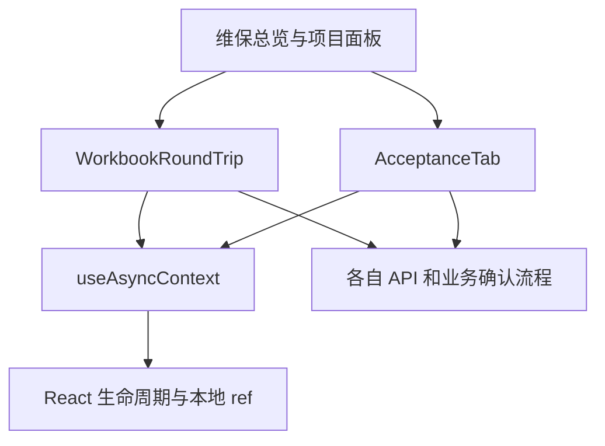

# F1：维保异步回调的上下文所有权

决策: 无

基线 main `7a9fd2098acb6be0009a59a84e7d7330bb960d6b`，2026-10-23 按 #452 近期口径台账实施。没有新增业务状态、后端权限或回执规则。UI 候选自动检查完成后仍待用户点按验收。

## 边界

项目、账号或上传权限变化后，旧请求仍可能返回；Modal.confirm 不随页面自动卸载。此前 WorkbookRoundTrip 自管 mounted/epoch/portal，AcceptanceTab 仅有读取序号。现在两种实际流程共用回调有效性和门户清理，API、业务数据、权限、幂等凭据、强制接管及刷新仍由各组件负责。

WorkbookRoundTrip 的六个挂载点为总览、项目面板、备件订单、费用、回款、现场归还。AcceptanceTab 是不同的真实流程：上传需求清单、确认整表替换。没有为假想流程增加 registry 或通用业务状态机。

## 接口和变量

| 名称 | 类型 | 用途 | 为何这样定义 |
| --- | --- | --- | --- |
| scopeKey | string | 当前项目/账号/权限的组合 | 调用方用 JSON 数组编码，hook 不认识业务字段 |
| scope | 唯一对象 | 提交后的上下文身份 | useMemo 创建、useLayoutEffect 激活；放弃 render 不污染仍显示的页面，A→B→A 也不复活旧 handler |
| epoch | number | 挂载/手动失效的生命周期 | StrictMode 清理后第二次 effect 可用，第一次回调失效 |
| sequence | number | 同范围最新请求 | 新请求退役旧请求的本地落地权 |
| mounted | boolean | effect 是否有效挂载 | 卸载后不得继续旧页面副作用 |
| capture() | () => boolean | 捕获上下文有效性 | 不使同范围其他读取失效 |
| begin() | () => boolean | 开始请求、退役旧确认 | 只保留最新请求，旧 scope handler 不影响新请求 |
| invalidate() | () => void | 清理当前生命周期/门户 | effect cleanup 使用，不碰业务数据 |
| ownConfirmation(close) | (() => void) => (() => void) | 登记门户清理、释放所有权 | 旧框结束不能注销后继框；替换框由具体流程负责 |
| readContext / downloadContext | hook 返回对象 | 读取范围 | 不依赖上传权限；撤销上传不等于禁止读取 |
| uploadContext | hook 返回对象 | 写流程范围 | 权限变化使迟到预检、旧确认及旧刷新失效 |
| activeUpload | ref<AsyncGuard或null> | 工作簿单次上传 | 已排队的原生 change 不能只靠按钮 disabled 拦截 |
| importAllowed / uploadAllowed | ref<boolean> | 当前提交页面的资格 | useLayoutEffect 更新，放弃的权限 render 不影响仍显示的页面 |
| isCurrent / operationCurrent | () => boolean | 组合上下文、请求与实时 token | 实时 token 还必须等于当前提交页面捕获的 token；未重绘时拒绝旧结果及新发起请求 |

不承诺中止网络请求或撤销服务端已提交写入。后端仍执行最终权限校验；hook 仅管理本地回调和门户生命周期。

## 提取与有意修正

- 明确复用未合并 #451 的 AcceptanceTab 和 Lifecycle 测试两文件窄补丁，再接入 hook；没有带入其他 #451 代码。
- 工作簿原有预检、合单 token、冲突/force_takeover、原回执错误、保留文件、取消及同文件重选保留。
- 验收清单增加项目/账号/权限迟到结果屏蔽。旧确认不写入，成功写后的旧父级刷新不继续；读回开始时使旧清单失效。
- 上传权限在写后读回期间变化时，重启当前只读加载。旧写流程退役后不能把真实存在的清单显示成“尚未导入”。
- 工作簿对同一 render 排队的重复原生上传回调只接受一次。把主线旧组件临时用于新增反例，出现两次预检；候选一次。此为受控回调竞争复现，不外推为生产事故。
- A→B→A 不复活已捕获 guard，也不允许保存的旧 context handler 启动当前操作；StrictMode 清理和重新挂载分别验证。

## 验证和回退

反例覆盖迟到预检、已发送 apply、写后读回、账号/项目/权限变化与恢复、门户销毁/后继确认、重入上传和真实组件文件 input。现有测试保留 API 参数、业务确认和刷新失败断言。

首轮全前端 1,919 项通过；追加撤权读回用例和旧 handler 世代修正后相关 70 项通过。最终全量、TypeScript、构建及生产依赖扫描结果随 PR 记录。后端/schema/文件协议未改，当前提交 CI 仍验证后端与迁移，不把前端 mocks 当数据库证据。常规门禁后另安排两名独立测试设计者。

可单独 revert，无数据转换。用户点按验收和生产发布均未发生。

## 第二阶段独立反例和修复

常规门禁后两名代理分别从 React 生命周期和真实路由消费者设计新用例，新增 19 项，根代理交叉阅读并合跑 19 项通过。生命周期代理使用 gpt-6-astra，与根代理模型不同。

复核发现三类可复现缺口并已修复：hook 在 render 写 ref 会被未提交的 Suspense transition 污染；上传资格 ref 也有同类问题；旧 UI 在 token 已改变但尚未重绘时发起请求会借用新身份。前两处改为 layout 提交阶段更新，第三处在请求开始和返回均核验页面捕获 token 与实时 token 一致。放弃 transition 后原 UI 继续可用、新账号提交后立即可用都有正控。

真实 App 的 BrowserRouter key={token} 及项目内容 key={projectId} 原来已经使正常账号/项目切换重建子树；不能将孤立组件的 token 窗口外推为已发生的生产泄漏。四个新下载/上传入口反例对精确 main 旧组件也失败，证明此窗口是既有缺口。新增 hook 的 Suspense 问题属于本次回归，已由独立反例捕获。最终修复 SHA 全量结果在 PR 单列；旧 SHA CI 不替代新提交验证。
