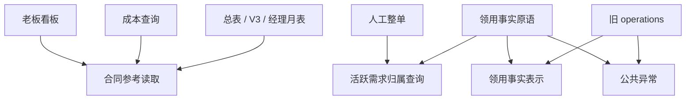

# 维保 R1/R2 公共读取与事实表示提取

决策: 无。结构重构，不新增业务规则。

基线：main `7a9fd2098acb6be0009a59a84e7d7330bb960d6b`。设计依据为 [PR #452](https://github.com/Jinchen-Yang/it-spareparts/pull/452) 的 `82a992c`，特别是[近期口径台账](https://github.com/Jinchen-Yang/it-spareparts/blob/82a992c9e1490e5a4a62b184faf3b4d6368d9ce2/docs/architecture/refactor-design/recent-policy-baseline.md)。实施前已重新 fetch，main 未变化。#451 的其他公共模块尚未合入，本批直接从 main 提取，不依赖候选中尚不存在于主线的接口。

## 变化与依赖方向

合同参考读取从老板看板中迁出，让成本、项目总表、V3 和经理月表直接依赖公共读取。领用事实不再为验证归属调用人工入口，也不再为构造审计快照直接调用整个 operations 模块。

| 公共模块 | 解决的问题 | 上游依赖 | 调用者 |
| --- | --- | --- | --- |
| `maintenance_contract_reference` | 多入口复用同一批量合同读取，摆脱展示模块依赖 | ORM、业务日期、既有过滤和税额计算 | 看板、成本、总表、V3、经理月表 |
| `maintenance_demand_project_reference` | 活跃需求归属的存在性查询不再属于人工入口 | 需求单与归属模型、调用者 Session | 人工整单、领用事实原语 |
| `maintenance_site_issue_representation` | 事实与审计复用原有完整表示 | 领用行模型及纯格式化 | 事实原语、旧 operations 兼容出口 |
| `maintenance_operation_errors` | 保持异常身份而不反向导入整个工作流 | Python Exception | 事实原语、旧 operations 兼容出口 |

公共读取不替调用者授权。快照包含成本和取价证据，仍是内部表示，不能直接作为已脱敏的 HTTP 响应。没有增加查询入口或 Agent 业务写能力。

## 接口与兼容

| 名称 | 类型 | 用途 | 定义理由 |
| --- | --- | --- | --- |
| `db` | SQLAlchemy `Session` | 复用调用者会话 | 不改变会话、锁和提交所有者 |
| `project_ids` | `list[str]` | 批量读取已授权项目的合同参考 | 空列表返回空映射；共享检测可看全局关联，结果仅限输入项目 |
| `project_id` | `str` | 稳定项目身份 | 不以展示名替代 |
| `demand_order_no` | `str` | 检查已有本项目活跃挂靠 | 查询不负责字段归一化或额外来源有效性判定 |
| 合同参考结果 | 按项目 ID 的字典 | 合同号、金额、共享与完整性标记 | 各入口继续分别投影，金额非空不代表完整总额 |
| 归属查询结果 | `bool` | 是否存在匹配的活跃归属 | 人工入口和事实入口各自翻译为原异常协议 |
| 事实表示结果 | `dict` | Decimal/日期/成本证据/版本的既有表示 | 旧调用者和审计共用一个实现；授权投影仍在入口 |

旧 `_card_contracts`、`site_issue_line_dict`、成本表示辅助及 `MaintenanceOperationError` 保留兼容导出，指向迁出的同一个实现/对象。人工 `_resolve_demand_project` 保留 wrapper 与原错误文案。事实错误仍具有原 code、HTTP status、message 和显式同类 cause；提取导致 traceback 栈帧及类定义模块位置变化，不承诺这些调试信息不变。

合同查询的实际 SQL、顺序、当前日期调用、fallback 零/负值及五类消费者投影不在本批改变。这些是结构差分的现状基线，不是借重构重新批准旧口径。活跃挂靠查询也不擅自增加源状态/墓碑过滤。默认 partial、旧 manual 完整命令与 V1/V2 各自保留归一化、签名、指纹、版本和回执行为。

## 扩展与剩余依赖

新增同类展示入口使用公共读取，在入口完成授权和输出投影；不要重新从看板/工作簿私有函数借用事实。新增局部编辑入口复用已有事实原语，不复制成本失效、审计和返还事件算法。

架构测试约束四个新模块的直接与传递依赖，包含函数内 import 和包初始化，并用全新进程检查实际导入。事实模块仅禁止本批消除的两条直接反向依赖。

**仍存在** `facts → site_return_requirements → operations._site_issue_return_payload` 的旧事件路径，及该路径的工作簿异常适配。没有宣称整个维保循环依赖已消失。后续事务辅助/工作簿协议拆分继续按 R3/W1/W2 分批；Q1/Q3 和完整恢复目标仍受近期台账及对应暂停状态约束，本批不实施它们。

## 验证与回退

验证使用本任务新建的 loopback PostgreSQL 15 容器；pytest 每进程创建独占数据库与原始文件目录，只使用合成数据。迁出查询主体、五个表示函数和成本标签字典已与基线做 AST 对照。架构、归属异常/零赋值和隐藏成本证据测试分别覆盖实际接口及反例；完整回归结果在本 PR 的验证记录中给出。

本批无数据库迁移、历史转换、依赖升级或前端修改。回退为 revert 本批提交；旧兼容出口仍存在，数据结构及业务文件协议未改变。本记录只证明开发验证，不代表合并或生产发布。
