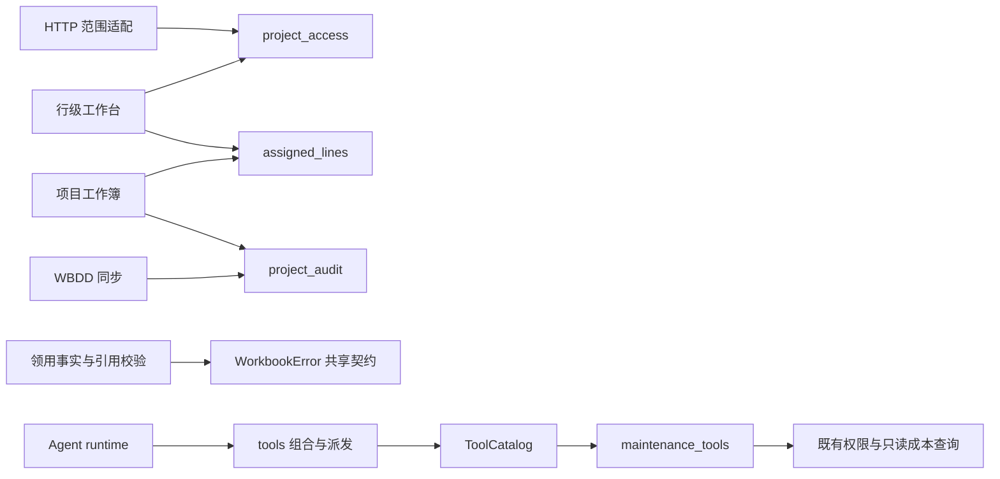

# 维保共享基础与 Agent 工具目录

本批从 main `7a9fd2098acb6be0009a59a84e7d7330bb960d6b` 独立创建，提取早期候选 #451（`fa97e2490f480336e29f51c84bfdaac3ee4f12fe`）仍未被其他批次接续的后端能力。2026-10-23 实时核对远端 main 仍为该 SHA。决策：无；结构整改保留既有行为，业务边界以近期 D-33 / D-36 等已确认决定为准。

目标是让项目范围、有效需求查询、审计与 Agent 家族扩展各有明确入口，避免普通查询为了共用一段实现而加载 HTTP 路由或完整 Excel 应用流程。

## 扩展入口与职责

| 入口 | 解决的问题 | 上游调用者 | 保留的边界 |
| --- | --- | --- | --- |
| `maintenance_project_access` | 共享项目直达与目录范围规则，去掉 service 对 HTTP 路由的反向依赖 | FastAPI dependency、行级工作台 | `None` 为全量，空集合为无可见项目；直达与目录语义不同；暂保留既有 `HTTPException` 类型 |
| `maintenance_assigned_lines.assigned_lines_query` | 共享有效 WBDD SQL，调用者可继续筛选/分页/导出 | master、行级工作台 | 调用方传已授权范围；保留状态、墓碑 cutover、稳定排序、默认网页倒序及导出升序 |
| `maintenance_project_audit.write_project_audit` | 避免来源同步依赖 master 中的审计私有函数 | master、WBDD 同步 | 只 `db.add`，不 flush/commit/锁/版本推进，加入调用方事务 |
| `maintenance_errors.WorkbookError` | 共用异常身份与 HTTP payload，不依赖 Excel 实现 | 返还要求、领用单合并、EC/master 兼容出口 | 同一 class；code/message/issues/details 不变，不合并其他领域错误 |
| `ToolCatalog` | schema 与同步 handler 单点绑定、显式家族组合 | `tools` 启动入口、`maintenance_tools` | 重名原子失败、深拷贝 schema、export 为启动快照；不发现任意插件、不授予权限 |
| `maintenance_tools` | 三个维保查询的独立扩展位置 | catalog → 既有 dispatch | page gate、受限销售、金额脱敏、原异常回灌和访问审计不变 |

新增同家族工具只在该家族注册；新增家族在组合入口显式 include 一次。无需修改 runtime 或增加第二份 handler 表。18 项 schema 和发现顺序是本次兼容基线，不能误读为永久限制工具数量。`write_excel/write_report` 是现有文件产物工具，不授权写维保业务状态。Skill 的读取与角色门未改变，ToolCatalog 也不是 Skill 文件标准或权限沙箱。

## 与其他批次的集成约束

本分支可独立测试，未提前依赖 W1/W2 未组合的模块。最终组合必须处理两个重复提取点：

1. **唯一 WorkbookError**：W1 由 `maintenance_workbook_plans` 定义 class；最终本模块改为单向重导出，`errors/plans/EC/master` 四个出口必须是同一 class 对象，不能保留两份同名 class。
2. **唯一审计实现**：保留公共 `maintenance_project_audit.write_project_audit` 执行体；W2 的 `maintenance_workbook_audit._write_audit` 与 master 旧出口作为同一函数对象的兼容 alias。相应故障注入测试跟随真实 owner，回滚断言不能删减。

合并 master、EC、WBDD sync 时只合入上述公共依赖改动，保留 R1 合同查询、R3 state、W1 codecs/plans、W2 coordinator 已完成的提取。F1 前端由其最新实现独立接续，本批不复制 #451 前端、AGENTS 新节或历史验证报告。

架构测试按明确的 Excel/HTTP adapter 和写 coordinator 名单拒绝反向依赖，不再以名称包含 `workbook` 一刀切：纯 plans、协议、状态模块不等于 Excel adapter。对 assigned/access/row/sync 四个根保留静态传递依赖检查；静态扫描包含函数内 import，但不证明动态反射或隐式包导入的全部运行路径。

## 保持行为的证据

- 固定 main 原源码独立求值的 18 schemas 与 golden fixture 内容、顺序完全一致。
- 22 个原工具函数（包括三个移出的 handler、dispatch）AST 相同，只忽略新注册 decorator。#451 中额外的负数 `top` 下限裁剪未采用：本批保持 main 的旧切片行为，参数校验改变留给单独需求。
- 两个 scope 函数、assigned query、审计函数、WorkbookError 完整 AST 相同，仅审计公共名称改名；master 剩余 129、EC 剩余 29、API adapter 剩余 1 个定义按顺序逐项相同，避免同名定义比较丢失。
- 长驻测试验证旧 scope、master query/audit、EC/master error 导出与公共入口对象 identity；真实冲突保留 error code/HTTP payload、事务 rollback 和失败依赖路径。

本轮新增 12 项 foundation 行为契约：外部模型由假 provider 替换，但真实 runtime → schema 发现 → dispatch → 审计 → 第二轮 tool 消息完整执行，覆盖成功、内部异常脱敏、业务拒绝、权限拒绝、未知工具。页面 gate 另有三个“业务查询前拒绝”反例。

四种金额/销售范围组合使用非空合成数据通过真实 dispatch，含同名项目下其他销售的明细。PostgreSQL 业务 session 执行 `SET TRANSACTION READ ONLY`，同时保留既有独立访问审计事务；校验本人行范围、无成本时先按名称再截取、隐藏状态不参与筛选与计数、审计实际落库。

## 本批验证与后续门

隔离 PostgreSQL 15，`127.0.0.1:32770`；每个 pytest 进程独立新建测试库，全部合成数据。20 个常规相关测试文件一次运行：**346 passed / 1 skipped，68.77 秒**。唯一跳过为现有 `test_overview_roundtrip` 的合成库缺指定型号分支。既有 Starlette/httpx 与 openpyxl deprecation warnings 未改。测试 manifest 与 JUnit 保存于本地证据 `foundation-related.xml` / `foundation-validation.json`。

覆盖目录/runtime/文件 ACL/技能角色、共享错误/边界、维保成本与质量、项目范围、工作台及旧过滤器、有效读、WBDD 同步及 HTTP、返还要求。新增测试最初把不应存在的状态计数键误断言为空，已按当前拒绝泄漏契约修正为键不存在；生产代码未为迁就该断言改动。

这是常规验证，不冒充用户要求的两名独立测试设计。完整后端、前后端组合、数据库迁移门、跨模型审查和两个独立后验视角由后续批次门与最终组合继续执行；本批没有迁移、前端变更或生产操作，也未证明实际模型任务准确率。既有 board 整体输出预算、projects 先聚合再截断和负数 top 行为仍是原边界，不宣称本次解决了这些性能/输入策略问题。
