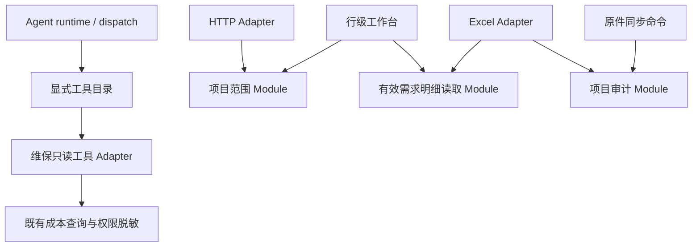

# 维保模块扩展与 Agent 工具设计调研

基线：`7a9fd20`（本轮 fetch 后 origin/main）；跟踪：[#450](https://github.com/Jinchen-Yang/it-spareparts/issues/450)。决策: 无。

## 主干：适配器依赖共享能力，共享能力不依赖入口

新增查询入口依赖共享读取和现有权限；新增维保工具在 `agent/maintenance_tools.py` 中登记 schema 与 handler。runtime 和 dispatch 不需要知道新增工具的名字。全新工具家族仅需在组合入口显式 include 一次，不做动态目录扫描或未经审核的插件加载。

## 调研范围与证据等级

全量枚举维保命名的前后端文件及 Agent 文件，并对后端 Python 做 AST import 检查；深入阅读权限、有效读、工作簿、原件同步、工具派发和前端数据加载的关键路径。**这不是对全部代码逐行完成的正确性审计**，也不将静态依赖扫描称为全量业务验收。

可重现清单覆盖 573 个维保命名与Agent代码文件（含测试、迁移）；后端全域AST图覆盖280个模块，而非只扫描维保自身。基线含 96 个维保 service（86,352 行）、39 个维保 API；前端路径含 maintenance 的文件 182 个（包括测试）。工作簿 7,509 行，项目操作 7,315 行，批量导入 5,070 行，往返 4,777 行。文件规模只是调查线索，不能据此判断应拆成多少文件。

## 外部方法与本项目落地

| 原始来源 | 方法 | 本项目采用 | 不直接套用的部分 |
| --- | --- | --- | --- |
| [Anthropic: Writing effective tools for agents](https://www.anthropic.com/research/writing-tools-for-agents) | 工具功能边界清楚、返回相关信息、以任务评估验证工具可用性 | schema 和 handler 单点登记；保持稳定名称、说明、上限、错误回灌；测试扩展工具发现与执行 | 不把每个数据库方法自动暴露成工具；不扩大业务写权限 |
| [mattpocock/skills](https://github.com/mattpocock/skills) 与本机 improve-codebase-architecture skill | 深 Module、小 Interface、真实 Seam、接口行为测试 | 从两个实际调用者中抽取公共读取；消除 services 反向依赖 HTTP routes；保留调用契约 | 不为假想数据库或消息总线预设插件系统，不凭文件行数整体重写 |
| [Agent Skills specification](https://agentskills.io/specification) | 元数据、说明、资源按需加载 | 将仓库扩展规则做短入口，详细依赖与回归放本文和测试 | skill 文本不承担权限、事务和并发保障；这些由代码与测试保证 |

原作者仓库路径已迁移到 `skills/engineering/`；交叉复核已直接读取 [improve-codebase-architecture](https://github.com/mattpocock/skills/blob/main/skills/engineering/improve-codebase-architecture/SKILL.md)（blob `44cc7d3`）、[codebase-design](https://github.com/mattpocock/skills/blob/main/skills/engineering/codebase-design/SKILL.md)（`3f63c81`）和 [code-review](https://github.com/mattpocock/skills/blob/main/skills/engineering/code-review/SKILL.md)（`373a4f2`）。采用真实变化热点、YAGNI、Standards/Spec 分轴审查方法；本仓库已有 CONTEXT 约定优先。没有安装第三方 skills。

## 已实施的五处共享能力

| Module | 解决的问题 | 上游依赖 | 下游调用者 | 保持的 Interface |
| --- | --- | --- | --- | --- |
| `maintenance_project_access` | 项目权限不再放在 HTTP 路由内供业务反向调用 | 用户上下文、项目与挂靠 | HTTP scope adapter、行级工作台 | 先404后403；None=不限范围，空集合=无可见行；目录与单项目不同 |
| `maintenance_assigned_lines` | 只读列表不再加载工作簿协议/写入实现 | 明细、源订单、归属、有效性过滤 | 工作簿与行级查询/导出 | SQL可组合；活跃行/挂靠/源状态、墓碑开关、窗口与排序完全保留 |
| `maintenance_project_audit` | 同步业务不再调用工作簿私有函数 | 审计ORM实体、调用方Session | 工作簿、原件同步 | 仅add，不commit/flush/锁/版本递增；保留旧默认原因 |
| `maintenance_errors` | 领域命令不再为了错误类型加载Excel实现 | 无业务实现依赖 | 领用义务、合单、工作簿及其错误适配器 | 原WorkbookError名称、类型别名、code/message/issues/details保持 |
| `ToolCatalog` + `maintenance_tools` | 新工具无需同时修改说明列表与派发字典 | 显式schema、handler、既有业务查询 | runtime经既有TOOLS/dispatch使用 | 重名启动失败；schema快照隔离；原18个工具名称、参数、说明与handler行为保留 |

兼容入口保留 `api.maintenance_project_scope` 原函数名、`master.assigned_lines_query` 和工作簿 `_write_audit` 别名。新代码使用公共路径，旧调用无需同次大迁移。

项目范围 Module 仍保留历史 `HTTPException` 类型。这次消除的是对 API 路由模块的依赖，**没有宣称服务完全摆脱 FastAPI**。若未来出现非 HTTP 调用的独立错误协议需求，再引入领域异常与显式转换，避免本次同时更改 39 个入口的错误语义。

## 保留的业务不变量

- D-33：权限校验先于过滤与count；目录与canonical销售单项目直达不同。金额不可见时，排序、条件、枚举、派生信号均不泄露。
- D-34：源状态、墓碑、行级软作废独立。墓碑继续遵循现行cutover语义；源状态非生效始终排除。不能借重构统一开关口径。
- D-38：首次回执、签名、三路合并、幂等、锁顺序、事务提交者均不变。
- D-0024：看板不引用巨型 `api.maintenance`；数量、估价、已计成本分开；未计金额不伪造成0；单位分桶保留。
- Agent只读业务；工具目录登记不代表获得权限。维保页面门、受限销售合同拒绝、服务行范围和字段脱敏保持原位。
- 前端批量逐行编排，Excel整本事务。两者不能抽象成一个“通用批处理”后改变原子性。

## 后续候选及优先级

| 候选 | 证据与收益 | 处理建议 |
| --- | --- | --- |
| 合同参考读取 | `boss_board._card_contracts` 被 cost、master、v3、manager adapter 私有引用 | Worth exploring：先明确当前/安全/共享合同等语义，再抽公共读模型；不要合并两套成本算法 |
| 领用命令 | operations、manual、facts、merge间共享私有实现，牵涉锁和追加事件 | 独立批次，用真实DB测试串起锁、回滚、幂等和复活边界后再移 |
| 前端数据加载 | 已有panel/dashboard子模块与refresh工具，但多入口的数据口径不同 | 保留领域子模块；避免一个通用loader吞并成本、回款及看板状态 |
| 工作簿各sheet策略 | 可成为扩展入口，但各sheet共享签名、快照、冲突与提交 | 先建立协议级特征测试，避免把跨sheet事务切成插件各自提交 |

本次交付是完成上述五处可验证解耦，不意味着消除了维保所有历史耦合。后续新增功能应优先依赖公共接口；只有出现第二个真实实现/调用场景时，再增加新的 Seam。

## 扩展时逐变量约定

| 名称 | 类型 | 用途 | 为什么这样定义 |
| --- | --- | --- | --- |
| `project_id` | str或None | 显式项目筛选 | 稳定身份不用项目名替代 |
| `allowed_project_ids` | set[str]或None | 已授权的目录范围 | None与空集语义不同，禁止truthiness回退全量 |
| `window` | 日期二元组或None | 查询期间 | 查询组合与分页解耦 |
| `ctx` | UserContext | 页面、行、字段权限输入 | 权限来自服务端身份，不能由模型参数自报 |
| `db` | Session | 参与调用方事务 | 公共能力不隐式提交 |
| `schema` | dict | 工具名字、说明与参数契约 | 与handler同点登记，避免漏接 |
| `handler` | Callable | 业务适配函数 | 派发器无需硬编码每个业务功能 |
| `catalog` | ToolCatalog | 显式家族组合 | 重名立即失败，避免覆盖其他工具 |

## 验证入口

- `test_agent_tool_catalog.py`：新家族发现/派发/审计、重复名字、非法声明、schema隔离、18工具原始契约快照。
- `test_maintenance_module_boundaries.py`：所有维保services不得反向导入API；共享能力不得重新依赖工作簿；真实事务审计回滚。
- 既有权限/过滤/原件同步/工作簿/Agent回归见本轮验证回执。

架构规则用测试执行，不能只依赖 Agent 读懂文档。没有数据库迁移、业务数据修改或生产发布。

## 多智能体交叉检查补充

主代理统筹依赖图与回归；三个独立代理分别负责后端、前端、Agent与外部方法。各自先提出可证伪假设，再互发结论；同模型独立审查，不冒称跨模型复审。详细矩阵与验证回执见 `maintenance-cross-review.md`。

初轮抽离后，行级工作台静态可达依赖109→68，原件同步109→69，Agent工具117→119；四组静态循环未减少。该图包含函数内部与条件import，是可能依赖的上界，不是运行时加载量、性能指标或实际执行调用图。工具目录收益是新增工具少改入口，不能称为加载性能优化。

交叉检查进一步确认 `site_return_requirements → expense_collection_workbook.WorkbookError` 将领域错误绑到Excel；因此补做中立错误类型与旧路径兼容重导出，并复核其余调用者。前端验收清单的旧项目预检响应也由隔离组件测试复现，补齐项目世代守卫。最终依赖数量以验证回执为准，不用初轮数字冒充最终值。

详细结果：[多智能体交叉矩阵](maintenance-cross-review.md) · [验证回执](maintenance-validation.md)。
