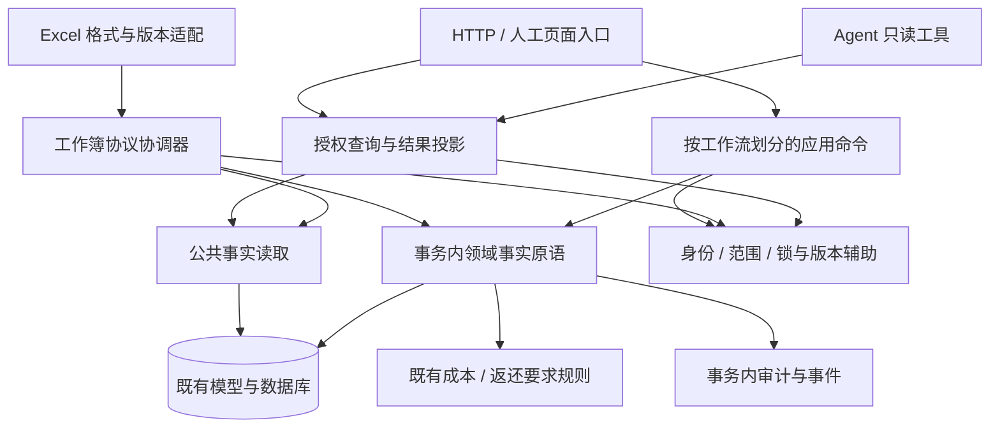

# 维保下一阶段重构设计

状态：调研与接口设计提案；尚未实施本方案。决策: 无（沿用既有业务决策，不新增口径）。

调查日期：2026-10-23 UTC。主线基线 `7a9fd2098acb6be0009a59a84e7d7330bb960d6b`；第一阶段候选 [PR #451](https://github.com/Jinchen-Yang/it-spareparts/pull/451) 为 `fa97e2490f480336e29f51c84bfdaac3ee4f12fe`。#451 尚未合并；本文凡提到已抽出的 access / assigned_lines / audit / errors / ToolCatalog，均指候选代码，不代表主线或生产已有。跟踪 [#450](https://github.com/Jinchen-Yang/it-spareparts/issues/450)。

## 1. 主干结论

保留现有 FastAPI、SQLAlchemy、React 和单库部署，沿真实业务边界形成**模块化单体（modular monolith）**。近期用显式领域函数消除反向依赖；通过旧入口兼容迁移调用者；最后才给工作簿的纯解析部分建立静态扩展点。

“核心少变”限定为：新增展示入口、只读 Agent 工具或已有事实的表示形式时，不修改事务、身份、权限、事实编辑算法。增加新的事实类型、写入资源、成本口径或权限规则，仍需要审查相应核心。不能靠把这些规则藏进配置，让核心看起来没有改动。



图中层次是依赖方向，**不是要求一次建立八层目录**。先保留 `services/maintenance_*.py` 命名，按每批真实变更添加模块；模型不拆库，不引入服务发现、消息总线或通用插件框架。

| 概念 | 解决什么问题 | 依赖上游 | 被什么调用 |
| --- | --- | --- | --- |
| 公共事实读取 Read model | 多入口引用同一事实查询，避免依赖卡墙或工作簿私有函数 | 稳定身份、既有有效性规则、ORM | 卡墙、成本、工作簿、经授权的查询入口 |
| 应用命令 Application command | 把一次人的操作及其锁、CAS、幂等、结果组织起来 | 服务端授权、事实原语、工作流专属锁协议 | HTTP；Excel 使用自身整本命令 |
| 事实原语 Domain operation | 同一事实更正只保留一套赋值、成本失效、审计和事件规则 | 已建立的事务与锁、既有规则 | 网页命令、旧人工整单、V1/V2 |
| 协议适配器 Adapter | 处理 HTTP 参数、Excel 单元格、工具 JSON 的差异 | 稳定的查询或命令接口 | 用户页面、文件上传、Agent runtime |
| 渐进替换 Strangler | 每批可单独验证和回退，避免全部调用者一起改 | 旧契约、可复用接口、差分测试 | 各迁移批次 |

## 2. 代码证据与真实拆分位置

以下链接固定在 #451 的精确提交；不把行号依附于继续变化的 main。

| 证据 | 当前问题 | 方案中的处理 |
| --- | --- | --- |
| [`boss_board._card_contracts`](https://github.com/Jinchen-Yang/it-spareparts/blob/fa97e2490f480336e29f51c84bfdaac3ee4f12fe/backend/app/services/maintenance_boss_board.py#L1728) | cost、master、V3、经理月表依赖卡墙私有查询 | 原样迁到公共合同参考读取；各消费者金额策略保留 |
| [`manual._resolve_demand_project`](https://github.com/Jinchen-Yang/it-spareparts/blob/fa97e2490f480336e29f51c84bfdaac3ee4f12fe/backend/app/services/maintenance_manual_site_issue.py#L86) | facts 反向调用人工入口，形成双向依赖 | 提取需求单活跃归属查询，两个旧入口各自翻译异常 |
| [`facts._line_snapshot`](https://github.com/Jinchen-Yang/it-spareparts/blob/fa97e2490f480336e29f51c84bfdaac3ee4f12fe/backend/app/services/maintenance_site_issue_facts.py#L104) | 事实原语为了快照依赖 operations 大模块 | 提取既有表示函数并保留兼容导出；不新造一份审计 DTO |
| [`correct_site_issue_line/header`](https://github.com/Jinchen-Yang/it-spareparts/blob/fa97e2490f480336e29f51c84bfdaac3ee4f12fe/backend/app/services/maintenance_site_issue_line_correction.py#L30) | 已有良好命令边界，但锁/幂等辅助仍从 operations 私有引用 | 保留现有命令；按真实调用者迁出辅助，不再包一层万能 service |
| [`master._v2_recheck_row_guards`](https://github.com/Jinchen-Yang/it-spareparts/blob/fa97e2490f480336e29f51c84bfdaac3ee4f12fe/backend/app/services/maintenance_project_master_workbook.py#L5470) | 05 回款快照正确性依赖五个写者共同遵守锁协议 | 先建立写者清单和并发契约，再拆 sheet |
| [`master.apply_project_master_v2`](https://github.com/Jinchen-Yang/it-spareparts/blob/fa97e2490f480336e29f51c84bfdaac3ee4f12fe/backend/app/services/maintenance_project_master_workbook.py#L6289) | 签名、计划、锁后复核、事实、回执强相关 | 保持一个整本事务拥有者，逐段抽纯协议能力 |

前轮已对 573 个匹配路径做结构清单、关键链路深读，并非对全部业务逐行完成正确性审计。本轮聚焦接口决策和迁移边界，未重新执行业务测试、未连接生产。原始调查与测试证据见 [#451 研究目录](https://github.com/Jinchen-Yang/it-spareparts/tree/fa97e2490f480336e29f51c84bfdaac3ee4f12fe/docs/architecture)。

## 3. 三种独立设计与取舍

采用本机 `design-an-interface` skill 的多方案方法；联网核查发现上游已将它收进 [codebase-design / DESIGN-IT-TWICE](https://github.com/mattpocock/skills/blob/5beb35b040e3de97e54fa9e386d7e42d15c295c2/skills/engineering/codebase-design/DESIGN-IT-TWICE.md)。三个代理在同一基线、同一问题上独立设计，再互相提交反例。完整签名、调用例、逐变量表和交叉意见分别保存在下列文件。

### A：少量显式领域函数

[方案 A](refactor-design/design-a-explicit.md)把公共读取、事务内事实操作和工作簿整本应用分开。调用者直接引用具体能力；新增功能没有中央命令字符串、处理器选择或泛型执行器。

这种接口最容易看出谁在读、谁在改、谁拥有事务。主要限制是每个新工作流仍要明确编排权限与锁，必须用共享辅助和行为测试防止复制后漂移。适合作为近期目标，不能把“少方法”误解成所有输入塞进一个 `dict`。

### B：静态能力目录、计划与事务协调器

[方案 B](refactor-design/design-b-registry.md)以显式注册的能力描述和计划汇总扩展点，协调器统一执行。新增同类功能可集中于实现和登记处；代价是计划必须准确表达跨域引用、锁资源、顺序及回执责任。

本仓库的风险在于锁集合不能只由单张 sheet 自报：合单、归属迁移、回款快照和旧义务消费者都存在跨模块约束。声明式目录只能帮助检查，不能证明计划完整或实际持锁。全局引擎会把真实差异压入更多策略和模式，因此暂不作为整体架构。仅保留将来对纯解析/渲染的静态组合方法。

### C：按常见用例设置 facade，逐个替换旧实现

[方案 C](refactor-design/design-c-facade.md)先让新调用者通过稳定门面使用旧实现，再逐步移走内部旧依赖。兼容推进容易，适合保护 18 个 Agent 工具和工作簿旧协议。

单纯增加 facade 不会降低底层耦合；若 `query → facade → boss_board/master` 仍然可达，就仍在依赖展示或文件模块。每个临时适配器必须有具体消费者、退出批次及依赖检查。已有 `correct_site_issue_*` 这样的稳定入口继续直接用，避免多层等价转发。

### 推荐组合

采用 **A 的最终接口 + C 的逐入口迁移**。B 的静态目录只用于已经证明行为相同的表示层扩展，不用于执行任意写命令。推荐依据是易于正确使用、隐藏的复杂性是否真实、能否证明授权与事务边界，未以初始编码量或文件行数作为首要标准。

具体顺序：**合同参考读取 → 需求归属与事实快照 → 工作流事务辅助 → 前端异步上下文 → 工作簿协议拆分与有限 sheet 扩展**。前三项后即可显著减少反向依赖，不必等工作簿全部重构。

## 4. 近期公共接口

下面是提议的最小接口，不是已实现代码。采用当前已有 `Session` 和稳定项目 ID，不引入通用 Repository / UnitOfWork 抽象。

```python
# maintenance_contract_reference.py
class ContractReference(TypedDict):
    contract_nos: list[str]
    amount_inc_tax: Decimal | None
    contract_shared: bool
    contract_incomplete: bool

def current_contract_references(
    db: Session, project_ids: list[str]
) -> dict[str, ContractReference]: ...

# maintenance_demand_project_reference.py
def demand_has_active_project_assignment(
    db: Session, *, project_id: str, demand_order_no: str
) -> bool: ...
```

| 变量 | 类型 | 用途 | 为什么这样定义 |
| --- | --- | --- | --- |
| `db` | `Session` | 复用调用者的数据库会话 | 查询不自行 commit；与现有调用方式兼容 |
| `project_ids` | `list[str]` | 一次读取多个已授权项目 | 保持批量查询，空列表必须直接返回空映射 |
| `project_id` | `str` | 稳定项目身份 | 不能以可变项目名替代 |
| `demand_order_no` | `str` | 沿旧协议验证需求单与项目关系 | 此接口只验证已有活跃挂靠，不扩张成“有效需求”判定 |
| `contract_nos` | `list[str]` | 原合同号列表 | 保持当前顺序与重复处理，不顺手改变外部输出 |
| `amount_inc_tax` | `Decimal / None` | 当前可得金额或未知 | 可能为部分参考小计；不得仅凭非空判断完整总额 |
| `contract_shared` | `bool` | 全局共享/冲突标志 | 不受当前页截断；不能隐含分摊 |
| `contract_incomplete` | `bool` | 完整性不足标志 | 调用者据其原策略决定隐藏金额或显示诊断 |

`TypedDict` 只是静态契约，不验证授权，也不让嵌套列表变为不可变。近期不改变返回字段、不新增 `as_of` 参数、不扩大用途；若以后确需 provenance 等字段，独立扩展内部类型和兼容投影。

示例：总表仍按自身语义投影公共事实；校验需求关联时保留原入口错误类型。

```python
reference = current_contract_references(db, [project_id]).get(project_id)
# master 仍保留 _canonical_contract_read_model 的现有掩码与缺省行为。

belongs = demand_has_active_project_assignment(
    db, project_id=project_id, demand_order_no=demand_order_no,
)
if not belongs:
    # manual 抛旧 MaintenanceOperationError；facts 抛其既有结构化错误。
    raise_existing_entry_error()
```

| 示例变量 | 类型 | 用途 | 为什么这样定义 |
| --- | --- | --- | --- |
| `reference` | `ContractReference / None` | 指定项目的原始参考事实 | 只读事实不能冒充对外已脱敏结果；缺项不自动补零 |
| `belongs` | `bool` | 活跃挂靠存在性 | 公共查询不依赖人工入口的异常类；适配器保持错误协议 |

调用示例中的 `raise_existing_entry_error` 为说明占位，不新增该生产函数。授权在调用者读取前完成；跨项目共享检测可在内部检查全局关联，但不得输出未经授权的其他项目身份。Agent 不直接调用这份原始合同读取，继续通过现有金额与行范围控制的成本查询。

### 必须保留的合同差异

1. 卡墙允许部分已知小计伴随 incomplete 作诊断；重复稳定身份、跨项目冲突不能返回伪精确金额。
2. 总表 `_canonical_contract_read_model` 在 shared/incomplete 时隐藏金额，完整真实零保留。
3. V3 额外要求存在当前合同台账行，不能因为 fallback 有金额就视为台账总额。
4. 成本页限制销售禁止穿透 canonical 合同；自身 `as_of` 存在性检查和公共读取的 `business_today()` 不在此批合并。
5. 经理月表保留现有集合过滤、完整性及后续比例口径。
6. 当前 XSDD fallback 只有 `total > 0` 才回填金额，零/负小计保留原行为；不同于台账完整零。此处是否合理属于业务调查，不能藏在搬函数中修正。

### 复用已经存在的领用接口

`apply_locked_site_issue_edits` 已经是跨网页、人工整单、V1/V2 的公共事实原语；[既有契约](../integrations/maintenance-site-issue-facts-v1.md)继续有效。只移除它对 manual / operations 的反向依赖，不复制算法，也不把新建、作废、复活或整单替换塞进局部补丁。

现有 `correct_site_issue_line` 和 `correct_site_issue_header` 继续承担网页命令，返回值、请求指纹、错误码、replay 时机不变。`authorize` 是服务端构造的回调，不能由 HTTP、sheet 或模型提供任意实现。

## 5. 谁拥有授权、锁、版本和提交

| 能力 | 授权 | 锁 / 新鲜读取 | 版本 / 回执 | commit / rollback |
| --- | --- | --- | --- | --- |
| 合同参考、需求归属查询 | 调用前入口按原范围授权 | 不新增写锁；保留原查询一致性 | 无 | 不提交 |
| 网页单行/单头命令 | 初查、锁后、重放均按当前实名校验 | 既有命令 idempotency → state → project → issue → lines | 原语事实版本；外层 revision 与 command receipt | service 仅 flush，既有 HTTP 边界提交 |
| V2 工作簿 apply | 保留原入口与回执金额资格检查；锁内仅按现有具体归属命令复核 | 既有全局锁、身份、排序 state、项目、operation、来源及事实锁 | 各事实版本；外层一次 revision 与首次完整回执 | 整本 service 拥有一次提交和约束失败回滚 |
| 事实编辑原语 | 复验归属、来源、字段白名单 | 消费调用者已经建立的锁；不补拿上层锁 | 既有事实版本与审计/返还要求事件 | 不 commit、不 rollback |
| 返还登记/导入 | 各原入口按当前范围校验 | 保留各自锁前缀，最终同需求容量锁后算 N/R | 现有回执与导入终态 | 各工作流原事务边界 |

“统一事务辅助”表示复用明确协议中的辅助，不表示所有工作流一个排序器。`LockedContext` 或 `frozen dataclass` 最多改善使用方式，不能证明数据库锁确实持有；真实数据库并发和回滚测试仍是必要证据。

现状区别：网页 correction 的回调会锁后重读当前账号；V2 通用编辑/范围/金额门主要在 HTTP 入口，service 只在特定归属分支消费 `user_ctx`，不能据此宣称所有 V2 写入都有全面锁后重新鉴权。锁等待期间撤权的行为需要 R3 独立调查和竞争测试；备选方案提到的统一 fresh 授权是目标，不是本次已经验证的现状。

SQLAlchemy 2.0 的 `Session.commit()` 会提交最外层事务，不能以 `begin_nested()` 包住一个内部 commit 来保证整本原子性。当前锁定依赖为 2.0.49，运行容器使用 PostgreSQL 15；方法依据对应的 [SQLAlchemy 事务文档](https://docs.sqlalchemy.org/en/20/orm/session_transaction.html)和 [PostgreSQL 15 锁文档](https://www.postgresql.org/docs/15/explicit-locking.html)。

工作簿锁后 `expire_all()` 的新鲜读取阶段与事实写入阶段须分开：已经产生未 flush 修改后再 `populate_existing` 会覆盖内存修改。计划扩展不能把两阶段揉成“每次读都刷新”的通用仓库方法。

## 6. 工作簿扩展点的边界

当前已有 `MasterV2Plan`，不另造一份万能业务命令。先冻结它表达的字段意图和三路冲突语义，再从原模块搬出协议类型、纯单元格规范化、行身份和签名读取。所有网络请求仍是不可信输入；预检成功不代表应用时事实、身份与权限未变。

纯 sheet codec 可以接受已读取的单元格和上下文，输出数据、问题位置及既有类型意图；不接收 `Session`，不持锁、不提交、不分配 operation、不保存回执。静态组合表维护名称和协议版本，同名或缺少必需策略启动/测试失败。每种旧协议有明确策略，不静默升级未知版本。

写入顺序仍由 V2 整本协调器显式掌握。遇到新事实域、新锁资源、新的跨 sheet 引用，允许且要求修改协调器和协议回归；无法承诺“任意新 sheet 只写一个插件”。同类只读 sheet 才可能仅增加 codec 与组合项。

锁前的身份发现不是权威事实。锁后复核发现计划未包含、且需要回到更早锁阶段，或超出既有确认授权/身份范围的新资源时，不临时倒序补锁或扩张确认范围；按该入口既有冲突语义整体拒绝，重新预检。无关服务端新增行、未触字段变化、既有协议定义的后继锁和合法三路合并继续保留，不能因为计划内容变化就一概判 stale。是否支持有界重试另行设计，不能改键盲重试。

首次完整回执、历史缺回执兼容、当前授权复验继续遵守 [D-38](../decisions/0016-工作簿首次应用回执.md)。领域事实、审计、operation、revision、首次回执必须同事务；禁止对写操作双跑新旧实现作“影子验证”。

## 7. 前端与 Agent 扩展

前端先对第二个真实异步流程补反例，再提取仅负责“账号/项目世代、请求序号、挂载状态、确认回调有效性”的小 hook。它不决定取消服务器写入、不合并领域数据、不统一分页。Acceptance 的已完成写入但读回失败须保留成功状态，不能自动重提业务命令。

面板 workspace 与 board loader、刷新屏障、卡墙候选分页和 dashboard 实际分页继续分开。能力命名分别体现 `data_profit`、采购成本、工作簿编辑和负责人例外；前端可见性不是授权，近期不引入新的全局 capability 系统。

Agent 新工具继续在已存在的 `ToolCatalog` 家族登记 schema 与 handler，经授权查询返回有限、可追溯结果；保留 18 个旧工具 schema 及顺序。新查询能力应带“缺权限、空范围、字段脱敏、界限参数、错误回灌”契约。不得把只读读模型和人工写命令统一暴露给 runtime。

Skill 和 AGENTS 用于告诉开发代理从哪里扩展、运行哪些测试；权限、锁和只读性用代码保障。Agent 任务准确率、调用次数与输出体量需要独立 eval，静态依赖图和 handler 单测不能替代真实模型效果评估。详见 [来源与规则设计](refactor-design/research-and-rules.md)。

## 8. 怎样证明扩展能力提高

| 扩展场景 | 目标改动范围 | 核心是否应改 | 验收证据 |
| --- | --- | --- | --- |
| 同域新增只读 Agent 工具 | 家族 handler+schema、接口测试 | runtime/dispatch 不改；无新读能力时查询核心不改 | 发现→派发→审计→结果回灌及越权反例 |
| 现有合同事实新增展示入口 | 入口授权、投影/页面 | 公共合同查询不改 | 同事实差分、未知/共享/零金额案例 |
| 新增已有事实的网页更正入口 | HTTP/页面适配、既有命令调用 | 不复制事实编辑、成本、审计算法 | CAS、同键重放、失败回滚、版本与事件计数 |
| 新增真正可编辑字段 | schema、白名单、事实规则、相关表示与测试 | 应改相关事实核心 | 省略/null/值、成本副作用、旧协议回传 |
| 新增同协议只读 sheet | codec、显式组合、格式测试 | 预期不改 apply/锁/回执 | 旧导出可读、身份与签名语义稳定 |
| 新增跨域可写 sheet 或成本规则 | 领域操作、协调器、协议版本与测试 | 必须审查并按需修改核心 | 锁闭包、整本回滚、权限和会计口径 |

这是一组验收目标，不是已测量的开发耗时收益。每批记录新功能实际触及的既有生产模块、反向依赖路径与协议测试结果。只统计新文件数量或把所有代码移进一个 registry 都不算成功。

完整迁移、回退与验收清单见 [实施批次](refactor-design/migration-and-acceptance.md)；研究来源及规则见 [研究记录](refactor-design/research-and-rules.md)。
