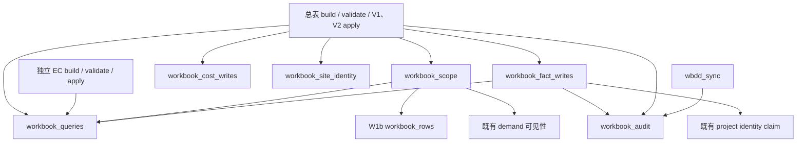

# 工作簿共享查询、作用域校验与事务内写入边界（W2a）

决策: 无。本批按 #452 的定向迁移方案拆分代码归属，不新增或裁定业务规则。基线为 W1b `f6f68ebd7788cc12646de73e8c6ccd738c0db50e`（#459），在独立 worktree 实施。时间核验：2026-10-23 15:28 UTC。

## 问题与结构

V1、V2 的解析、预检和应用共用总表模块内的私有 helper。若直接移动 V2 apply，它还得反向导入总表才能读取合同、验证归属、补成本和写审计。本批先把这些真实实现及其依赖闭包迁出，为下一批独立 coordinator 提供可直接调用的边界；本批没有移动 apply 或首次回执流程。

六个模块分别拥有六组独立变化原因：

| 模块 | 解决的问题 | 上游依赖 | 被谁调用 |
| --- | --- | --- | --- |
| `maintenance_workbook_queries` | 当前合同关系、金额可编辑关系、费用唯一归属三种不同资格 | 模型、业务日期、同一 `WorkbookError` | 总表、EC、scope、fact writes |
| `maintenance_workbook_scope` | 重新取得当前项目实体集合、按原锁序检查归属、复核 validate 后变化 | 查询、行投影、模型、既有 demand 可见性 | 总表 validate 与 apply |
| `maintenance_workbook_cost_writes` | 在主行与人工证据之间保留锁序、自动成本优先级和双税金额 | 模型、`CostRefill`、同一异常 | 总表 V1 与 V2 |
| `maintenance_workbook_audit` | 向调用者事务追加行级审计 | 审计模型 | 总表、合同物化、WBDD 缺项确认 |
| `maintenance_workbook_site_identity` | 校验最终单头和自动新头冲突 | 模型、`SiteReturnFlag`、同一异常 | 总表 parser、validate、apply 及异常转换 |
| `maintenance_workbook_fact_writes` | XSDD 合同 claim/物化、03→06 作废级联、展示号分配 | 查询、审计、模型、既有身份服务 | 总表 V2 apply |

迁移的是 **16 个总表定义与 2 个 EC 查询定义**；旧总表和 EC 通过 import 保留同一函数对象，调用参数、异常类型与返回值均保留。没有包装转发或注入一整包旧总表回调。总表原有 `_project_expenses` 三行兼容 adapter 仍在；新 scope 直接绑定中立 `project_expenses`，执行查询不需要绕回 EC。`wbdd_sync` 的行级审计直接引用新审计模块。

## 必须区分的查询资格

`_current_contracts` 按业务日读取本项目生效关系；`_v2_editable_contracts` 要求本项目当前计入总额的关系恰好一条；`_current_unique_contracts` 则按合同号检查全项目当前关系是否唯一，供费用归属使用。后者会被其他项目当前但不计入总额的关系阻断。这三者也不是卡墙汇总的 `current_contract_references`，没有相互替换或统一。

费用查询继续要求原始 BXD 的销售单号、稳定项目归因、精确合同关系 ID 同时吻合。仅销售单号匹配不足以获得费用编辑资格。结束日等于业务日的关系已失效；未来开始关系不生效，日期边界与原实现相同。

## 事务、锁与当前规则

- helper 始终使用调用者传入的 `Session`，不增加 commit、rollback 或子事务。合同物化保留既有 claim、合同 advisory、关系锁及 flush；展示号的原子计数器更新仍在应用事务内，回滚同时撤销计数。
- scope 保留来源单→活跃挂靠→备件行、领用单头→领用行、费用归因→费用行的原次序，以及原有 `populate_existing`。guard 仍在锁后、业务写之前运行；05 采用列级标量读绕过旧 identity map，五类回款 writer 的原锁约束没有改变。
- 人工成本先锁主行再锁 override，自动证据存在时只保存人工证据，不覆盖自动成本。未知金额继续为 NULL；不把数量、双税取整或成本来源语义合并成新通用计算器。
- D-0042（2026-10-19）允许同号既有领用单由现有 merge 计划处理；自动新头仍不能隐式合并。这里原样迁移的是最终号校验函数，没有恢复早期“一律拒绝同号”的旧规则。
- D-38（2026-10-16）的首次回执与事实同事务保存、当前权限复验以及历史缺快照兼容，本批都没有移动。D-34 暂停分支上的保护周期、完整误取消恢复也没有借提取扩大实施范围。

新模块均没有直接或传递回到总表、HTTP API、boss board、manual command adapter 的依赖。**仍存在两条明确的 legacy 路径**：

1. `workbook_scope → maintenance_demands → maintenance_project_operations → maintenance_site_return_requirements → maintenance_expense_collection_workbook`。
2. `workbook_fact_writes → maintenance_project_identity → maintenance_project_operations → maintenance_site_return_requirements → maintenance_expense_collection_workbook`。

这是既有 demand 可见性与项目身份 claim 的依赖，本批没有把它们伪装成纯函数或声称全局无环。查询、成本写、审计、现场身份四个模块的完整本地 import 闭包则不依赖 EC 或 operations。

## 逐变量表

| 名称 | 类型 | 用途 | 保持这样定义的原因 |
| --- | --- | --- | --- |
| `db` | `Session` | 共享锁、事实、计数器与审计事务 | 调用者仍拥有提交/回滚，不能提前持久化部分结果 |
| `project_id` | `str` | 当前稳定项目范围 | 签名和销售单号不能替代当前归属 |
| `contract_nos` | `set[str] \| None` | 缩小费用合同候选集 | 全局唯一关系判定仍检查所有项目，不能只在候选项目内去重 |
| `lock` / `lock_rows` | `bool` | 选择既有只读与锁后路径 | 下载和预检不额外加锁，apply 保留原锁层级 |
| `lock_site_merge_scope` | `bool` | 合单时锁全项目单头及其明细 | 仅已触碰行不足以证明合并集合稳定 |
| `plan` | `MasterV2Plan` | 携带 validate 时的行指纹证据 | guard 复核实际触碰行，不恢复整本 revision 硬拒 |
| `refill` | `CostRefill` | 人工成本与理由 | V1/V2 共用事实写 helper，避免从 V1 反向依赖 V2 coordinator |
| `flags` | `list/tuple[SiteReturnFlag]` | 现有单头修改和新增明细意图 | 最终单号与稳定 issue ID、展示号的角色不同 |
| `assigned_xsdd_nos` | `set[str]` | 调用者已锁定的来源挂靠证据 | 合同物化不能重新用未锁查询打开归属竞争窗口 |
| `operated_by` | `str` | 既有实名审计操作者 | 不改变身份归一化和幂等语义 |
| `issue_date` | `date` | 展示号按日计数键 | 分配由数据库原子递增，不能由本地计数替代 |

## 验证与限度

AST 对比基线：18/18 迁移定义完全一致，不需要忽略语句或规范化内部 import；总表余下 75 个定义和 EC 余下 24 个定义也全部一致。只改变 import 绑定、定义归属及 `wbdd_sync` 的审计 import 路径。新函数的 `__module__`/traceback 来源改变，旧 import 仍指向同一个对象，不承诺 monkeypatch 旧模块 globals 会修改新模块内部依赖。

专用 PostgreSQL 15 上，12 个现有高危文件 **330 passed / 191 秒**：V1/EC、V2 可编辑与创建、锁后新鲜性、行合并、首次回执、同号合单、自动身份、展示号、WBDD 同步及 API。证据是 `/tmp/itsp-domain-seams-evidence/w2a-regression.log` 和同名 XML。

新契约 **25 passed / 10.65 秒**，覆盖完整静态 import 闭包（含函数内 import 与包 initializer）、新进程 import 零连接、18 个旧出口同对象且新模块拥有函数 globals、注解可解析、三种合同资格差异、费用精确归因、同项目重复当前关系、成本/审计/计数器统一回滚、自动成本优先。首次运行发现测试复用固定 BXD 参考号造成真实唯一键冲突，修正为不同来源参考号后重跑；没有为通过测试修改生产规则。最终新契约结果由 `w2a-boundaries.log/xml` 记录。

本批不含 schema、迁移、前端、工具 schema 或权限规则变更。完整后端回归、CI 与通过后两名独立 agent 的反例设计由后续门禁分别记录；上述定向绿灯不代表全量通过、main 合入、用户点按验收或生产部署。后续 W2b 才迁移 V2 coordinator/receipt 并验证完整依赖闭包与提交归属。
