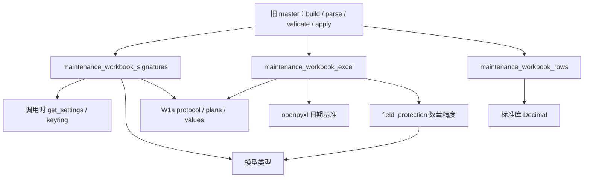

# 工作簿签名、Excel 转换与行投影 W1b

决策: 无。按 [设计 PR #452](https://github.com/Jinchen-Yang/it-spareparts/pull/452) 的分批方案和近期口径台账实施。本批基于 W1a `f1d01366b1717f0e6bbce346c317c73558435e0c`，沿用其协议、计划与同一 `WorkbookError`；主线基线仍为 `7a9fd2098acb6be0009a59a84e7d7330bb960d6b`。

原来 build、parse、锁后复验都要从总表大模块取得签名与行值。现在这些算法有独立实现位置，后续 coordinator 可以直接依赖它们，无须反向导入 master 或接收一包 master 回调。旧入口直接导出同一函数对象，参数、执行体及返回值保持不变。

## 边界与扩展位置

| 模块 | 解决的问题 | 上游依赖 | 当前下游调用 |
| --- | --- | --- | --- |
| `maintenance_workbook_signatures` | 统一承载行基线、全局成本令牌与整本元数据的配置签名 | W1a 值／协议／异常、`get_settings`、全局成本模型类型 | master 的下载、预检、冲突比较 |
| `maintenance_workbook_excel` | 将 Excel 值解释与元数据读取从业务协调中分开 | openpyxl、字段保护的数量精度、W1a 值／协议／异常 | master 的解析、元数据校验与只读页摘要 |
| `maintenance_workbook_rows` | build、parse 和锁后 guard 使用同一行投影 | 标准库 Decimal；调用者提供完整加载的对象 | 03／04／05／06 导出、行基线与复验 |

三个模块没有 `Session` 参数、SQL 查询、flush、commit 或业务写入。行投影没有接入 `current_contracts`；05 的合同号和 04 的项目展示名仍由调用者明确传入。ORM 对象应由调用者加载，不能把本边界解释成“访问 expired/lazy 属性也绝不会触发 ORM 查询”。

`signatures` 和 `excel` 不宣称仅依赖标准库：模型及字段保护会经 `Base` 导入 `app.db` 并建立惰性 Engine 对象。全新子进程禁用 `Engine.connect` 后导入成功，完整本地静态闭包（含函数内导入与 package initializer）无 master、EC、HTTP、boss 或 operations 回边。W1a 三个纯模块继续独立保持标准库边界。

本批迁出 15 个函数，分为 5 个签名函数、5 个 Excel／元数据函数、5 个行投影函数。所有旧 `master._…` 入口都是 `old is new` 的 import 别名；EC 继续使用 W1a 同一异常，原 HTTP `except ec.WorkbookError` 保持有效。Python 定义位置与 traceback 改到新模块；不承诺 Python 对象序列化字节不变。

## 保持的协议与近期口径

- 每次签名或验签都在调用时读取 keyring。新 key 签发、previous key 验旧件、撤销旧 key 后拒绝旧件的行为不变；没有导入时缓存。行基线与全局成本令牌各自的 domain、规范 JSON、中文编码、key ID 和完整 payload 都保留。
- 元数据签名覆盖未分块逻辑值及算法／key ID。单格仍按 30000 字符分块，读取按数字后缀重组，所以 `@10` 在 `@9` 后。重复 key 后值覆盖、首尾 strip、缺首块与不连续块的旧宽松读取继续保留；这是当前兼容事实，不是新输入格式授权。
- `_decimal` 保留当前 Decimal context 的两位量化；V2 金额仍用 `ROUND_HALF_UP` 两位，需求量仍复用 `normalized_value('qty', …)` 的三位精度。不把三套历史行为合并。None、空值、bool、0 和非有限输入沿现有错误路径处理。
- 日期序列沿工作簿 `epoch` 解释，保留 Windows 1900 与 Mac 1904 基准及 Excel 1900 闰年兼容行为。bool 不能成为日期序列，月字符串取当月首日，datetime 取日期。没有引入 Unix 时间解释。
- 06 导出显示 `display_no_effective`；身份投影只把对应字段换为 `issue_no`，用于 replay、base hashes 与删行守卫。该分离沿 [D-28／0006](../decisions/0006-领用单可读展示号.md) 保持，既有同号合单仍按 [D-0042](../decisions/0020-项目总表同号领用单合并.md)。投影不分配展示号、不查号、不改对象。
- 03 保留系统成本未知与零的差异，以及人工成本证据、真实数量和三种来源；04 保留来源金额口径，05 保留调用者提供的合同关系。这里不新增金额权限、查询资格或统计口径。

[D-33](../decisions/0011-行级表筛选导出与网页编辑.md) 的金额授权和整本事务、[D-38](../decisions/0016-工作簿首次应用回执.md) 的首回执、项目备注严格 CAS，仍由原来的上层路径负责。`_v2_verify_meta` 涉及项目上下文查询，三路合并涉及现有 force_takeover 策略，二者留在 master。D-34 Q1/Q3 和完整误取消恢复仍按 #430／#440 暂停；本批不实现新周期证据、恢复命令或新表功能。

## 验证与回退

15 个迁出函数逐项 AST 完全相同；master 其余 91 个函数／类定义亦完全相同，没有名称归一化例外。W1a 的原协议测试继续覆盖纯层。新增边界测试覆盖：完整导入闭包、旧入口对象 identity、注解和异常 identity、基线提交捕获的三类签名字节向量、key 轮换／撤销、不同 domain、错行／错表／畸形令牌、真实 xlsx 保存读取的 11 个不同 Unicode 分块、1900／1904 日期、量化精度、空值与零、元数据宽松兼容，以及展示／身份投影分离。

新增 47 项及 W1a 原有 40 项共 87 项通过（5.05 秒）；进一步加强完整静态闭包后，47 项新测试再次全部通过（9.26 秒）。现有回归选择直接引用 master／EC 的 35 个测试文件，使用本任务 PostgreSQL 服务下的独立 pytest 数据库，覆盖 V1／V2／EC、HTTP、金额权限、原回执、锁后复验、字段保护、全局表、自动身份、合单、地址、项目备注和收货语义。

没有前端、schema、依赖版本或环境配置变化。完整 CI、第二阶段两名独立测试设计代理和最终组合回归由集成流程继续完成；此处不代表用户实际点按或生产发布。回退为撤回本批代码，业务记录与已签文件保持原协议。

## 逐变量表：跨模块接口

| 名称 | 类型 | 用途 | 为何保持这样定义 |
| --- | --- | --- | --- |
| `sheet` / `entity_id` | `str` / 原实体标识 | 行基线作用域 | 避免别的表或实体的合法令牌被复用 |
| `values` | `dict[str, object]` | 导出时可编辑字段快照 | 使用原规范化，保留空值、bool、数字、日期差异 |
| `line` / `override` | 已加载 ORM 对象／可空人工证据 | 全局成本令牌的身份、版本与 active 状态 | 不改 token payload，也不为纯化接口另作查询 |
| `key_id` / `signing_key` | `str` / `bytes` | 标识当前签名材料 | 调用时选择，轮换后仍可验 previous key |
| `epoch` | `datetime` | Excel 日期序列基准 | 1900 与 1904 文件不能互相套用 |
| `demand_quantity` | `bool` | 切换需求数量精度 | 数量三位和金额两位不能合并 |
| `row_no` / `label` | `int` / `str` | 原错误定位和中文说明 | 保持 HTTP 回执定位与同一异常身份 |
| `wb` / `ws` | openpyxl Workbook／Worksheet | 元数据与只读页逻辑值来源 | 对逻辑单元格签名，不比较 ZIP 时间戳 |
| `project_display` / `contract_no` | `str` | 已判定的展示上下文 | 不在行值模块隐式重查归属或权限 |
| `issue` / `details` | 已加载单头／可空返还摘要 | 展示与身份投影、原返还文案 | 不把展示号改成内部身份，不在投影中改业务状态 |
