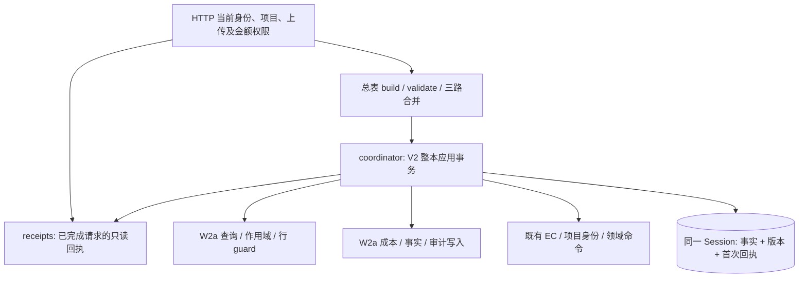

# V2 整本应用与首次回执的职责边界（W2b）

决策: 无。本批执行 #452 的 W2 结构迁移，不新增业务规则。基线为 W2a `3d63d0d703140da8fa585af39631c33ca63845d7`（#461），在独立 worktree 实施；核验日期 2026-10-23。

## 主干与职责

`maintenance_workbook_coordinator` 拥有 V2 应用入口、数据库约束错误翻译、原锁序、实际业务写入、首次完整回执以及提交；`maintenance_workbook_receipts` 拥有请求幂等键、响应投影、持久回执校验和已完成文件查询。总表保留原名、原签名、同一函数对象的兼容 export，既有 HTTP 调用仍经该出口到真正的新执行体。没有反向调用总表，也没有向新模块注入一整包总表 callback。

迁移 6 个函数，函数 AST 逐一完全一致；总表剩余 69 个顶层定义按原顺序完全一致，包括既有同名定义。总表减少约 1,250 行事务/回执实现。V1、Excel 解析、当前权限、合单预检 token 及其验证仍在原边界；不以这次迁移制造统一写入接口。

## 事务与兼容约束

锁顺序仍是全局 data-change advisory → 清理 validate 留下的旧 ORM identity → XSDD 身份 advisory → 按项目排序的 workbook states → project → 幂等 operation identity → 来源/挂靠/明细行 → 锁后 guard → 业务写入。嵌套 EC 使用同一个 Session、`commit=False`、`bump_revision=False` 和已锁状态；事实变更后统一 bump 一次。写阶段不能新增 `populate_existing`，避免覆盖未 flush 的数量/成本修改。

首次成功的事实、版本、operation、完整响应审计同一事务提交。已锁的重复 operation 仍按原路径提交释放事务；只读 `get_project_master_v2_replay` 不加锁、不 flush、不提交。它按项目、文件 SHA、操作者和操作类型读取，HTTP 必须先完成当前权限检查，并根据回执中的标志复验金额权限。无历史快照时返回 None，保留旧兼容路径，不能按当前事实伪造“原回执”。

外层只捕获 `IntegrityError`，回滚并保留原错误码及不泄露 SQL 的提示；其他 WorkbookError 保留原 HTTP 回滚责任。本批不扩大异常捕获，不新增提交点。新模块的 globals/traceback 来源改变，旧 alias 不是 monkeypatch 旧 globals 的传播机制；故障注入应指向实际执行模块。

新模块完整静态 import 闭包不回到总表或 HTTP adapter。coordinator 仍调用既有 EC/operations 业务能力；其 `maintenance_cost → maintenance_boss_board` 旧间接依赖由独立 R1 批次解决，不能将本批单独声称为所有领域模块无环。只读 receipts 不依赖 coordinator、EC 或 operations。模块 import 可加载模型/Engine 定义，但不连接数据库。

## 逐变量表

| 名称 | 类型 | 用途 | 为何这样定义 |
| --- | --- | --- | --- |
| `db` | `Session` | 整本事实、锁、审计和回执共享事务 | 嵌套 writer 不能提前提交部分结果 |
| `plan` | `MasterV2Plan` | validate 后的操作、基线、冲突和响应证据 | 解析与应用职责分开，锁后重新验证事实 |
| `operated_by` | `str` | 当前实名操作者及幂等身份的一部分 | 不允许另一操作者借用历史回执 |
| `import_batch_id` | `str` | 无导出身份时沿用请求标识，有身份时转换为确定性批号 | 重试返回稳定批次，不重复导入 |
| `user_ctx` | `UserContext \| None` | 原领域调用所需的权限上下文 | 不将注册/导入模块视为授权 |
| `apply_operation_key` | `str \| None` | 绑定项目、导出、文件和操作者 | 并发首次请求需要 absent-key advisory |
| `workbook_states` | `dict[str, MaintenanceProjectWorkbookState]` | 已排序锁定的所有受影响项目状态 | 跨项目挂靠不能倒置锁序 |
| `operating_fact_changed` | `bool` | 聚合本次经营事实是否变化 | 整本成功最多统一推进一次当前项目版本 |
| `receipt` | `MaintenanceProjectWorkbookOperation` | 首次成功请求身份 | 与对应完整响应审计一起验证 |
| `requires_amount` | `bool` | 原成功请求是否改合同金额 | 重放仍由 HTTP 按当前权限决定是否可见 |

## 验证记录

新增 10 项契约通过：6 个旧出口对象/注解身份、完整静态依赖闭包、新进程 import 零连接、回执审计 flush 末端失败后的完整回滚及同 plan 重试、只读回执不提交调用者待写版本且返回独立深拷贝。后两项使用真实 PostgreSQL；末端失败刻意注入 SQLAlchemy IntegrityError，不声称生产存在约束问题。

第一轮架构断言将尚未组合的 R1 `cost → boss_board` 边也禁止，暴露跨批依赖，已明确记录并将本批断言限定为真实要求的“不回到总表/HTTP”，没有删事务或业务断言。随后 10 passed。完整 387 文件后端回归已按固定文件清单启动；远端 CI 与两名独立 agent 的后验结果另行补充。

无 schema、迁移、前端、工具 schema 或业务政策修改；#430/#440 保持暂停。W3 只有真实新 sheet 需求才启动，本次不造示例业务。main 合入、用户实际点按验收与生产部署均不由本文件测试结论替代。
