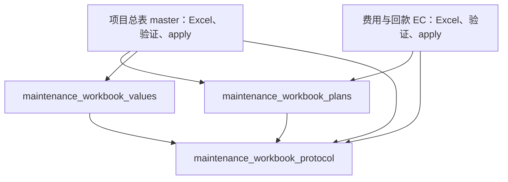

# 工作簿协议底层提取 W1a

决策: 无。依据 [设计 PR #452](https://github.com/Jinchen-Yang/it-spareparts/pull/452) 的近期口径台账执行。

基线为 main `7a9fd2098acb6be0009a59a84e7d7330bb960d6b`。本批迁移现有值、常量、计划类型和同一校验异常，让后续读取、验证和应用模块能直接依赖它们，无须加载旧总表或费用写入 adapter。

三个新模块只依赖标准库及彼此。不存在 SQLAlchemy、模型、配置、Excel、HTTP、旧 master/EC 的直接或传递导入。旧 master/EC 保留同对象 import 出口；调用者拿到的异常、类、常量、函数都来自唯一新定义。没有转发回旧模块的 facade，也没有重复算法。

## 模块边界

| 模块 | 解决的问题 | 上游依赖 | 当前调用者 |
| --- | --- | --- | --- |
| `maintenance_workbook_protocol` | 协议版本、sheet/列名、基线字段、签名 domain 与分块规则只定义一次 | 无 | master、EC、plans、values |
| `maintenance_workbook_plans` | V1/V2/EC 计划和 WorkbookError 脱离写入 adapter | 标准库 dataclass/date/Decimal、协议 sheet 集合 | master、EC |
| `maintenance_workbook_values` | 规范化、哈希、显式 key 元数据签名、编码和自动身份不再加载业务写链 | 标准库与协议常量 | master |

`values` 不是一概无副作用：自动领用身份函数保留对调用者 `occurrences` 计数器的递增。`frozen=True` 的 plan 也没有变成深度不可变对象；nested dict/list 的原有变更方式、默认工厂隔离与字段次序全部保留。

本批保留在 adapter 中的职责包括：调用时获取 keyring 的签名/验签、Excel 日期转换、worksheet 元数据读取、三路合并策略、数据库身份查询、锁、审计、回执、事务和所有 apply 协调。TAX_RATE 与费用状态校验未顺带搬成协议规则。当前 `_v2_verify_meta` 仍会查询项目上下文，不能归入纯 codec。

## 兼容约束

- V1 master 与 EC 的 `PROTOCOL_VERSION` 仍分别是 `project-master-v1` 和 `expense-collection-v1`。新常量采用明确名称，旧模块各自按原名导出。
- 所有迁出的定义保留执行体、参数、默认值、字段次序和算法；plan 注解中的 `ec.WorkbookPlan` / `ec.ExpenseUpdate` / `ec.CollectionOp` 改为中立层中同一类的直接引用，运行时类型解析不变。
- `master.WorkbookError is ec.WorkbookError is plans.WorkbookError`。没有新包装子类；原 HTTP `except ec.WorkbookError` 继续命中，code/message/issues/details 行为不变。
- header list/set 的可变类型与对象共享方式保留。没有 tuple 化、排序重写、deepcopy 或重新生成历史身份。
- 哈希保持 bool 与数字区别、datetime 取日期、Decimal 规范化及负零；金额文本继续服从调用时 Decimal context，不统一为新的 rounding。
- metadata 除自身签名字段外全部参与显式 key HMAC。分块继续按 30000 字符；坏 hash chunk 跳过、重复 ID 后值覆盖、row ID 不 strip 等宽松兼容行为未收紧。
- 自动领用身份继续绑定 project/export，按同内容的第几次出现区分重复物理行；排序不改变这组身份，换导出作用域会改变身份。

类和函数迁移后 `__module__` 与 traceback 的定义位置会变化。本次搜索 `backend/app` 与 `backend/tests` 没有发现这些对象被 pickle/cloudpickle/dill 持久化或依赖该模块名反射；旧 import 路径仍可解析到同一对象，但不承诺新 pickle 字节与旧字节相同。HTTP 与 workbook 协议不传输 Python 定义路径。

## 当前契约与目标边界

本批按近期 D-33 保持 Excel 整本事务，D-38 保持首次完整回执，D-32 项目备注保持严格 CAS，D-0042 保持同号合单。这些行为不在本批改写。新层中的旧历史注释与兼容测试只描述当前执行协议，不能替代近期决策或授予新的业务行为。

D-34 Q1/Q3 的解除基准与保护周期证据仍是未集成、暂停实施的目标；现有 `V2RowGuard` 不足以替代它们。本批没有新 plan 字段、存储迁移或恢复命令，也没有恢复 #430/#440 的实施。

## 验证与回退

提取清单的 79 项定义/常量逐项 AST 比较，加上两个旧 adapter 全部剩余函数/类的整体比较，81 项全部等价。仅归一化上述类型注解绑定及两个协议版本常量名称。

新增边界与反例测试 `test_maintenance_workbook_protocol_boundary.py`：40 项通过。包含全新 `python -S` 进程在没有 site-packages 时独立导入三个模块并解析 plan 注解、含函数内 import/package initializer 的静态边界、旧出口对象身份、summary/默认工厂、签名/哈希固定向量、Unicode 11 块元数据、宽松解码和重复物理行身份。

22 个相关现有文件在独立 PostgreSQL 测试数据库中共 550 项通过，208.35 秒。覆盖 V1/V2/EC、项目工作簿接口、原回执、锁后复验、归属 OCC、字段保护、签名/令牌、真实大项目 metadata 分块、自动身份、单号批处理、地址和收货兼容；保留现有 openpyxl 样式复制弃用警告。不是全后端回归或生产验收，完整 CI 与独立测试设计核验由本批集成流程继续完成。

全量回归复用 #454 的 `b5b3b75` 迁移测试隔离修复；生产迁移与原断言不变。

没有前端、数据库 schema、环境配置或依赖版本变化。部署未包含在本批；回退为 revert 本批代码，既有文件与数据库记录继续使用原协议。

## 逐变量表：关键边界输入

| 名称 | 类型 | 用途 | 为何保持这样定义 |
| --- | --- | --- | --- |
| `metadata` | `dict[str, str]` | 整本导出身份和隐藏 scope 的签名载荷 | 新隐藏字段仍自动被签入，不能缩减为可见列 |
| `hmac_key` | `bytes` | 元数据 HMAC 的明确密钥输入 | 纯层不读配置、不缓存 keyring；adapter 决定当前密钥 |
| `values` | `list[object]` 或 `dict[str, object]` | 按现有字段顺序生成兼容 hash | None、bool、数字、日期各自保留原规范化含义 |
| `fields` | `tuple[str, ...]` | 缺行与服务端 guard 的选定基线字段 | 不隐式扩大校验范围、不改变历史指纹 |
| `occurrences` | 可变计数映射 | 同内容重复实物行的出现序号 | 不把重复行折叠为一个身份 |
| `project_id` / `export_id` | 现有调用者提供的稳定身份值 | 自动编号作用域 | 不使用项目名称或展示号猜身份 |
| `site_issue_rows` | `dict[str, list[int]]` | 当前 plan 中的 Excel 来源行索引 | 每实例独立默认工厂；保留既有受控变更 |
