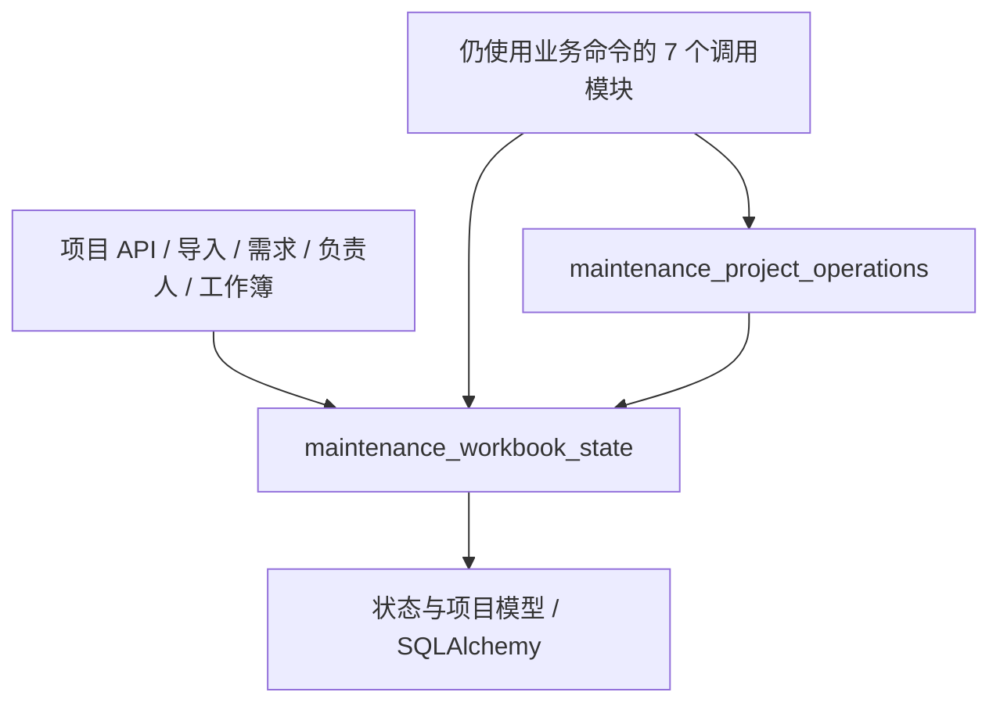

# 维保状态辅助调用方迁移（R3b）

决策: 无。承接 [R3a](maintenance-workflow-state-r3.md) 的结构重构，不新增业务规则。

本批基于 R3a `611873dd861ee04e939348b7e546f631b38b0836`；上游 main 为 `7a9fd2098acb6be0009a59a84e7d7330bb960d6b`，2026-10-23 开工时远端核验未变。R3a 是本批真实依赖，合并前需要集成其实现；没有复制另一份锁或 revision 算法。

## 改变的依赖方向

原来调用者为了锁定状态行或推进 revision，需要经过包含现场领用、合同和回款命令的 operations 模块。现在 23 个调用模块的 64 处属性调用和 1 个直接导入直接使用底层状态模块；其中 16 个模块不再直接导入 operations。这样未来修改状态锁或 revision 去重时，调用者不必经过业务命令模块，也不需要新增转发门面。

工作流仍负责更早的全局／身份锁、授权、锁后重读、事实与审计、回执和提交。没有把业务工作流搬进状态模块，也没有合并各入口的事务或权限语义。某些模块经其他业务服务仍可传递到 operations，本文不宣称全系统无环。

## 调用者清单

表内路径位于 `backend/app/`。`—` 表示删除了对 operations 的直接导入，不表示没有传递依赖。

| 调用模块 | 状态能力调用数 | 保留的 operations 能力 |
| --- | ---: | --- |
| api/maintenance_projects.py | 3 | — |
| etl/loader.py | 5 | `_fact_audit` |
| services/maintenance_bulk_import.py | 3 | create/update collection、create/update contract |
| services/maintenance_collection_milestone_restore.py | 2 | — |
| services/maintenance_collection_plan_imports.py | 2 | — |
| services/maintenance_collection_reminders.py | 2 | — |
| services/maintenance_cost.py | 2 | `recompute_cost_gaps` |
| services/maintenance_demand_manual.py | 4 | — |
| services/maintenance_demands.py | 2 | — |
| services/maintenance_expense_collection_workbook.py | 2 | 错误类型、事实审计、金额转换、回款单调性、回款表示 |
| services/maintenance_ledger.py | 3 | `_fact_audit`、`contract_dict` |
| services/maintenance_manager_workbook_adapter.py | 3 | — |
| services/maintenance_migration_source.py | 1 个直接导入的调用 | — |
| services/maintenance_project_assignments.py | 4 | — |
| services/maintenance_project_catalog.py | 3 | — |
| services/maintenance_project_identity.py | 2 | — |
| services/maintenance_project_master_workbook.py | 6 | `_audit_contract`、`contract_dict` |
| services/maintenance_project_workbook_adapter.py | 1 | `create_collection`、`project_workbook_workspace` |
| services/maintenance_project_workbook_v3.py | 1 | — |
| services/maintenance_return_receipt_import.py | 1 | — |
| services/maintenance_source_assignments.py | 9 | — |
| services/maintenance_source_cancel_cascade.py | 2 | — |
| services/maintenance_wbdd_sync.py | 2 | — |

另外更新 `maintenance_cost.py` 与 `maintenance_periods.py` 的锁模块文档引用。共 24 个生产文件发生差分；只有 23 个文件改变导入和调用接收者，`maintenance_periods.py` 仅修改说明。

## 接口变量与保持的边界

| 名称 | 类型 | 用途 | 为何这样定义 |
| --- | --- | --- | --- |
| workbook_state_service | Python 模块别名 | 定位公共状态实现 | 多个工作流已有名为 workbook_state 的 ORM 局部变量；独立别名避免遮蔽 |
| db / session | SQLAlchemy Session | 调用方已有事务 | 辅助函数不创建新会话、不提前 commit/rollback |
| project_id / project_ids | str / ID 集合或迭代器 | 指定项目状态及预锁包络 | 不修改调用者发现 ID 的时点与过滤规则 |
| state / workbook_state | MaintenanceProjectWorkbookState | 已创建或锁定的状态行 | 保持原对象及刷新策略，不覆盖未 flush 的业务写入 |
| locked_states / prelocked_states | 项目 ID 到状态行的映射 | 多项目预锁及后续 bump | 保留包络校验，禁止事实写后补拿更早的状态锁 |

此次不移动、增加、删除任何业务函数调用，也不改变参数、条件、返回、异常、flush、commit、rollback 或 SQL 锁序。主工作簿 V2 的全局锁、XSDD 身份锁、状态锁、项目锁、operation、事实守卫及原回执顺序原样保留。历史 exact dedupe 不增加 state 锁或 revision bump；旧 adapter 的直接 revision 增量也不改写成通用去重调用。

`get_or_create_workbook_state(lock=False)` 仍可能 INSERT 状态行，不改称纯读；根事务内 revision 去重不新增 savepoint 回滚保证。operations 的旧兼容导出仍由 R3a 提供，业务命令内部调用和现场请求指纹／replay／receipt 均未迁移。

近 15 天的规则核验沿用 [设计 PR #452](https://github.com/Jinchen-Yang/it-spareparts/pull/452) 的逐条台账，并阅读当前 D-33、D-34、D-38、D-0042：页面逐行与 Excel 整本事务、字段保护、当前金额资格、首次完整回执和同号合单的边界不变。暂停的 Q1/Q3 与完整恢复候选没有恢复施工；本批不把旧实现行为升级为新的业务授权。

## 验证与证据

1. 对 24 个生产文件与固定基线逐个比较完整 AST。仅归一化 operations/state 的 import 名、状态 helper 的模块接收者，以及两处说明中的模块名；全部执行节点等价。锁、SQL、调用顺序、参数、异常和提交均包含在比较范围内。
2. 新增 `test_maintenance_workbook_state_callers.py`：扫描整个 `app/`，禁止通过旧 operations 引用状态能力，没有放行清单；另对 16 个仅需状态能力的调用模块禁止直接 operations 导入。守卫覆盖直接导入、重命名、完整模块路径和星号导入。
3. 新增真实 PostgreSQL 事务契约：将旧 operations 状态出口替换为失败函数后，依次运行项目主档编辑和负责人指派。两个业务审计均保留、同根事务 revision 仅 +1；调用方 commit 保存整组事实，调用方 rollback 同时回滚备注、指派、审计与状态行。
4. 两份既有故障注入测试只改真实注入目标：自动归属的取锁前并发写入仍须 fail closed；负责人／销售同步在 revision 异常后仍须全部回滚。既有断言不变。

首轮新增 24 项契约与两份既有 OCC／负责人 API 测试合计 **52 passed**。`py_compile` 检查本批 27 个 Python 文件通过，`git diff --check` 通过。

按实际 imports 收集另外 154 份已有回归，分两个隔离数据库进程运行，覆盖 loader、master、identity、回款五类写者竞争、原回执、合法三路合并、需求编辑、成本、返还导入及其余迁移调用者。文档落笔时该长回归仍在运行，不计为通过；最终退出码和结果以本批 PR 验证记录为准。测试只使用临时 PostgreSQL 和合成数据，没有 schema、依赖版本、前端或生产改动。

可单独 revert 本批调用方迁移回到 R3a 兼容出口；不需要数据库回滚。合并、用户验收与生产发布分别判断。
