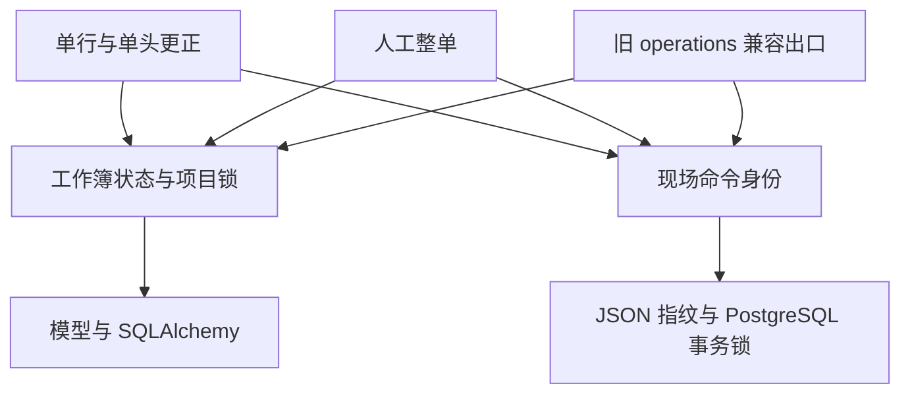

# 维保工作流辅助与写者锁边界（R3a）

决策: 无。结构提取，不新增业务规则。

基线 main `7a9fd2098acb6be0009a59a84e7d7330bb960d6b`；依据 [设计 PR #452](https://github.com/Jinchen-Yang/it-spareparts/pull/452) 的近 15 天口径台账。R1/R2 尚未合入，因此本批从 main 独立提取，不假设其他候选接口存在。测试隔离修复复用 #454 的 `b5b3b75`；它只改变迁移测试夹具，不改变生产迁移。

## 依赖主干

State 隐藏状态行创建、排序锁定及根事务内的 revision 去重。Identity 隐藏当前 JSON 指纹字节与 advisory key 算法。调用者仍负责前置锁、授权复验、锁后 fresh read、事实/审计/回执、commit/rollback。没有统一 UnitOfWork，也没有为 Agent 增加业务写能力。

两个新模块内共 9 个函数的 AST 与旧实现相同（仅公开名改名）。operations 保留同一实现对象的兼容导出。更正模块去掉对 operations 的直接 import；它经 facts / return requirements 等仍存在传递路径，不宣称全系统无环。人工整单仍使用 operations 的业务能力。其余 26 个调用模块本批保留旧出口，后续逐组迁移。

## 接口与限制

| 名称 | 类型 | 用途 | 原因 |
| --- | --- | --- | --- |
| db | Session | 调用方事务 | 不创建子会话或提前提交 |
| project_id / project_ids | str / Iterable[str或None] | 状态与项目身份、预发现的锁集合 | 多项目去空、去重、排序后逐一锁定 |
| lock | bool | state SELECT 是否加行锁 | False 也可能 INSERT，不是纯只读函数 |
| state | MaintenanceProjectWorkbookState | 已持锁状态行 | 不自动刷新，防止丢弃未 flush 的业务修改 |
| transaction / registry | 根 SessionTransaction / 配对项目集合 | 每个根事务每项目最多 bump 一次 | 同 Session 提交/回滚后重新登记；不承诺 savepoint 回滚后去重正确 |
| payload | dict | 调用方已构造的指纹内容 | 不合并 manual 与 partial 的字段或空值语义 |
| idempotency_key | str | 现场领用命令身份 | 保持原 hashtextextended(key,0)，不新增前缀或修改互斥范围 |

原 `_project` 只作为内部 helper 及旧出口保留。新命令使用 `lock_project_for_fact_write`，但仍须遵循自己的更早锁前缀。旧的直接 revision 增量点与按合同编号的另一种 roundtrip state 不在本批归一。

## 当前写者矩阵

以下是基线的调用链证据，行号来自提取前 `9afc0e4`（与 main 函数主体相同），不是近期业务裁定。未来新增写者必须再次核对 ORM、原始 SQL、bulk 与动态表集合。

## 3. 五类回款快照 writer 与真实外层入口

扫描 `MaintenanceCollectionSnapshot` 构造/属性写、ORM delete、SQL UPDATE、bulk query.update 和原始表名。app 中仍为五类，**不是只有五个 HTTP 入口**。回款“计划节点”“收款单台账”不是同表；它们通过下列写者派生实收快照才计入该矩阵。

| writer 与代码 | 外层入口/调用 | 锁顺序与互斥依据 | 锁后读/写及 revision | commit/授权 |
| --- | --- | --- | --- | --- |
| operations.create_collection:3909–3980 | API operations:596–633；bulk 收款 adapter:2995；project_workbook_adapter:872 | state → project；合同归属 SELECT，无单独 FOR UPDATE；同项目 state 保护缺位月份 | 校验 active/归属/月首/金额/确认序列 → INSERT snapshot → fact audit → 可选 bump | service flush；网页 API commit；bulk 外层 service commit；旧项目 adapter HTTP commit。金额/范围/实名在各入口，不迁入 state helper |
| operations.update_collection:3983–4085 | API operations:637–667；bulk:3035 | 无锁读 project_id → state → project → snapshot FOR UPDATE | version CAS、字段更新、确认单调性、无变化早退；有变化 audit + 可选 bump | service flush；原外层 commit。project_id 预读不是锁内授权证据；未发现通用锁后 SysUser 重验，不新宣称已有 |
| expense_collection_workbook.apply:1131–1388 | 独立 ec API:160–187；master V1:1374；master V2:7311 | state → project（737–775）；current contracts FOR UPDATE（814）；报销行 advisory → attribution → raw expense（830–853）；snapshot 按 contract/month FOR UPDATE（888–899） | 已有关系锁后复核；contract 锁保护缺位月份；UPDATE/VOID/CREATE直接写snapshot；终态单调性校验；按 operating_fact_changed/bump_revision | 默认 commit=True 自提交；V1/V2 传 commit=False、bump_revision=False、已锁 state，整本外层统一提交。绝不调自提交网页命令替代 |
| project_identity 归并：apply_historical_project_merge_batch:2046 / _apply_locked_project_merge:1566 | 单组 wrapper:2209；仓库未发现产品 HTTP/CLI 调用者，当前是显式内部维护能力，测试使用 | DATA_CHANGE advisory(2111) → 全部 XSDD identity(2119) → 全项目排序 states(2120) → 逐项目 FOR UPDATE(2125) → 后继事实锁 | 锁后重建 manifest 并核对 reviewed hash/成员/canonical；先 exact dedupe；1754更新snapshot合同FK；**1791–1797 经_GENERIC_REPARENT_TABLES动态更新snapshot.project_id**（集合150行含该表）；canonical一次bump(1916) | service flush，调用者拥有 commit/rollback；只校验 operator 非空+reviewed manifest，不把维护工具当授权过的 HTTP 能力 |
| project_identity.apply_exact_collection_dedupe:890–1049 | scripts/apply_project_xsdd_exact_dedupe.py:48 | DATA_CHANGE advisory(912) → XSDD identity(915) → manifest preview → projects FOR UPDATE(935) → snapshots(953) → contracts(966) | 锁后逐条重新算完整业务 fingerprint；repoint workbook operation.entity_id；物理删除完全相同快照；project audit；**没有 state 锁，也没有 revision bump** | service flush；CLI:53 commit，异常rollback；CLI需 --apply-exact-collections。没有应用用户权限校验；R3不改变这类维护入口范围 |

补充外层保护：

- bulk 收款 adapter `maintenance_bulk_import.py:2795–2802` 先拿每合同 `maintenance-receipt-ledger:{id}` advisory，再排序 states，之后读 contracts/snapshots/ledger并作计划 CAS；底层仍调用 operations.create/update。外层 `apply_preview:3736/3779`、`apply_transfer:4909` 拥有提交。不能因为底层 writer 有 state 锁就把台账身份锁删掉。
- `project_workbook_adapter.py:796–922` 先通过 `_state` 持 state，检查当前 revision、合同月份缺位和 operation 身份，再调用 create_collection(bump_revision=False)，最后自己直接加 revision；其旧回填协议不能改成 master V2 行级三路合并。
- manager workbook 的 snapshot 查询（452–529）只读；其节点写入与项目 version/revision不构成第六 snapshot writer。
- `backend/scripts/v2_full_roundtrip.py:115` 有原始 DELETE 清测试数据，不属于 app runtime writer；脚本测试/清理用途不受上面的协议自动保护。数据库 migration 的数据迁移也不是在线命令。不能把“app五类”说成仓库绝无其他写 SQL。

## 4. V2 为什么在没锁 snapshot 行之前可以复核

`maintenance_project_master_workbook.py:_apply_project_master_v2`：

- 6422 取 DATA_CHANGE 全局事务 advisory，然后 `expire_all`（6438）；此时 validate 不能有 pending writes。
- 6446–6478 先发现 XSDD 包络，6479 锁 identity；6532 排序 state；6537 项目行锁。
- 6545–6584 operation advisory/receipt FOR UPDATE；已完成同身份回执在 revision/事实 CAS 前返回，并由 service commit释放锁。
- `_v2_assert_entity_scope` 加 source/site/expense 等事实锁；`_v2_recheck_row_guards` 5532–5700 在任何写之前复核。
- 05分支 5650–5676 使用列级 SELECT 读快照，绕开 identity map；稳定性来自三种既有锁共同覆盖全部五类 writer，而不是每类都持 state。
- EC 真正snapshot行锁较晚才在 `ec.apply` 获取。因此 **不能仅迁state helper后删除全局或project锁，或把dedupe不bump当作无关**。
- V2 首次完整回执审计在7490以后，7508 commit；IntegrityError 由6361–6388 wrapper rollback，其余HTTP错误原入口rollback。

必须保持合法三路合并：未触行变化用现有测试确认可接受，不能把任何新行/整体revision漂移都改成 stale。新增资源只有要求倒序前置锁或扩张确认身份包络时才按既有协议拒绝。

## 5. 授权、回执与提交差异（本批保留）

| 流程 | 权限读取时点 | 回执/提交边界 | 不能归一之处 |
| --- | --- | --- | --- |
| partial line/header correction | API operations:1930–1949 authorize 从 SysUser populate_existing 重读、token_version对比、runtime permissions、项目范围；service:106先查，118锁issue后再查，154锁行后再查 | command replay在128–137、**line锁之前**；新事实→audit/event→revision→receipt同事务；API1961commit | 先锁line再重放会破坏行后续合单迁移后的原回执；不搬动顺序 |
| legacy manual | manual:432/596先生成本入口规范化payload指纹；435/605 id锁；自己的receipt/归属/版本流程 | service只flush、API原提交；与partial payload和错误语义不同 | 不共用新的万能replay handler，不附新actor字段 |
| operations confirm/patch/void | 使用自身fingerprint/replay/错误类，部分命令先replay再projectlock | 旧request identity/receipt及外层API提交 | `_site_issue_command_replay`仅本模块内部用，暂不抽取 |
| V2 workbook | API master:85 `_require_master_edit`、项目范围依赖；合同额门110、首次/重放分别928附近/854；这些使用已构建ctx，通用锁后不重新取SysUser/token | HTTP `_completed_v2_upload`前置重放；service6545后锁内receipt；service拥有完整首次提交 | 仅6750归属变更等特定分支传user_ctx复核，不能宣称全面fresh auth已存在 |
| direct collections / standalone EC | API page/action/data_profit/scope + 各自实名规则，service检查项目active/关系 | collections外层HTTPcommit；EC默认内部commit | 不因同一state helper重用partial的权限回调或金额门 |
| historical merge/dedupe | 内部维护操作，operator文本+manifest/CLI显式开关 | 调用者commit | 不是可直接暴露给Agent的业务工具 |

V2在等待写锁期间撤权仍需独立调查/竞争测试。当前只读证据只能确认没有通用fresh-user调用，不能等同已复现越权。新增授权修复应单独提交、独立行为测试，不混入函数迁移。

## 验证与回退

新增测试用真实 PostgreSQL 独立 Session 验证竞争，Event 只定位执行点，pg_blocking_pids/pg_stat_activity 证明实际锁等待；测试时间上界只用于失败退出。已有更正接口测试覆盖撤权、并发重放和事实/审计/回执失败回滚。新增原语测试覆盖创建回滚、跨事务 revision、排序锁、旧/新出口互斥及请求指纹。新模块的静态导入限制和新进程导入检查阻止回到上层业务模块。

最终执行结果写入对应 PR；本文件不把待运行用例计为通过。全部测试仅用专用临时数据库和合成数据。本批无 schema、文件协议或依赖版本变更，可 revert 提交回退；不代表生产发布。Q1/Q3 与完整恢复仍是暂停业务目标，不在本批恢复实施。
