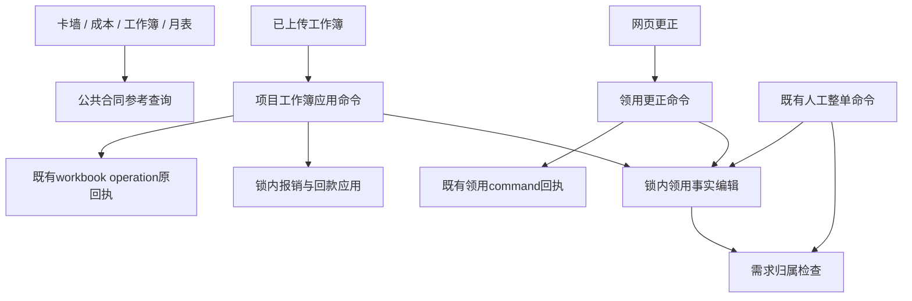

# 方案 A：少量明确的领域查询与命令

> 综合稿说明：本文件保留独立备选方案，未来的 fresh 授权、Session 所有权和接口类型不是当前已实现状态。近期实施以[总体设计](../maintenance-refactor-design.md)及[批次计划](migration-and-acceptance.md)为准；尤其 V2 全面锁后重新鉴权尚需 R3 调查，不从本方案流程示意推断现状。

设计基线：本地 `fa97e2490f480336e29f51c84bfdaac3ee4f12fe`；main 基线 `7a9fd20`。这是下一阶段方案，不是已经实现的接口。本次只写方案，未改业务代码。应用 design-an-interface 的约束：面向本轮三个真实需求保留 1–3 个主要入口，不建立中央 execute/插件/handler 引擎。

## 1. 主干：读模型、锁内事实、外层命令各自只承担一种生命周期



“少改核心”在本方案中的可核验定义：新增合同读取方无需修改提供方；新增领用入口只适配输入及调用既有命令或原语；新增独立业务流程增加独立命令模块；新增工作簿sheet允许修改一次明确的工作簿组合位置。新增事实字段或改变业务规则仍必须修改权威事实模块，这是合理的集中变化，不能通过任意字段字典或自动ORM赋值消除。

解决的问题是业务规则被页面、Excel、手工完整命令重复维护。上游依赖已拍板的稳定身份、权限、事务与回执协议；下游调用方只拿与自己任务相符的读结果或命令结果。代码形态类似“几个明确的库函数 + 两个 main 函数”，不通过中央分派器推断每种业务意图。

## 2. 当前证据：接口必须围绕这些调用差异设计

以下行号均为 `fa97e24`。

- `services/maintenance_boss_board.py:1728–1984` 的 `_card_contracts`批量读取当前合同；全局检查共享关系；只有完全没有当前台账合同行时才查询成功销售批次作fallback。它会保留已知subtotal并标记incomplete，不能直接改名成“安全总额”。
- `services/maintenance_project_master_workbook.py:337–365` 的 `_canonical_contract_read_model`把shared/incomplete金额遮蔽，但保留完整真实0；`maintenance_project_workbook_v3.py:400–411`还要求确实存在contracts列表；`maintenance_manager_workbook_adapter.py:539`把参考完整性用于多项目月表；`maintenance_cost.py:1213–1299`禁止受限销售从可见WBDD穿透canonical项目合同，且另有当前合同存在检查。这四类策略不得合并成同一金额开关。
- `services/maintenance_manual_site_issue.py:88–114` 的 `_resolve_demand_project`只校验单号与本项目active归属。虽然docstring写“活跃需求”，SQL没有源状态、墓碑和行级有效过滤；当前契约 `docs/integrations/maintenance-site-issue-facts-v1.md`明确按活跃归属校验。抽取时不能擅自追加active_orders。
- `services/maintenance_site_issue_facts.py:191–199`为复用该校验反向import manual adapter；manual:35–38又import facts，是当前2模块循环的真实来源。
- `services/maintenance_site_issue_line_correction.py:86–195`已有明确的单行/单头事务编排：锁内再次授权、CAS、原语、revision、回执，但commit在 `api/maintenance_project_operations.py:1924–1983`，当前账号读取和token_version复验也在HTTP闭包中。
- 完整manual命令在 `maintenance_manual_site_issue.py:573–864`保留整单替换、原规范化与指纹、旧版本次数；不能改用partial correction就宣称语义相同。现有测试 `test_maintenance_site_issue_facts.py:226,251`专门冻结旧改单号取价时序及整行重估行为。
- `maintenance_project_master_workbook.py:6289–7444`已拥有整本commit；`api/maintenance_project_master_workbook.py:844–947`仍负责当前资格、提前原回执查询、validate失败/成功后二次回执查询、金额资格及merge token。新应用命令必须把这套行为一并迁移，不能只把 `_apply_project_master_v2` 包一下。

## 3. 最终形态：三个主入口，两个事务所有者

以下是目标接口，不建议一批完成。

```python
# maintenance_contract_reference.py：纯读取，不授权、不提交。
def read_contract_references(
    db: Session, *, project_ids: Collection[str],
) -> dict[str, ContractReference]: ...

# maintenance_site_issue_commands.py：只服务已获授权的人工网页更正。
def correct_site_issue(
    session_factory: Callable[[], Session], *,
    actor: AuthenticatedActor, request: SiteIssueCorrection,
) -> SiteIssueCorrectionReceipt: ...

# maintenance_project_workbook_commands.py：拥有完整上传应用生命周期。
def apply_project_workbook(
    session_factory: Callable[[], Session], *,
    actor: AuthenticatedActor, submission: WorkbookSubmission,
) -> ProjectWorkbookReceipt: ...
```

类型约定：

- `ContractReference`最终使用内部immutable DTO，仅保留现有四个语义：`contract_nos`、`amount_inc_tax`、`contract_shared`、`contract_incomplete`。金额是可能不完整的参考值，不能叫 `total`；无记录继续缺键，不能制造“complete/0”。**兼容第一批仍返回原dict形状**，类型化独立后置。接口不提供任意 `as_of`，因为现实现只回答当前合同，历史口径另立需求。
- `project_ids`只允许已经上游授权的显式集合；空集合返回空字典，不接受 `None=全库`。共享判定内部仍需要全局冲突查询，但只输出请求项目，不返回其他项目身份。第一批参数行为保留原list接受方式，不借签名升级把业务查询集合变窄。
- `AuthenticatedActor`来自现有登录校验，携带服务器确认的账号ID、token_version及原身份上下文；不是前端可构造的请求模型，也不能把 `operated_by`作为用户输入。命令内复用当前账号读取、有效性和token_version检查，锁后重查项目范围。
- `SiteIssueCorrection`为已存在的 `HeaderCorrection | ExistingLineCorrection`判别联合：稳定issue/line身份、预期版本、局部字段意图、原因、幂等键。网页省略字段保留，null显式清空，PN/part_id成组。**不包含create/void/restore/replace_all，也不让客户端选legacy profile。** 已有manual完整命令仍有独立兼容门面；以后若要统一是另一项协议迁移。
- `WorkbookSubmission`包含 `project_id`、上传bytes、`force_takeover`、`site_issue_merge_token`。命令自行算文件SHA，验签并构造plan；不接受客户端提交“已验证”的 `MasterV2Plan`、金额资格标记或operation key。上传字节数/ZIP炸弹检查继续在接收边界先拒绝，命令验证格式、身份和业务协议，不能依赖某个HTTP路由才安全。
- 两类receipt保持各自原字段、重放标志、原存储表和指纹，不建立通用receipt表，不改旧操作键namespace。顶层返回只在commit成功后；早期只读重放无需额外业务写入或revision。

### 内部保持的真实seam

`apply_locked_site_issue_edits(db, project, issue, line_changes, header_changes, operated_by, reason, legacy_context)`保留现有锁内原语。它不是第四个对外应用入口；是两个命令及兼容适配器共享的内部事实端口。外层命令不能互相调用以复用事实，否则会嵌套Session、重复幂等和提前commit。

新增一个内部联系函数 `demand_is_assigned_to_project(db, *, project_id, demand_order_no) -> bool`，只返回当前SQL是否存在匹配；不依赖manual/operations异常、不改范围、不拿锁、不commit。manual adapter保留旧 `MaintenanceOperationError`，facts转换成既有 `SiteIssueEditError`。返回布尔用于回答明确的一项事实，避免为这一个复用点新增错误继承图或通用repository。

原 `manual._resolve_demand_project`在迁移期作为兼容wrapper继续存在，调用布尔函数并抛同一旧错误；facts直接调用布尔函数并抛原code/message。第一批连异常链也保留：facts暂继续从operations导入现存 `MaintenanceOperationError`，在布尔校验失败时用相同文案创建该旧异常并 `raise SiteIssueEditError(...) from cause`；不再import manual。A2再把原异常类型原样移到既有中立errors模块并在operations重导出；不能复制成不同类型。布尔检查只负责数据库事实判断，不悄悄承担HTTP错误映射。

## 4. 两个实际调用例

例一：当前已授权项目卡/工作簿读取合同参考。示例中的 `selected_project_ids`已经在上层按现有scope取得；工作簿金额策略保持单独投影。

```python
references = read_contract_references(db, project_ids=selected_project_ids)
reference = references.get(project_id)
workbook_amount = (
    reference.amount_inc_tax
    if reference is not None
    and not reference.contract_shared
    and not reference.contract_incomplete
    else None
)
```

此例只描述master既有策略；V3还要保留 `contracts`存在条件，cost还要保留受限销售拒绝canonical查询。不能把这段例子复制为所有消费者的共用总额函数。`None`与完整零必须分开。

例二：同一事实可从网页单行更正或Excel整本应用进入，事务归各自命令。

```python
# HTTP已认证身份，不把客户端JSON转换成actor。
receipt = correct_site_issue(
    SessionLocal, actor=actor,
    request=ExistingLineCorrection(
        issue_id=issue_id, issue_line_id=line_id,
        expected_issue_version=issue_version, expected_line_version=line_version,
        changes={"remark": "人工核对", "no_return": None},
        reason="按当前规则重新核对", idempotency_key=request_key,
    ),
)
# 独立Excel入口；不复用上面这个会commit的网页命令。
workbook_receipt = apply_project_workbook(
    SessionLocal, actor=actor,
    submission=WorkbookSubmission(
        project_id=project_id, content=uploaded_bytes,
        force_takeover=False, site_issue_merge_token=merge_token,
    ),
)
```

逐变量表（含接口和示例出现的变量）：

| 名称 | 类型 | 用途 | 为什么这样定义 |
|---|---|---|---|
| db | Session | 读取参考或参加锁内写事务 | 不自行创建隐藏事务 |
| project_ids / selected_project_ids | Collection[str] | 明确已授权的读取集合 | 空集不能退回全库；不用名称作身份 |
| project_id | str | 稳定项目身份 | 不受项目文字漂移影响 |
| references | dict[str, ContractReference] | 一次批量查询的结果 | 避免每卡查询；不存在保留缺键 |
| reference | ContractReference或None | 当前项目参考 | 无记录不制造0 |
| workbook_amount | Decimal或None | master可展示的完整金额 | 部分/共享不伪装合同总额 |
| session_factory / SessionLocal | Callable[[], Session] | 顶层命令取得专属Session | 不接管调用者已有脏事务，方便隔离测试注入 |
| actor | AuthenticatedActor | 服务器认证身份及token版本 | 权限不能由模型或请求自报 |
| request | SiteIssueCorrection | 网页局部意图 | 显式区分单行/单头及完整替换 |
| issue_id | str | 稳定领用单身份 | 不用可改业务号或展示号定位 |
| line_id / issue_line_id | str | 稳定领用行身份 | 同PN可有多行，不能按PN对齐 |
| issue_version / expected_issue_version | int | 单头CAS基线 | 单头或同行变化必须被发现 |
| line_version / expected_line_version | int | 明细CAS基线 | 不接受过期更正覆盖 |
| changes | Mapping[str, object] | 白名单字段意图 | 缺键保持，null清空；不是任意ORM patch |
| reason | str | 实名更正理由 | 审计保留动作原因 |
| request_key / idempotency_key | str | 既有请求幂等身份 | ACK丢失后仍用原键，不能换键重写 |
| submission | WorkbookSubmission | 完整上传应用输入 | 计划、SHA和资格由服务端生成 |
| uploaded_bytes / content | bytes | 原上传内容 | 签名/文件hash绑定真实原文件 |
| force_takeover | bool | 既有强制接管意图 | 不因架构迁移删除已有确认能力 |
| merge_token / site_issue_merge_token | str | 已批准合单预览凭据 | 不能对变动计划静默合单 |
| receipt / workbook_receipt | 各协议receipt | 提交后的命令结果 | 保留两套现存回执语义，不混同 |

## 5. auth、锁、commit与回执归属

### 读模型

HTTP/Agent/导出adapter先做页面/动作/项目/字段授权，才决定是否调用参考查询及哪些项目。查询不接受自报user scope，不对输出自动脱敏；返回内部事实，调用方有责任保留已有字段策略。Agent仍只读，不注册两个写命令。

### 网页更正命令

最终把API `_site_issue_correction_result`的当前账号/权限guard和service `_correct_site_issue`组合成一个领域应用命令：首次授权 → 既有command幂等锁 → state → project → issue → 指定行（单头更正为全部有效行） → 锁后新鲜账号/项目授权 → 原回执判定 → CAS → 原语 → 一次revision → 既有command receipt → commit。失败回滚本Session。**不要把Workbook全局锁强加给网页命令，也不要把网页幂等锁塞进已持行锁的Excel原语。** 既有具体重放/CAS前后顺序以当前代码保持，流程图只表示职责，不能用图改重放协议。

### 工作簿应用命令

最终命令拥有原API提前重放/权限/merge-token验证与原service事务，一次Session：当前登录/项目/编辑资格 → 读取已完成回执并校当前金额资格 → 只读validate → validate失败/成功窗口内再次查receipt → DATA_CHANGE → XSDD identities → sorted states → project → operation identity/receipt → 源单/归属/明细 → 行守卫/合单引用fresh check → 各领域锁内写 → 一次revision → 首次完整receipt与事实同事务保存 → commit。仅锁前准备的候选身份不可信，锁后发现新身份必须拒绝stale/重新预检，不能晚拿更上层锁。

各sheet函数不得自行commit、不得打开Session、不得触发独立网页命令；旧ec.apply暂以 `commit=False,bump_revision=False`调用，后续才拆明确的locked函数。对原手工/网页/Excel各自的指纹和回执不做统一序列化。D-38历史无完整快照继续走旧兼容，不借迁移回填假原回执。

## 6. 兼容迁移与目标形态分开交付

### A1：合同读取与需求归属两个真实seam（最先可实施）

1. 新建 `maintenance_contract_reference.py`，移动 `_card_contracts`查询原实现为公共 `read_contract_references`；保留boss `_card_contracts`旧名字alias/wrapper。先不改数据结构、不加as_of、cache、金额权或筛选，不把全局shared查询限到本页。
2. 替换真实调用点：boss_board:1379/1414/2157；master:83/347；cost:1243–1245；v3:400；manager_adapter:539。各caller继续原投影与授权逻辑。根静态图应不再因合同参考把上述消费者绑到整个boss_board。
3. 新建 `maintenance_demand_assignment_check.py`的明确布尔校验；manual:88–114 wrapper保留旧错误；facts:191–199移除manual import。先覆盖正常/未归属/跨项目/非生效但仍有active归属、空白输入归一化、未提供字段不动，以及错误链兼容，再决定是否有必要迁异常类型。
4. 建立依赖边界：合同读取不import卡墙/成本/workbook/API；需求校验不importmanual/facts/operations/API；AST验证manual↔facts这组SCC消失。运行时import测试仅作补充，不能代替传递图。

**测试门**：`test_maintenance_boss_board_api.py::test_card_contract_fallback_accepts_only_consistent_successful_sales_facts`及该文件合同完整性用例；`test_maintenance_project_master_workbook.py:221/254/282`；`test_maintenance_project_master_v2_editable.py:349/406/450`；`test_maintenance_cost.py:483/561`及受限销售用例；`test_maintenance_project_workbook_v3.py`、`test_maintenance_manager_workbook_v3_adapter.py::test_manager_snapshot_and_workbook_use_inc_tax_contract_amount`、`::test_manager_workbook_fails_closed_for_unmapped_contract_fact`、`::test_manager_workbook_fails_closed_for_duplicate_or_shared_contract`及`test_maintenance_manager_workbooks_api.py::test_status_fails_closed_without_contract_amount_permission`。需求检查复用 `test_maintenance_site_issue_facts_errors.py::test_demand_reference_normalization_and_assignment_validation`、`test_cross_project_demand_rejected_before_any_dirty_state`与manual用例。新增测试必须检验已有合法但容易被“优化”收紧的来源状态。

退出条件：old/new行为等价、无migration、无新权限、无SQL集合变化、2条反向import移除；这时还没有移动commit所有者。

### A2：锁内事实模块解除表示层依赖

`facts._line_snapshot:104–108`依赖operations.site_issue_line_dict。先抽“领用事实快照”公共表示供原序列化与审计调用，区分内部成本证据快照和对外脱敏DTO；不把整个project_workspace搬过来。再抽operations里实际共用的状态锁/版本工具到窄模块，但不能为了拆文件把每个金额格式函数做服务。

验证 `test_maintenance_site_issue_facts.py`、`_compatibility.py`、`_errors.py`中no-op、PN失效、header全行定价、每单单个P3事件、manual旧版本和真实并发。退出条件：default facts不反向依赖manual及巨型operations表示，但保留合法下游native obligation锁。

### A3：收拢网页命令，兼容旧API事务

先将 `_site_issue_correction_result`中的纯当前账号策略移到中立授权服务并保留原HTTP映射，当前API仍commit；再以一个独立批次移动 Session所有权至最终 `correct_site_issue`。后一批必须改API dependency：避免先用一个request Session授权、另开command Session后仍拿旧ORM对象。API只取认证identity、解析body/传输错误，命令重新读取权威账号；测试通过注入session_factory而非全局monkeypatch ORM。

保持老 `correct_site_issue_line/header(db, authorize=...)`作为事务内兼容入口，明确不用于新业务入口；迁完所有已知callers后才能删。manual整单命令不在这一批统一，继续已冻结协议。

退出条件：一条命令只有一个commit所有者；当前权限撤销/同键不同载荷/并发CAS/ACK重放/失败后Session关闭得到真实Postgres验证。

### A4：工作簿事务协调独立，sheet逐步搬出

先把apply lifecycle由API+master两个文件收拢为 `maintenance_project_workbook_commands`，原validate/parse/render和field merge继续原函数。首批只搬编排，保留旧service facade。再以01/02、03、04/05、06等真实域逐批提取locked写入单元；由具体工作簿组合函数按固定业务顺序调用，**不注册任意callable插件**。

新增sheet时需要改自己的解析/plan/locked apply以及这一个组合函数；若产生新锁对象，必须提前纳入身份集合和重检协议。只有出现第二个真正独立sheet供应者/插件需求再评估B的注册型策略。现阶段用可见的显式调用让审查者看清全事务。

测试门：`test_maintenance_master_v2_original_receipt.py`、`test_maintenance_master_v2_lock_freshness.py`、`test_maintenance_master_v2_row_merge.py`、`test_master_workbook_issue_no_batch.py`、`test_maintenance_project_master_workbook.py`的多sheet revision/坏行零写入、`test_maintenance_master_v2_receipts_shared_path.py`。补一个“06成功后05抛错”故障注入，断言事实/版本/审计/outbox/operation/原回执全部回滚；测试锁后归属改变不得晚拿更上层锁。

## 7. 取舍与适用边界

接口浅表数量少，但每个入口藏住的是完整业务任务。调用方不能选择commit或锁策略，降低错误组合自由度；源码中的明确调用顺序让调试、Git diff和审查直观。新规则集中在权威事实层，新工作流增加具体命令，不让中央引擎增长switch。

代价是跨多个领域的全新原子命令必须写新的协调函数；不能把两个会commit的入口放进数组就获得跨领域原子性。新sheet仍修改工作簿组合函数，无法实现“所有未来扩展核心零变动”。如果业务明确需要第三方sheet、独立启停、版本路由或大量同构命令，本方案会复制编排约束，B可能更合适。对当下已有入口和缺少插件需求的事实，A倾向用明确代码获得可审查性。

还存在授权重复、共享锁工具演化与两种receipt存储接口的重复；先用契约测试控制，只有出现具体重复bug再抽小基础能力。不要以“统一”为理由把D-03负责人特权、data_purchase_cost、data_profit和scope收成一个bool。

## 8. 缺失信息与实施前必补证据

1. 当前没有明确下一项具体扩展功能；新增只读视图、增加06字段、增加第七sheet、接新来源导入的变化面完全不同。A可以先落A1，但A3/A4排期应由真实扩展驱动。
2. 没有生产锁等待/查询耗时证据，不能承诺性能改善；合同fallback全局扫描是否需要优化应另有explain与数据规模证据。
3. 未对所有非HTTP嵌入callers确认谁依赖Session注入；删除兼容入口前需rg+AST及测试caller清单，不能仅看业务文件。首批已选择保留原异常类型与cause，不以“未发现使用”作为删除理由。
4. manual关联校验不包含源状态是否是预期业务口径，只记录当前实现和既有契约；此设计不替用户裁定更强过滤。
5. commit所有权迁移会改变request生命周期；A3/A4需要一批独立真实DB事务和failure-injection验证，不能跟A1功能等价抽取揉成一PR。


## 9. 合同读模型的逐caller差分矩阵（首批必须冻结）

| 调用方/当前证据 | 查询边界 | 金额与完整性投影 | A1允许变化 | 禁止顺手变化 |
|---|---|---|---|---|
| boss_board `_card_contracts`及卡片/导出调用，1728–1984 | 当前business_today；fallback shared检测看全局关联 | 保留已知subtotal并标不完整；shared的ledger金额None，shared的fallback可保留参考额 | 只改公共import/函数名 | 把所有incomplete金额统归None、或shared检查限到本页 |
| master `_canonical_contract_read_model`，337–365 | 单项目参考 | missing/shared/incomplete→金额None；真实完整台账0保留 | 保留外层原投影 | 回退缺记录伪造0；在公共read里统一遮蔽subtotal |
| project_workbook_v3，400–411 | 另有本地contracts集合 | 必须contracts存在、参考complete且unshared，才给总额 | read提供方替换 | 只要fallback金额存在就给合同总额 |
| manager_workbook_adapter，539及后续消费 | 多项目月表；已有contract_rows、milestones、actual snapshots | 用公共完整性，不替换每合同金额和confirmed_received_amount | 保留batch查询 | reference DTO替代整个月表事实载入；改每合同金额字段 |
| maintenance_cost，1213–1299 | 受限销售不取canonical；是否存在canonical合同另按as_of判断 | 有唯一稳定身份且满足当前canonical存在条件才消费，金额别名/不完整标记另投影 | 保留两层query和原permission gate | 统一as_of或把business_today套给presence；增加成本筛选前泄漏合同 |

首批等价反例至少含：

1. 完整台账含税0 → 原reference金额0；master显示0。不能用truthiness回退。
2. fallback销售经济值一致但合计0 → `_card_contracts:1966–1979`当前仅 `total > 0`才填金额，因此保留None；若无缺失/冲突/共享，incomplete仍可能False。**不修成0、不新增未知原因、不顺手令incomplete=True**；这种展示语义是否合理另列业务问题。
3. fallback净合计负值 → 同样不回填金额；按原条件保留其完整性标志。不能借数据类构造自动clamp、abs或判零。
4. 部分合同缺额、已有正subtotal → 卡片/诊断保留部分额，master遮蔽。共享ledger vs fallback金额行为不同。
5. 相同XSDD多个成功批次经济值相同 → 不重复计价；经济值不同 → 失去可用总额。
6. cost设置历史as_of，而reference内部仍按当前business_today：保持此现有组合，避免抽取后默默变成新历史估价引擎。先建立差分夹具再另行讨论口径。
7. 用户有项目范围却无相应金额权 → 对外query必须在金额过滤/排序/枚举前拒绝或保持既有无金额投影；不能把公共read结果直接JSON返回。

这里的baseline/candidate差分以数据库固定夹具比较完整dict、Decimal、missing-key、None/0、日期边界、SQL写次数及权限失败，不只比较展示金额。没有生产采样数据就不改变默认口径。

## 10. 与 B/C 的交叉挑战

**B问A：新增sheet同时涉及旧/新项目、XSDD和费用VOID，外层如何不无限if增长？** A承认一处具体组合函数需要增量改动；每个sheet的prepare函数返回业务typed intent及需锁的身份集，组合处显式联合，按当前协议分类排序锁定，锁后复核。当前已有prestate_contract_nos、assignment_xsdds、void_contract_nos不能藏进随意回调。若需要第二个独立sheet供应者或if持续增长，再把明确sheet列表升级成B的受限目录；不预设万能描述器。

**A反问B：descriptor不能证明锁闭包完整。** 费用VOID必须从raw fact取合同，合单可能扩及全部旧issue/warehouse links/obligation，新增月份是不存在行的唯一键。typed descriptor的字段齐全不能替代这些查询与并发证明；compiler必须是受信任的业务代码，并有冲突注入和锁后包络漂移失败测试。B已明确晚发现早期身份需整次回滚重新预检，不自动扩确认；A接受此为共同约束。

**C问A：纯read只接项目集合，金额策略是否继续散落？** A保留两层职责：纯read是内部事实API，对外query继续由已有caller按各自scope+金额权限+派生筛选顺序治理。现有四种参考投影不是相同代码，先用差分矩阵证明哪些可共享，再考虑C面向具体页面的safe facade。A不把金额权限错误藏进低层reader，也不允许低层reader直接作为Agent工具。

**C问A：单correct会不会吞掉manual历史协议？** 不会：A只合并既有partial Header/ExistingLine，manual保留独立兼容函数和profile、规范化、指纹及版本次数。工作簿也只调用锁内原语，不调用会提交的correct。

A与C都有具体应用命令，但关注点不同：A先收最小真实seam，调用方仍明确选择权限和投影，延后facade覆盖全部路径；C可以优先让常用任务一次获得已授权投影/回执，承担更大应用门面。最终选择应按真实下一项扩展，不以函数比类更先进作判断。
