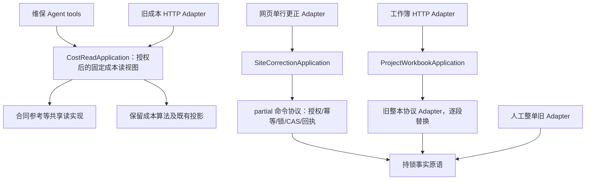

# 方案 C：按常用流程提供 Application Facade，以兼容 Adapter 逐个替换旧入口

> 口径时效更正（2026-10-23）：以下是独立设计备选。业务规则须以[近15天口径台账](recent-policy-baseline.md)为准；文中“保留/冻结/继续”描述不得把旧代码或旧文件升级为当前业务授权，未重申的历史条款待核。

> 综合稿说明：本文件保留独立备选方案，未来的 fresh 授权、Session 所有权和接口类型不是当前已实现状态。近期实施以[总体设计](../maintenance-refactor-design.md)及[批次计划](migration-and-acceptance.md)为准；尤其 V2 全面锁后重新鉴权尚需 R3 调查，不从本方案流程示意推断现状。

状态：设计备选，仅文档。基线 `fa97e2490f480336e29f51c84bfdaac3ee4f12fe`，main `7a9fd20`。没有修改业务代码，没有把下面的接口当作已实现。

## 1. 选择的形状

C 从调用方的完整任务出发：一次「读维保成本」、一次「更正已有领用行」、一次「应用整本工作簿」各有一个应用入口。入口内部收拢授权调用时机、事务完成、兼容回执和错误转换前的业务结果，调用方不用按约定拼接多个低层步骤。不会建拥有所有领域方法的 `MaintenanceManager`。

与 A 的区别不是把函数改成 class。A 将稳定领域函数暴露给各调用方，由调用方组合；C 要求业务流程的对外调用者只调用一个应用用例，并逐步把现有 HTTP 层的业务编排移到该应用用例。与 B 的区别是 C 不定义通用 `execute(capability, plan)`，不建立全局注册执行引擎；每个用例仍有可搜索的显式控制流。



读与写在不同 Python 模块；`application/__init__.py` 不聚合导入。Agent 只允许导入读模块。不能通过一个总 facade import 把工作簿写模块重新带进只读请求。

## 2. 真实调用者及必须保留的差异

| 当前事实 | 定位 | 设计约束 |
| --- | --- | --- |
| 合同参考含当前台账与XSDD回退、shared/incomplete | `maintenance_boss_board.py:1728` `_card_contracts`；函数延续到1987前 | 不能改成只取某合同amount；缺失、重复、共用合同都不能默认为0或变成项目利润 |
| 四组外部调用者借用老板看板私有读取 | `maintenance_cost.py:1243`；`maintenance_project_master_workbook.py:80,347`；`maintenance_project_workbook_v3.py:42,400`；`maintenance_manager_workbook_adapter.py:41,539` | 读实现要真实迁出，不是新facade再次调用旧私有函数 |
| 采购成本权和合同/预算权独立 | `maintenance_boss_board.py:219,228`；`security.py:272,281` | `data_purchase_cost` 不能替代 `data_profit`；隐金额排序、状态过滤、枚举不得侧漏 |
| 当前Agent三维保工具对应旧成本视图 | `agent/maintenance_tools.py:58,108,148`；`maintenance_cost.py:1094,1623,1721` | 旧项目名输入不改成稳定project_id；18个schema及顺序保持；新增稳定项目能力另有接口 |
| partial correction自行加锁、CAS、回执，最后只flush | `maintenance_site_issue_line_correction.py:87-197` | commit目前由API做；不能把它误称已有独立事务 |
| partial授权在查到归属后、锁内身份复检后、锁明细后调用 | 同文件`:106,118,154` | 应用入口必须保留这些调用时点；不是只有入口时检查一次 |
| manual先规范化行并计算旧指纹，再取幂等锁 | `maintenance_manual_site_issue.py:573-638` | 不和partial共用新规范化DTO；不重算旧幂等指纹、不吞未提供与显式null差异 |
| 公共fact primitive不拥有commit、回执、revision和生命周期 | `maintenance_site_issue_facts.py:202-220` | 工作簿可以调用原语，不能调用会提交的网页应用入口 |
| 工作簿服务已有唯一整本commit | `maintenance_project_master_workbook.py:6289,6327`及末尾commit | 过渡facade不再包begin/commit；以后一次搬完整事务所有权 |
| 工作簿回执重放先检查当前合同金额管理资格 | `api/maintenance_project_master_workbook.py:844-862` | 已成功过不代表现在仍能拿金额回执；不能缓存旧许可 |
| 工作簿apply HTTP有「初次查回执→validate失败再查→validate后再查」 | 同文件`:865-953` | 不精简为一轮查回执；并发首次提交可能恰好在validate时完成 |

## 3. 候选外部接口

下面是形状草案，类型名称是设计用语；请求和响应的wire字段不变。DTO不能从模型输入构造权限，也不能用dataclass默认值吞掉字段缺省。

```python
class CostReadApplication:
    def __init__(self, db: Session, user: UserContext): ...
    def board(self, query: LegacyBoardQuery) -> LegacyBoardPayload: ...
    def projects(self, query: LegacyProjectCostQuery) -> LegacyProjectCostsPayload: ...
    def lines(self, query: LegacyProjectLinesQuery) -> LegacyProjectLinesPayload: ...

class SiteCorrectionApplication:
    def __init__(self, db: Session, identity: RequestIdentity): ...
    def correct_line(self, request: ExistingLineCorrection) -> LegacyLineReceipt: ...
    def correct_header(self, request: ExistingHeaderCorrection) -> LegacyHeaderReceipt: ...

class ProjectWorkbookApplication:
    def __init__(self, db: Session, identity: RequestIdentity): ...
    def preview_upload(self, request: WorkbookUpload) -> LegacyWorkbookPreview: ...
    def apply_upload(self, request: WorkbookUpload) -> LegacyWorkbookReceipt: ...
```

`LegacyProjectCostQuery`保留当前date_from/date_to/q/lifecycle/as_of组合；Agent只传它已有的q，top正数裁剪和面向模型的提示仍在工具Adapter。`LegacyProjectLinesQuery`保留project_name/month/page/page_size，不能悄悄转义为稳定项目身份。对外读方法负责执行当前scope/field规则，低层`read_contract_references`只读事实，不拥有权限；不能因为抽纯读而把授权移到金额过滤之后。

`ExistingLineCorrection`保留issue_id、issue_line_id、expected_issue_version、expected_line_version、changes、reason、idempotency_key；`changes`保存「键不存在」「显式null」「0」「false」的原始差异。`ExistingHeaderCorrection`独立类型，不带line_version。manual整单协议另保留legacy adapter，不能通过加一个`mode`参数塞进这两个类型。

`WorkbookUpload`保存原始bytes、project_id、force_takeover、site_issue_merge_token；SHA和操作键按旧协议生成。`RequestIdentity`是HTTP认证产生的现有ident与UserContext组合，不是客户端提交的角色；具体operator仍按原入口分支解析（项目备注、合同金额修改不能被统一actor字段掩盖）。

## 4. 调用示例

### 示例一：现有 Agent 项目成本工具

```python
# 既有catalog.register声明逐字保持；这里只替换handler内部依赖。
reader = CostReadApplication(db, ctx)
payload = reader.projects(LegacyProjectCostQuery(q=args.get("q")))
# 以下仍保留原工具的top裁剪、ranking_restricted提示、JSON错误回灌契约。
return legacy_agent_project_response(payload, args)
```

这是目标调用形状，不能把`legacy_agent_project_response`当作额外应立即创建的纯转发函数。真正实现可保留原handler的数行裁剪代码。现有工具错误必须仍是既有安全`{"error": ...}`：读入口用具体领域异常，工具Adapter精确映射页面/受限销售拒绝文案，不能让它掉进通用internal错误。HTTP Adapter则映射原HTTP状态及detail，不用一套错误字典通吃两种入口。

### 示例二：整本工作簿应用

```python
request = WorkbookUpload(
    project_id=project_id, data=uploaded_bytes,
    force_takeover=force_takeover, site_issue_merge_token=merge_token,
)
app = ProjectWorkbookApplication(db, RequestIdentity(ident, ctx))
result = app.apply_upload(request)
return existing_workbook_http_response(result)
```

`apply_upload`封装的是回执前置查询、预检竞态重放、金额特殊权限、合并确认、锁内复核、整个结果回执。HTTP仍负责multipart读取/限流/状态映射、访问日志；不再自行拼这套业务顺序。过渡阶段最后一步仍调用旧`master.apply_project_master_v2`完成唯一commit；HTTP与facade均不得再commit。

### 示例三：已有行更正

```python
app = SiteCorrectionApplication(db, RequestIdentity(ident, ctx))
result = app.correct_line(ExistingLineCorrection.from_existing_body(body))
return existing_line_http_response(result)
```

迁移前API持有commit；迁移这条完整用例后，由`correct_line`在成功完成原命令和回执flush后commit一次，异常rollback，API不再commit。工作簿永不调用`correct_line`，继续调用持锁fact primitive。

### 逐变量表

| 变量/参数 | 类型 | 用途 | 为什么这样定义 |
| --- | --- | --- | --- |
| db | Session | 现有请求拥有的数据库会话 | 初期避免替换依赖注入；一个用例只用一个Session，不创建隐形第二事务 |
| ctx / user | UserContext | 服务器生成的读权限 | 模型参数不能声明角色，data_profit与成本门分开 |
| ident | 现有认证身份dict | 原操作者规则的输入 | 保持实名及特殊权限分支，不以角色名字代身份 |
| identity | RequestIdentity | ident与ctx的只读组合 | 仅移交已认证上下文，不成为权限缓存 |
| reader / app | 相应Application对象 | 当前请求的完整用例入口 | 不做进程全局单例，不共享Session或可变请求状态 |
| query | Legacy读条件类型 | 旧视图的过滤条件 | 保持当前名称身份、时间和生命周期语义 |
| payload / result | 对应Legacy payload/receipt | 旧调用方的稳定返回契约 | 不顺手加统一成功包裹或改回执字段 |
| args | dict | 现有模型工具参数 | 保持18个外部schema，按工具现有逻辑校验 |
| request | ExistingCorrection或WorkbookUpload | 本次业务意图 | 分开协议，不把所有写动作变成type+任意dict |
| changes | Mapping[str, object] | partial原始变更字段 | 缺省不变、null清除、0/false有效，不能通用清洗 |
| uploaded_bytes / data | bytes | 原始工作簿 | 文件hash、签名和首回执依赖原bytes，不重新序列化 |
| project_id | str | 稳定项目身份 | 工作簿/更正使用稳定身份，不从项目名猜归属 |
| force_takeover | bool | 已有显式冲突接管意图 | 保留原授权及逐项留痕，不能自动接管 |
| merge_token | str | 原有领用单合并确认绑定 | 原生成/校验算法保留，不当普通幂等键 |
| body | 现有HTTP请求模型 | 旧路由入参 | `from_existing_body`必须保留fields_set，不能把缺省变null |

## 5. 锁、授权与提交归属

「集中」是同一协议只有一个负责者，不是所有协议只用一把锁或一个事务类。

- **read**：CostReadApplication调用当前服务前执行页门；当前服务内部保证行范围、金额可见性及排序/过滤语义。没有commit。仅以项目范围授权不能推导利润权。共享合同判断允许读取判断完整性所需的全局事实，但返回仍限调用方范围；不得误把全局shared判定改成范围内唯一。
- **partial correction**：当前`api/maintenance_project_operations.py:1925-1961`的authorize会重读SysUser、核验token_version并重算page/action/cost/project scope，必须把这整个当前账号守卫一起迁移，不能换成构造facade时缓存一次ctx。保留当前授权→幂等锁→workbook state→project→issue→line锁及归属/CAS复核。授权调用时点和指纹字段顺序按既有协议迁移，不把它们统一成「先compile plan」。事实写入后由原协议追加事件、回执和revision；应用用例最终commit一次。
- **manual**：维持自身预规范化、旧指纹、回执及版本递增次数。未迁移时仍由旧HTTP入口commit；不让partial facade代理整单manual命令。
- **workbook**：保留global data-change advisory→XSDD身份→全部workbook states排序→project/source/assignment/detail的原有包络与锁内复核。不能只锁本项目，跨归属可能触及旧项目state。预读只用于形成完整锁集合，锁内发现新的更早身份/项目时回滚并重新预检，不持锁追加逆序锁。
- **锁后新鲜性**：保持`master:6360`附近全局锁后且尚无待写修改时的一次`expire_all`，防validate期间identity map旧值冒充锁内新鲜值；写阶段不得加通用refresh/expire/populate_existing hook，否则会覆盖未flush的数量/人工成本。
- **所有写者共同约束**：`master:5467-5494`的05实收回款守卫依赖五类写者至少被global/state/project之一阻挡。必须记录`create_collection`、`update_collection`、`expense_collection_workbook.apply`、project identity归并、`apply_exact_collection_dedupe`的写者×共享事实×锁矩阵，最后一项不拿state锁。抽facade或增加新writer时必须验证矩阵，单测当前facade的锁调用不够。
- **整本的事实原语**：只接收已验证且持锁的事实；不得获取事务终结权、单独写命令回执或独立提交。现有bump在同一根SessionTransaction最多一次的语义保留（operations:356-385）。
- **过渡拥有者**：WorkbookFacade委托LegacyWorkbookAdapter期间，旧master仍是唯一commit拥有者。Facade不得用`with db.begin()`或`begin_nested()`包旧服务；SQLAlchemy 2.0的Session.commit不能当作只提交内层savepoint。只有整条用例连同旧commit与错误rollback一次迁移完毕，才转移事务拥有者。
- **Session前置条件**：调用应用写入口时，不得携带该用例之外的未提交业务写。认证的只读查询可能已autobegin，因此不能凭`in_transaction()`就报错；先用现有API测试证明请求没有未提交业务修改，再决定是否增加防误用断言。

## 6. Strangler批次与是否真正改善

### C0：协议特征测试，零业务改动

冻结18个Agent schema、顺序和权限输出；建四个合同读caller的shared/incomplete/ledger优先/回退税归一结果对照；分别冻结manual、partial、workbook的旧指纹输入、首回执、重放、版本递增和提交者。记录当前依赖图与fresh-process加载模块。

此阶段没有运行架构改善；只降低后续变更的不确定性。

### C1：先真实迁出合同读取，再建立读入口

抽`maintenance_contract_references.read_contract_references`，把旧`_card_contracts`实现和其必要私有读取依赖整体移到中立模块。四组外部caller直接改公共路径；boss旧名只作为兼容别名。旧语义与输出完全保持。

CostReadApplication初次接入只承担明确页门和旧读模型调用；如果它只是原函数的一行转发，删除测试失败，应延后这个facade，先保留A的公共函数。只有它把Agent/HTTP共享的查询授权顺序及投影约束真正集中，并完成调用方行为测试，才算有depth。

验收：新公共read的AST传递依赖与fresh-process均不得经过boss board、工作簿渲染/应用或HTTP；仅文件名变短不算收益。成本读本身可能仍有其他复杂依赖，报告实际减少的路径，不宣称全Agent加载优化。

### C2：迁移一条最常用partial更正用例

只迁existing-line correction，整条HTTP业务编排及commit转交SiteCorrectionApplication，原helper逐步成为内部协议Adapter。HTTP状态/文案/回执不变。Header与manual暂留原路径。

验收：前后同请求同回执；同key异请求冲突；旧成功回执在后续合并移动明细后仍可重放；授权先后时点保留；失败无facts/events/audit/receipt/revision残留；No-op版本行为与现状相同；并发更正与workbook互斥顺序无倒置。真实PostgreSQL测，mock不能证明锁和回滚。

此阶段收益是HTTP不再承载部分业务事务编排；公共fact primitive没有变成万能命令。若该用例只有一个caller且编排并不重复，可延后，不为统一文件形状而迁移。

### C3：工作簿应用先搬入口编排，后搬事务拥有者

先将HTTP中的回执重查、权限和验证串联移到ProjectWorkbookApplication，保留legacy master完成全事务。此时工作簿核心依赖及复杂度尚未降低，必须直说。随后按真实变更热点提取sheet解析/展示codec，但保持原MasterV2Plan字段、锁包络与apply调度。

后续需要完整迁移应用事务时，连同锁内复检、所有sheet写入、回执及唯一commit作为一批移动；不把某sheet变成能独立commit的插件。每抽完一个真实片段，旧调用点只做compat re-export，不长期保留新旧双向调用。

验收：一张sheet故障全本回滚；上传ACK丢失仍返回首回执；验证期事实变化锁内拒绝；合同权限变动后重放仍复核；跨项目归属锁包络完整；重复上传不多增revision/重复义务；原sheet缺行作废和三路合并含义不变。

### C4：以实际caller删除过渡Adapter

只有旧入口内部实现全部转到公共能力且所有调用者已迁移，才删除LegacyAdapter。新入口→旧巨型函数→新入口的反向环路为禁止项。保留对外路径不等于保留两份业务实现。

## 7. Agent、skills与自动规则

1. Agent仍只通过ToolCatalog注册已审核同步只读工具；18个旧schema/顺序golden冻结。新增工具调用`application/maintenance_*queries`或明确公共读服务，不导入写应用/Workbook/HTTP；catalog不会授予权限。
2. `skills.py`只写任务说明，不能作为授权引擎。新剧本可以组合已有读工具，不得通过提示词调用写facade；剧本权限与执行期权限均保留。对真实任务增加held-out评估后再声称工具更好用。
3. AGENTS短规则说明「读写分模块、旧协议不统一、提交只有一个owner、Agent只读」，详细矩阵链接架构文档；不把几千行流程贴进AGENTS。
4. architecture tests检查传递依赖，禁止queries→boss/Workbook/API、facts→application/Workbook/API、Agent→写application；兼容别名允许反方向旧入口→公共模块。运行期local imports另用fresh process验证。
5. 协议测试走公共用例+真实DB，不仅断言调用某helper次数。schema snapshot只证明对外描述不变；它不证明权限、锁或模型实际使用效果。

## 8. 反例及与A/B的取舍

C的最大风险是形成第二个“大管家”：所有新功能都改一个facade，反而扩大冲突面。因此只按真实常用流程建独立应用模块；新增不相关查询加新的查询用例模块，不修改统一switch、registry或runtime。真正改了业务语义的功能仍必须修改对应核心，不能承诺核心永不改动。

A最适合近期先做合同读与需求归属这些真实小seam。C可以配合A安排caller迁移，但「A函数加一层C包装」本身不算新收益：如果权限裁剪原封留在各caller、transitive import仍到巨型模块、事务还是散在HTTP，则应删去包装、保留A。

B可以在多个纯sheet codec已经有一致输入输出之后做静态组合。当前不宜以通用capability engine接管锁、回执、授权。immutable plan也不会自动解决数据库事实变化；frozen dataclass包含dict仍可变，且它不该重写manual预规范化与旧fingerprint。

已经向A/B发出的反例：金额权不能从项目范围推出；partial与manual不能统一；旧项目state遗漏必须重编译完整包络；金额回执重放要按当前权限复核；包装旧Workbook再commit会破坏事务。A已明确partial独立、纯读不授予权限；B确认两套不同写事务协议并反对半迁移提交者。最终建议是A先实施真实读seam，C只在能集中完整业务编排时接入，B暂限纯codec的静态组合。

## 9. 原始方法依据

- [Matt Pocock：Design It Twice 对应设计 discipline](https://github.com/mattpocock/skills/blob/main/skills/engineering/codebase-design/SKILL.md)：小接口隐藏真实行为；删除测试判断Facade是否只是多一跳。已在上阶段核验原作者blob `3f63c8146dd2604b419c929e9876b90c30d410e9`，本阶段读本机`design-an-interface/SKILL.md`按三种不同约束设计，不安装skill。
- [Martin Fowler：Service Layer](https://martinfowler.com/eaaCatalog/serviceLayer.html)：应用用例入口协调操作与事务；这是C把HTTP业务编排集中起来的依据，不等于所有流程共用一套事务。
- [Martin Fowler：Strangler Fig Application](https://martinfowler.com/bliki/StranglerFigApplication.html)：以可替换seam逐段替换，允许有明确退出路径的过渡架构；因此每个LegacyAdapter都必须有删除条件。
- [SQLAlchemy 官方事务文档](https://docs.sqlalchemy.org/en/20/orm/session_transaction.html#nested-transaction)：2.0的Session.commit结束最外层事务，begin_nested还会无条件flush待写状态；所以不把savepoint当成包住旧commit的隔离墙。
- [Cosmic Python 原作者：Unit of Work](https://www.cosmicpython.com/book/chapter_06_uow)：将原子操作与提交/回滚责任放在明确边界，退出失败需回滚。这里借鉴所有权思想，不直接引入该书的Repository/MessageBus体系，也不以假UoW替代真实PostgreSQL锁测试。

这些是方法依据，不是本项目已经验证方案C正确的证明；实施前必须按各批次实际caller与协议回归验收。
