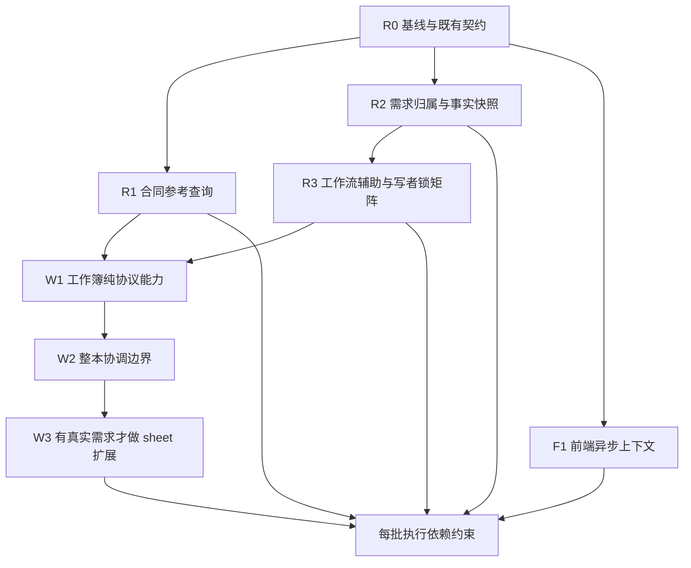

# 维保重构的实施批次与验收

配套 [总体设计](../maintenance-refactor-design.md)。本文是待实施计划；所有新测试名称、目标模块和未来退出条件均为提议，不表示已经执行或通过。代码证据基于 `fa97e2490f480336e29f51c84bfdaac3ee4f12fe`；实施时重新 fetch main，并核对 #451 是否已经合入及是否有并行变更。

**用户最新约束优先**：每批先读取[近 15 天口径台账](recent-policy-baseline.md)。下文“保持/冻结旧行为”只表示不夹带未说明的语义变更，不能据旧实现否决近期更正。已被替代的旧断言应先按最新口径更正；只有代码证据的行为标为现状观察，不能升级成业务验收标准。

## 批次依赖与工作分工

每个节点是一个可独立回退的逻辑批次，允许拆为更小 PR；不是把所有节点一次放进大 PR。R1/R2/F1 可分别调查，但不得并行修改 master、operations 或公共测试夹具。根协调者锁定各批文件所有者，另一代理独立复核业务契约，第三代理尝试构造反例。现有文档中的旧交付状态不能当作当前 CI 证据。

## R0：固定基线与行为契约

输入：最新 main、#451 精确提交、用户最新更正、近 15 天 `docs/decisions/` / `CONTEXT.md` / 契约的实际条款变更、现有测试和调用者清单。核验以提交 diff、条款内容和替代关系为准，不以文件最后修改时间为准；同一窗口内也以最后的明确修订为准。

产出：该批实际基线 SHA、变更模块范围、受影响入口、已存在/需新增测试列表。#451 未合并时不能在 main 分支直接假设公共 errors/access 已存在；选择等待该依赖或明确重做所需小提取，不能无声明地复制候选代码。

与该批相关的未合决策分支也进入 R0：特别是 #430 的字段保护目标、#440 的完整恢复目标及 #449 的登记人口径。它们的业务证据、代码集成和暂停状态分别记录，不因尚未合并而忽略，也不自动恢复实施。

原样搬函数之前先记录返回形状、缺省值、异常类 identity、SQL范围、日期、排序和提交行为。差分验证以固定种子和冻结业务日期进行；当前 `_card_contracts` 多处调用 `business_today()` 的行为也先保留，统一取一次日期属于单独改动。

退出：同时能回答“最新口径要求什么”“当前调用者实际做什么”“二者是否冲突”和“失败时谁回滚”。更早且没有近期重申的业务条款不得成为硬约束；相关语义变更待核，其余不依赖该争议的结构工作可以继续。

## R1：合同参考读取

**改动文件与动作**：

- 新增 `backend/app/services/maintenance_contract_reference.py`，原样迁移 `boss_board._card_contracts` 及必要查询依赖，公共名为 `current_contract_references`；旧私有名保留兼容别名。
- `maintenance_boss_board.py` 的卡墙、筛选与回款统计改用公共实现。
- `maintenance_cost.py`、`maintenance_project_master_workbook.py`、`maintenance_project_workbook_v3.py`、`maintenance_manager_workbook_adapter.py` 改 import；调用后现有策略保持原位。
- 不修改合同表、迁移、金额权限、缓存、历史数据或成本算法。

**测试矩阵**：

| 输入/场景 | 公共读取保持 | 消费者必须保持 |
| --- | --- | --- |
| 当前生效、mapped、included 完整台账 | 同一批量结果 | 各入口原有金额和比率 |
| 未计入合同、未映射、部分缺额 | 原 incomplete 与已知小计 | master/V3/cost/月表按原规则掩码 |
| 同项目重复稳定 ID/合同号 | 冲突及未知金额 | 不显示伪精确总额 |
| 跨项目共享；第二项目不在本页 | 全局 shared 检测 | 不按本页误判独占，不输出其他项目身份 |
| 无当前台账；成功/失败/错类型销售批次 | 仅原合法 XSDD fallback | V3 不被 fallback 冒充台账 |
| 同销售单多个有效候选经济值冲突 | 金额未知与冲突标志 | 不取最近一条或均值掩盖冲突 |
| 台账完整 0；fallback 0/负数 | 分别保持原行为 | 不能以 truthiness 共用默认值 |
| 空项目集合、无关联单号 | 原缺键/空映射 | 不回退全库 |
| 受限销售、无利润权 | 不新增 canonical 读取通道 | 原权限、字段、筛选/count边界 |
| cost 历史窗口与当前业务日不同 | 保留各自现有日期用途 | 不擅自统一为 `as_of` |

**现有回归入口**：`test_maintenance_boss_board_api.py`、`test_maintenance_cost.py`、`test_maintenance_project_master_workbook.py`、`test_maintenance_project_master_v2_editable.py`、`test_maintenance_project_workbook_v3.py`、`test_maintenance_manager_workbook_v3_adapter.py`、`test_maintenance_manager_workbooks_api.py`。按上述场景选择用例，缺口才新增，不写“函数搬到新文件所以存在”的镜像测试。

**退出**：先完成逐条时效核对；已确认契约下旧/新结果一致，待核语义只记录兼容现状；若旧测试与最新明确口径冲突，单列纠偏后再重构。查询数不随项目数线性增加；新模块不直接或传递依赖 boss/cost/workbook/API；消费者不再因这条引用依赖 boss_board。不能保证它们所有其他依赖也同时消失，应报告实际最短剩余路径。

**回退**：无数据结构变更，可 revert 该批提交恢复旧 import 与实现；迁移期不删除旧别名。不得同时保留两份可分别修改的业务算法。

## R2：需求归属与事实快照

建议分两个小 PR：R2a 先解 manual↔facts，R2b 再解 facts→operations 的表示与异常依赖。

**R2a**：新增 `maintenance_demand_project_reference.py`，用 `demand_has_active_project_assignment` 返回既有 SQL 是否存在匹配。`manual._resolve_demand_project` 转为兼容 wrapper；`facts._validated_changes` 直接调用公共查询，保持各自异常码、文案及必要 cause。

这个接口按当前实现只验证“需求单有本项目活跃挂靠”。近期编辑契约也采用活跃归属语义；但这不等于额外批准所有非生效来源的业务场景。目前未检查源单生效、墓碑、明细有效性，纯提取不夹带新过滤；是否加强校验必须先比对近期具体条款。默认局部命令遵循近期省略/清空/null 契约；旧 manual 完整命令与 V1/V2 分别保留自身归一化、签名及指纹，公共挂靠查询不处理字段意图。存在性不是授权证明，权限仍由命令复查。

**R2b**：从 `maintenance_project_operations.site_issue_line_dict` 提取既有事实表示，旧函数重导出。事实审计沿用同一表示加 `is_active`，不统一为面向客户端的脱敏 DTO。若为移除余下依赖迁移 `MaintenanceOperationError`，迁同一个类并兼容重导出，不能建同名新类或扩大 HTTP 映射范围。

**必测反例**：缺需求、非本项目、已失活挂靠、源单非生效但挂靠仍活跃、空白/显式清空/未提供、同批一个非法意图与一个合法意图（任何赋值前整体拒绝）。事实表示验证 Decimal、日期、版本、成本证据和隐藏字段与旧快照相等；不允许由审计快照直接 HTTP 输出。

复用 `test_maintenance_site_issue_facts.py`、`test_maintenance_site_issue_facts_errors.py`、`test_maintenance_site_issue_facts_compatibility.py`、`test_manual_site_issue_api.py`、`test_site_issue_line_correction_api.py`。

**退出**：manual/facts 双向边消除；facts 到 operations 的具体依赖逐项报告（包括传递路径）；no-op 零事实事件、PN 成本失效、单头修改全有效行重估、旧 manual 版本次数与审计条数不漂移。不要把 SCC 少两个节点当作“所有循环已消失”。

**回退**：无迁移、无历史回填，revert 对应小 PR。旧名字继续可导入，旧异常对象 identity 不变。

## R3：事务辅助与写者锁矩阵

第一批只迁出重复且已被多个命令使用的 state/project 锁与 revision helper、幂等身份 helper；可以继续使用明确函数，不引入 Session wrapper。各命令当前 commit/rollback 所有者保持。`correct_site_issue_line/header` 已有独立文件，不为目录整齐改名或重包。

独立调查项：V2 的通用编辑/项目/金额检查主要在 HTTP 入口，锁内只在归属变更等具体分支复核；不等同于网页 correction 的锁后重读 SysUser/token_version。先列权限读取时点，再模拟预检或等待写锁期间权限变化、随后首次应用/回执重放的实际行为。不能把“全面锁后当前授权”当作已通过的旧契约。若发现缺口，单独修复并补行为测试后再搬相关授权编排，避免重构与权限行为改进混成一个难审查差异。

必须先列出共享事实的全部 writer。05 回款快照至少包含以下已识别点，实施时通过 ORM 属性赋值、SQL update/delete、bulk 写入和调用链再次核对，不能把这份名单当作永久完整：

| writer | 当前保护线索 | 对应竞争者 |
| --- | --- | --- |
| `operations.create_collection` | workbook state 锁 | V2 快照复核/应用 |
| `operations.update_collection` | workbook state 锁 | V2 快照复核/应用 |
| `expense_collection_workbook.apply` | workbook state 锁 | V2 快照复核/应用 |
| `project_identity` 归并 | DATA_CHANGE 与 states | V2 应用/项目身份变更 |
| `project_identity.apply_exact_collection_dedupe` | DATA_CHANGE 与 project；没有 state 锁 | V2 快照复核/应用 |

矩阵列出每个 writer 的入口、受影响表/身份、锁模式、锁先后、锁后读取与提交点。新增 writer 必须纳入矩阵，不能单靠“sheet 声明资源”判断正确。

**真实数据库验收**：两独立 Session，用事件/屏障控制 T1 在持锁点暂停，T2 发起竞争；确认 T2 等待后读取新状态或按既有协议拒绝，而非使用旧快照。有限超时仅作失败上界，不能以 sleep 猜测交错。覆盖网页/Excel、归并/Excel、dedupe/Excel、同幂等并发、单头更正/同行更正；在事实后、审计后、回执保存点注入失败验证原子性。

复用 `test_maintenance_master_v2_lock_freshness.py`、`test_maintenance_master_v2_original_receipt.py`、`test_master_workbook_stale_replay.py`、`test_site_issue_line_correction_api.py`，补缺少 writer 的竞争情形。返还容量继续用 `test_return_receipt_scope_concurrency.py`、`test_return_receipt_capacity.py`、`test_return_receipt_capacity_import.py` 验证自身协议，不强行改为工作簿锁前缀。

**退出**：无锁顺序改变、无提前 commit、无新增授权捷径；`bump` 仍按既有根事务/项目规则去重；同事务不同实际操作的业务审计不能被去重吞掉。

**暂缓选项**：A/C 提出的最终应用 facade 自持 Session，只有需要第二个非 HTTP 人工调用者、且能整体迁移当前账号复验及 API commit 时才进入单独 PR。当前并没有必要为了形式一致移动 Session 所有权。迁移时必须让新命令重新加载权威账号，不能接管已有脏事务、拿旧 ORM 身份，或用 savepoint 包住会 commit 的旧实现。

## F1：前端异步上下文和能力呈现

从 #451 已验证的 `AcceptanceTab.tsx` 出发，先挑第二个有相同“预检→确认→写入→读回”生命周期的真实组件，记录其取消、卸载、换项目/账号行为；选择前不创建通用 hook。

候选 hook 只负责 generation/seq/确认回调有效性，不内置领域 API、分页或数据合并。账号切换与同账号请求乱序是两个维度；项目 A→B→A 也必须视作新世代。AbortController 可以减少无用请求，不能撤销已提交的服务器写入。

**必测反例**：A 预检迟到后切 B；旧确认按钮回调仍存活；apply 进行中切项目；卸载后 resolve；同项目第二次预检覆盖写后读回；服务端已成功但 readback 失败；账号切换；顺序颠倒的筛选请求。保持原成功/失败通知和刷新屏障。

复用 `AcceptanceTabLifecycle.test.tsx`、`MaintenanceProjectPanelPage.test.tsx`、所选第二组件测试；变更后运行类型检查与构建。用户真实点按验收单列，代理测试不能代替。

能力显隐改善另开小批次：按 D-33 近期明确续存的权限做准确呈现。负责人工作簿例外、`data_profit`、采购成本不能合并成 `canViewMoney`。D-0024 的含结束日 7 个上海日历日估价样本窗口（不限制统计区间）、单位分桶与未知金额与 D-0025 的 Top40、登记人筛选各守自己的合同；不得把 RKD 的 `rkd_import` 默认归为批次 `applied_by`。卡墙候选空页及 dashboard/page loaders 属当前兼容观察，保守迁移，不把旧实现认作新的永久业务规则。

## W1：先拆纯协议，保留整本事务

前置 R1/R3；R2 提供可直接复用的事实原语底座。从 master 中提取已经具有独立输入输出的 plan 类型、单元格规范化、签名与身份解析、序列化。建议目录为 `services/maintenance_workbook/`，只在确有第二个模块时创建；旧 import 保留兼容出口。

目标协议还须表达 D-34 Q1/Q3 的解除基准与保护周期证据，并保持来源观察值独立。当前 main/#451 尚无 #430 候选的完整目标，不能给现有 `MasterV2Plan` 换个文件位置就声称已支持。纯提取可以独立进行；目标能力的引入须单列行为改动、旧簿兼容及相关存储/协议回退，不能在“零语义变化”批次夹带完成。#430 仍暂停。

`MasterV2Plan` 的 nested dict/list 不因外层 `frozen=True` 自动冻结。若引入不可变叶子，应作为独立小批次，证明序列化、字段存在性、顺序、Decimal 与日期不变；不能连带重新生成历史指纹或更改签名载荷。现有代码若需要受控变更计划，先标出使用点，再决定冻结哪些字段，不能机械替换容器。

**验收**：原 V1/V2 文件、单 sheet、全六 sheet、多项目导出；签名篡改、未知版本/列/行身份；单元格空白、省略/null/值；删行作废与只读列；工作簿验证无业务写入。使用解压后的 workbook 语义或解析结果对比，ZIP 时间戳不同不等于协议变化。只有签名确实绑定的原始字节才要求字节相等。

## W2：隔离整本协议协调

把 V2 apply 的生命周期放到一个明确模块内，保持唯一 commit 所有者；HTTP 外层的当前授权、提前重放、validate 前后再次回执检查、合单 token 与金额资格不得遗漏。可先保留 HTTP 编排，只迁内部 coordinator；不强制同批收拢全部职责。

04/05 旧 `ec.apply(commit=False, bump_revision=False)` 暂留，随后再以独立接口替代布尔开关；必须先找全调用者并同时保持独立上传命令的提交行为。Excel 绝不调用自提交的网页命令来复用事实。

**组合验收**：

1. 01–06 真实多 sheet 修改；后段失败使前段事实、审计、operation、revision、回执全回滚。
2. 同一行数量与人工成本同时修改，不被写阶段刷新覆盖；日期/单号改动锁住全单有效行。
3. 改派旧/新 owner，费用 VOID 从服务端原事实取合同，合单引用按现有确认/锁协议处理。
4. 预检后事实或归属变化：在近期确认的规则范围内保留合法三路合并；D-02 旧文与 force_takeover 的待核差异单列。Q3 目标要求编辑字段的解除基准/保护周期漂移整本拒绝且不可接管，包含解除后重保护但值相同的情况；同周期仅来源变化、无关行和未触字段不因此拒绝。validate 与锁内 apply 都复验，不能用统一计划 hash 把所有服务端变化都判 stale。该目标尚未集成，不能冒称旧测试已覆盖。
5. 同文件 ACK 丢失后重传：仅 replay 标志变化；权限已撤销不能回执放行；历史缺快照仍只承诺防重复执行。
6. 保存首次回执失败的整个事务回滚；重试成功只留下一个既有命令身份。

复用 `test_maintenance_master_v2_original_receipt.py`、`test_maintenance_master_v2_row_merge.py`、`test_maintenance_master_v2_lock_freshness.py`、`test_master_workbook_issue_no_batch.py` 及 V1/V2、04/05、事实兼容测试。

**回退**：先要求零 schema/协议变化，使旧代码可以读取新代码生成的所有事实与回执。需要新增协议时单独设计读旧/写新与版本回退矩阵，不能承诺“revert 代码就够”。写路径不双执行，比较依靠隔离数据库种子分别运行。

## W3：有真实扩展需求才做 sheet 目录

选择两个实际相同协议的 codec，建立静态名称/版本映射。codec 不拿 Session、不保存幂等键、不控制写入顺序。先增加复用已有读取的只读 sheet 验证改动范围，再考虑同类写 sheet；新增事实域必须更新事务协议及锁闭包。

首个扩展 PR 记录实际修改的旧生产模块数、何处必须动核心、原测试仍覆盖哪些行为。没有真实新需求时停在 W2，不为了完成路线图造示例业务。

## 每批共同的完成与回退条件

- 业务口径未变；若有变化必须单列决策，不能用“重构”包住未授权业务调整。
- 精确 SHA 上定向回归通过，现有 CI 全绿，main 同步；跨模型独立复审依仓库规则另行完成。本次同模型三代理设计不替代它。
- 新公共模块有真实调用者；接口隐藏实际复杂性；不增加环或反向依赖。旧边界缩减用明确基线预算，不能给新增模块无上限豁免。
- 旧兼容出口仅单向转发，退出条件是所有内部 caller 迁完且相关契约通过；外部 HTTP/文件协议另有兼容期限，不能因内部查不到 import 就删除。
- 无数据迁移批次用 revert 回退；有新协议或迁移必须先写独立兼容/回退方案。发布与生产备份按近期 [BRANCH_POLICY](../../BRANCH_POLICY.md) 执行；不恢复旧 APPROVED/test 必经门槛，本计划不授权部署。

## 尚待调查而非实施阻塞全部工作

未来新增功能的真实分布、团队同时修改哪些文件、生产规模下查询计划/锁等待、所有晚阶段隐式锁及数据库触发器影响，目前无测量结论。它们限制“大型 registry 已值得投资”和“性能一定提高”的主张，不阻止 R1/R2 的明确行为保留提取。

需求关联是否应额外要求源单有效、XSDD fallback 零/负金额应如何表达、成本 `as_of` 与当前合同参考是否需统一，均不在重构中决定；当前行为仅作结构差分基线，不能升级为永久业务契约；有近期冲突证据时按最新口径单列纠偏。

完整恢复的近期目标纳入后续独立命令设计，不塞进 R2 局部编辑原语：仅依据确认回执证据精确逆转，并区分源状态恢复可见与实名恢复事实。#440 仍暂停；挂靠是否一并恢复、返还痕迹、来源重现与跨项目等细节先解决待决事项，再安排实现和验收。
