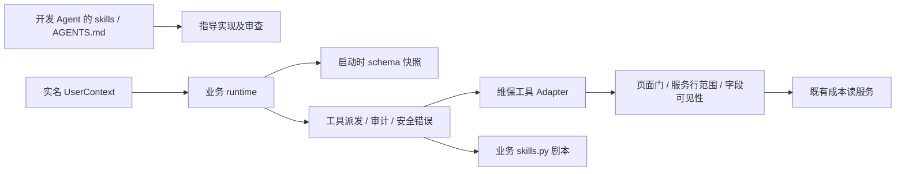

# Agent 工具、skills 与扩展机制独立调查

基线：`7a9fd20`，工作目录 `/tmp/itsp-maintenance-modularity`，审查对象是该基线上的未提交候选。先只读独立复核，根代理随后明确授权本审查者修正工具返回上限与注册校验；这些修改须由根代理作为作者之外的第二视角复核。

结论：显式 ToolCatalog 对「新增工具时少改中心模块」确有收益，不能将它描述为运行期插件隔离、权限自动化或整个维保模块解耦。18 个既有工具的名称、schema、说明及展示顺序保持；既有 22 个函数中 21 个函数 AST 与基线相同，唯一有意行为修正是维保项目 top 负数不再绕过 50 行上限。没有发现新增权限放行或业务写入口。

## 1. 主干与三种 skill 的区别

| 层 | 解决的问题 | 依赖 | 被谁调用 | 不承担的职责 |
| --- | --- | --- | --- | --- |
| 开发 skills / AGENTS.md | 指导编码、口径、测试和审查 | 仓库领域文档、决策、实际代码 | Codex 等开发代理 | 不会自动影响线上 Agent 权限 |
| `agent/skills.py` | 为复杂查询给按角色可见的打法 | 角色、页面门、字段门；剧本文本提到工具 | `list_skills/get_skill` | 不执行代码，不代表用户获得额外权限 |
| `ToolCatalog` | 将一个 schema 与一个 handler 一次绑定，显式组合家族 | 本地声明和同步 handler | tools 模块在启动阶段 export | 不扫描磁盘、不加载外部插件、不支持热注册、不做完整 JSON Schema 验证 |
| handler / 业务服务 | 把模型参数转成确定查询，执行真实授权及结果裁剪 | 服务器身份、业务数据和领域规则 | dispatch | 不能依赖模型遵守剧本完成授权 |

代码定位：`runtime.py:56,74-82` 每轮给 provider 发送当前全部 TOOLS 并执行 dispatch；`tools.py:474,538,541-557` 是家族组合、快照和通用派发。`skills.py:159-178` 发现与读取都会重新校验角色/页面/字段。因此「少改核心」的精确含义：同家族工具在 maintenance_tools 声明一次；新增家族在组合入口 include 一次；新增剧本仍在 SKILLS 一处添加。runtime 的循环、审计和错误处理不写工具名分支。它没有降低 Agent 导入全部业务依赖的开销，也没有减少模型每轮收到的工具数。

## 2. 原始来源与采用范围

| 来源 | 实际核验 | 可采用的工程方法 | 本仓取舍 |
| --- | --- | --- | --- |
| [Matt Pocock 架构调查原始 skill](https://github.com/mattpocock/skills/blob/main/skills/engineering/improve-codebase-architecture/SKILL.md) | GitHub connector 成功读全文；blob `44cc7d3136c44534d68ac523fa6cd37e759d2846` | 从用户范围和实际改动热点入手，YAGNI；用删除测试判断拆模块是否只是转发 | 只抽真实多调用者的 seam，不按行数平均拆文件 |
| [Matt Pocock 设计 discipline](https://github.com/mattpocock/skills/blob/main/skills/engineering/codebase-design/SKILL.md) | blob `3f63c8146dd2604b419c929e9876b90c30d410e9` | interface 包括错误、顺序、配置和性能约束；测试穿过调用者同一接口 | catalog 测试包括发现、派发、审计、回灌、坏声明；共享服务测试包括事务和权限 |
| [Matt Pocock 独立代码审查](https://github.com/mattpocock/skills/blob/main/skills/engineering/code-review/SKILL.md) | blob `373a4f26e6cfa3617778397945bb069d9cb184bc` | Standards 与 Spec 两条轴独立检查，避免「代码漂亮」掩盖目标缺失 | 本轮分别核对既有业务规则与可证伪的扩展收益；交叉探测竞态 |
| [Anthropic 工具设计](https://www.anthropic.com/research/writing-tools-for-agents) | 官方全文核验 | 从用户任务选工具，减少无关返回，评估真实任务结果与调用错误 | 保留清晰工具语义和返回上限；不把全部 HTTP 路由自动变成工具 |
| [MCP Tools 规范](https://modelcontextprotocol.io/specification/2025-11-25/server/tools) | 官方规范核验 | 描述/发现与执行权限不同；区分工具输入错误和服务内部失败 | 借鉴执行期验证原则；本系统仍是 OpenAI function 格式，没有声称符合 MCP wire protocol |
| [Agent Skills 规范](https://agentskills.io/specification) | 官方规范核验 | 元数据、正文和资源渐进载入 | 可借鉴文档组织；不能称当前 Python 字典剧本已实现该文件格式或插件生态 |

旧 GitHub 文件路径返回 404 后，读取 README 找到 `skills/engineering/...` 新路径，再成功读取源码。不是把网络失败伪装成核验，也没有安装第三方 skills。公开原作者当前约定使用 GLOSSARY；本仓明确 CONTEXT/decisions 为真值，因此保留本仓命名。

工具名约束来自当前安装 OpenAI SDK `types/shared/function_definition.py:12-16`：ASCII 字母、数字、下划线、连字符且最长 64。MCP 的命名规则不同，不能机械套用到本 provider。

## 3. 可证伪假设与实际验证

证据等级：E1 为源码/AST；E2 为可执行隔离试验（stub 业务或 provider，不调用真实模型）；E3 为真实 PostgreSQL 业务事务测试。此分级不表示 E2 能证明模型任务准确率。

| 假设 | 怎么推翻 | 结果与等级 |
| --- | --- | --- |
| H1：搬到 catalog 后既有工具说明或实现漂移 | 直接从 git HEAD 解析旧代码，并与候选 handler AST、TOOLS 列表逐项比较 | 初版 22/22 函数完全一致；最终仅 projects top 有意改变；18/18 schemas 含顺序一致，E1+E2 |
| H2：新增家族仍需改 runtime 才能发现/执行 | 使用真实 runtime.run，组合合成 family，仅 stub provider，两轮走工具返回 | 扩展工具出现在发送 schema，正确 dispatch，访问审计 action 正确，第二轮收到 JSON 结果，E2 |
| H3：移模块后页面门被漏接，服务先被访问 | 未授权 sales 对3个维保工具发请求，业务服务 stub 记录调用 | 3个均拒绝、业务 service 调用数0，E2 |
| H4：返回「最大50」是真上限 | 业务 stub 返回100行，分别调用 HEAD 和候选 top=-1 | 旧代码与初版候选均返回99行；修正后1行，E2。属于已存在的逻辑缺陷，本轮补修 |
| H5：注册层能拒绝不可执行声明 | 注册含空格/点号/Unicode/超长名字、非数组required、重复/不存在required和async handler | 初版接受部分坏声明，最终启动即拒绝；async callable/async generator也拒绝，E2 |
| H6：catalog 注册是启动快照 | export后再注册工具，观察旧TOOLS/dispatch和新export | 旧快照不变化，新export有新项，E2。明确不提供热注册 |

执行证据：`agent-probes.py` 与 `agent-probes-result.jsonl`；正式定向测试 `agent-hardening-green.txt` 最终 **32 passed in 70.41s**，使用根代理指定的独立 PostgreSQL 端口 55439 和每进程独立数据库。测试断言很快结束，随后数据库 cleanup checkpoint 等待；faulthandler 定位在 tests/run_isolation.py:725，根代理通过 pg_stat_activity 交叉确认。最终正常退出，不把等待记作代码死锁。红灯记录 `agent-hardening-red.txt` 中有旧行为的实际 FAIL，因清库等待时手动 SIGINT 干预，红灯那次最终 teardown 状态不能当干净基线成绩。

## 4. 本审查推动的具体修正

1. `maintenance_tools.py:111`：top 在转整数和默认值处理后收敛到1..50；负数不再使用 Python 负切片绕上限。None/0仍沿历史默认20、1..50合法值不变、超50仍50、非数字仍沿 dispatch 的固定安全错误。schema golden 未修改。
2. `tool_catalog.py:34-53`：在启动期检查当前 provider 可接受的名字、properties 对象及 required 数组/成员/唯一性。不是全 JSON Schema 验证，不新增框架。
3. `tool_catalog.py:55-64`：当前 dispatch 只执行同步 handler，异步函数/对象/生成器在注册时拒绝，避免把 coroutine 经 default=str 误回灌为工具成功。
4. `tool_catalog.py:80-84`：说明 export 是启动快照，新增模块必须在 export 前 include；运行时没有热加载承诺。

相关新用例位于 `test_agent_tool_catalog.py:78-147`。真实 runtime 闭环 probe 仍使用 stub provider，无 LLM key，不代表真实模型准确率提升。

## 5. 跨模块交叉审查

- 与 backend_review：共享 WorkbookError 只搬异常契约；独立 AST 核验除 docstring 外基类/构造完全同 HEAD；`legacy.WorkbookError is maintenance_errors.WorkbookError` 为真。旧 HTTP catch 能维持409/422语义，独立服务不再为了错误类型加载 Excel。真实冲突、rollback 与导入可达性试验由 backend_review 留证。
- 与 explore：确认 Catalog 不接管前端的刷新屏障或跨页变更信号。审查 AcceptanceTab 的项目、挂载、上传世代后提出反例：V0→apply成功→读回未完成→同项目新预检取代旧操作→新预检取消，旧响应被丢弃但V0残留。explore据此给 load增加旧数据失效，并分开 read ownership 与 operation ownership 的finally，再补回归。它比「所有await加同一判断」更精确。
- 修复后同项目旧load可结束自己的loading，不得结束新的load；项目ABA靠scopeEpoch识别；旧modal被销毁，旧onOk再被守卫；已经发出的后端写请求不被伪称撤销。前端实际浏览器验收由根代理说明，单元测试不代替用户点按。

## 6. 仍存在的限制与后续路径

| 后续场景 | 现在能做到 | 仍需明确的新增契约 |
| --- | --- | --- |
| 新维保只读工具 | 一个schema+handler登记，不动runtime/dispatch | 必须显式页面/行范围/字段门、返回上限、未知与零区分 |
| 新独立工具家族 | 新module + 组合入口include一次 | 静态审核、依赖不反向指向runtime，发布重启后生效 |
| 新业务剧本 | SKILLS一条记录，现有角色/page/field过滤 | 保持所引用工具存在；角色门不是额外授权 |
| 工具达到数十/数百 | 代码注册可扩展 | 每轮全量TOOLS会增加上下文；到真实任务出现选择错误时，再研究按权限发现与检索，执行时仍校验 |
| 新稳定项目/看板能力 | 可注册新查询Adapter | 不能把当前按project_std/项目名的旧成本工具悄悄重定向为稳定project_id看板；旧名称/数据含义属于兼容契约 |
| 异步/远程工具 | 目前明确拒绝async handler | 真有两个调用场景再设计异步dispatch、取消、超时、连接生命周期，不能只放开注册检查 |

尚未完成完整输入schema运行校验；runtime._parse_args把非法JSON降为空dict，未知参数由各handler处理。通用dispatch保持内部异常脱敏，但预期输入错误的文案细化还可改善模型自纠错。board没有统一token预算，项目汇总先查全量再裁top，也不因注册改造自动获得SQL分页或性能提升。权限、只读性与事务不可能仅靠一句skill说明或catalog元数据保证；后续新工具仍需按真实service接口做越权及副作用回归。

本轮应评价为「工具组装的一处有效 seam，加上发现的两类输入/声明缺陷修正」，而不是建成通用 Agent 平台。
