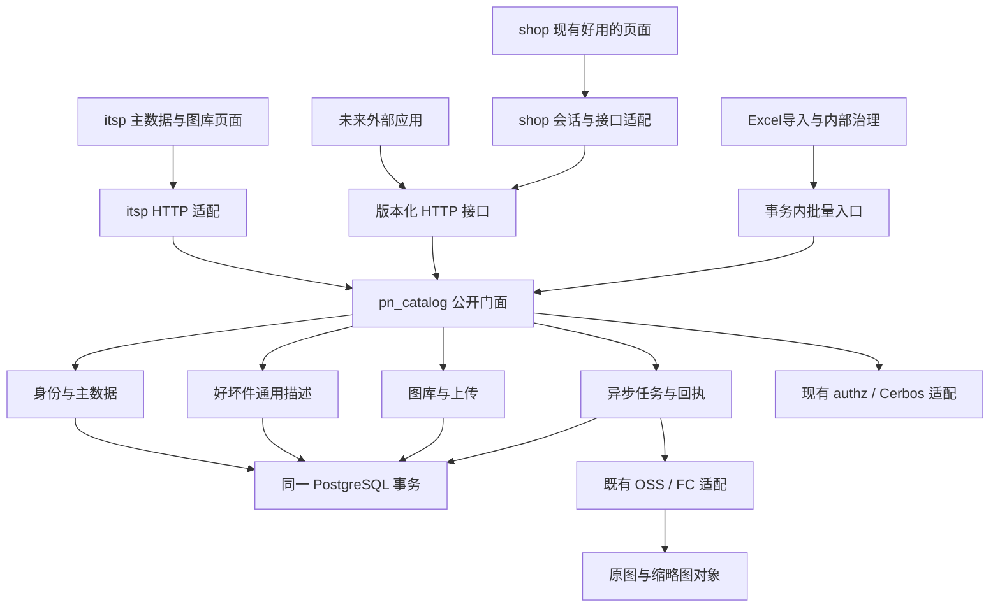

# 共享 PN 与图库模块：架构设计候选

状态：B0 设计候选，未实现、未迁移、未部署。跟踪：[itsp #463](https://github.com/Jinchen-Yang/it-spareparts/issues/463)。

用户确认：两边维护同一份 PN 主数据和图库；通用商品描述按 PN × good/bad 分开；保留 shop 已好用的维护交互；权限接入 D-0026 / #455 的新框架。新目标取代 D-36 中图库只能由 shop 维护、itsp 只读的限制。本文其余工程选择为设计建议，不冒充用户逐条拍板。旧 catalog-v2 与 gallery-v1 草稿保留历史，不自动续做。

## 1. 主干与选择

新建可复用的 `pn_catalog` 模块，替换两端现有维护模块的业务实现。**只有一套领域实现、一个写入权威；两端保留自己的页面、登录和业务系统。** 初期安装在 itsp 后端及其 PostgreSQL，沿用 dim_part.id；图库元数据、通用商品内容、写回执与图片任务迁入同一数据库。OSS 原图和已有缩略图原位保留。

模块独立是**依赖独立、接口稳定、能单独验证**，不是必须多部署一个微服务。第一版不加 Redis、Kafka、独立主数据数据库或通用工作流引擎。将来真有独立部署需求，只替换宿主适配和部署边界；不承诺当前带历史 FK 的持久化层能无成本搬库。

| 选项 | 优点 | 长期成本 | 选择 |
|---|---|---|---|
| 两站直连同表，各自实现写入 | 接入表面简单 | 权限、锁、版本、业务校验重复，外部调用无法复用 | 不采用 |
| 主数据 itsp、图库 shop，互相调用 | 不迁图库记录 | 改名/合并与上传跨库，需长期处理版本漂移与补偿 | 仅迁移期现状 |
| itsp 内统一领域模块，两个入口 | 权威数据和命令同库，复用现有 part_id | 需一次元数据迁移；共享模块故障影响两边共享编辑 | 推荐 |
| 全新第三服务和新库 | 完全独立部署 | 大量事实 FK 迁移、网络与运维增加 | 当前不采用 |

查询与编辑走权威模块；shop 为搜索/离线展示可保留**可重建、无写权**的投影。写后显示本次权威回执，不拿滞后缓存覆盖。服务不可用时明确显示缓存时间且禁止共享编辑；库存、原始导入记录等本地业务不因缓存失效被清空。

## 2. 领域模型与责任

| 概念 | 解决的问题 | 依赖 | 被谁使用 |
|---|---|---|---|
| Part 身份 | 同一型号如何稳定引用、改名和归组 | 既有 part_id、别名与身份状态 | 主数据、内容、图库及业务引用 |
| Profile 主数据 | 描述、品牌、厂商、品类、单位、规格的唯一有效值 | Part、字段来源与人工保护 | 两站页面、搜索、导入、外部系统 |
| ConditionContent | 同 PN 好/坏件各自的通用标题与描述 | Part、good/bad | 两站商品维护及后续销售渠道 |
| Asset 图片资产 | 不可变文件字节及校验元数据 | OSS object、SHA256、尺寸/MIME | 图库条目、收件箱、缩略图 |
| GalleryEntry 图库条目 | 图片对 PN 的用途、来源、顺序与删除意图 | Asset、原始 part_id | 两边图库维护 |
| Derivative 派生图 | 可再生的缩略图及算法版本 | Asset、recipe_version | 列表/详情/后续用途 |
| CommandReceipt 命令回执 | 网络重发只生效一次，能查询结果 | actor、request_id、payload_hash | 两端客户端、导入、恢复程序 |
| Job 任务 | 耗时工作可靠领取、恢复且不覆盖新结果 | 资源版本、租约、明确输入 | 上传归档、缩略图、人工触发的研究 |
| Evidence/Audit 来源与审计 | 区分原始资料、建议、决定、执行结果 | 操作者与来源证据 | 历史查看、冲突处理、追责 |

主数据保留 itsp 原字段；manufacturer 与 brand 是不同概念，厂商补充为显式字段，不把厂商塞进品牌。规格继续逐键、带单位/来源，避免引入第二套任意 JSON 主数据。good/bad 是受控枚举，未来新增等级通过契约与迁移扩展，不靠任意字符串。

库存、价格、采购销售事实、项目、SN/单件故障不属于此模块。ConditionContent 从现有 SKU.title/description/desc_status 迁出，SKU.id/qty_on_hand/stock_revision 和所有流水留 shop。通用坏件描述不能冒充每件实物的检测结论。

状态分三条独立轴：既有 `dim_part.status=active/merged` 只表示身份，`is_excluded` 只表示 itsp 治理排除，shop `catalog_active` 是商城展示/停用决定，三者不可互相推导。共享停用新增正交的 availability 状态（优先独立状态表），不向旧 status 枚举塞 inactive、不自动改治理排除或复活商城人工停用。

**没有第二份人工可写的共享字段。** shop 已生效值连同来源与保护迁为 legacy 有效基线；尚未采用的建议迁成候选。切换后有效值只由新模块命令产生。人工清空必须保留为明确值及保护意图，不能因为是空值被同步补回。

## 3. 模块组织与复用

建议 Python 包位于 itsp `backend/app/pn_catalog/`，内部只向宿主公开 `api.py` 与 DTO；业务核心不 import FastAPI Request、页面、环境变量或 shop 的 ORM。持久化 adapter 可用现有 SQLAlchemy 模型，写入调用方不得直接 import adapter 或直接修改内部表。现有采购/销售/维保只读 JOIN 可继续使用登记的 SQLAlchemy read bindings 与既有 dim_part 表；不要求把所有同库查询改成 HTTP，也不借本次重构重写全站查询。新拥有的图库/内容内部表通过 Query 接口读取；SQL范围适配由宿主统一登记。

- `profile`：复用 master_edit 的字段基线、人工保护、字典与规格校验；把历史散落写入迁入同一事务协议。
- `identity`：封装 rename/alias/merge/unmerge；现有 itsp 事实治理副作用由 itsp 宿主协调器明确承担，**不把会重指采购/销售 FK 的旧 merge 原样搬进共享核心**。
- `content`：PN×grade 内容、来源、候选与人工采用。
- `media`：复用 shop 上传意图、图库、收件箱、去重、云端验图/派生；替换旧 PN UUID 的权威归属依赖。
- `jobs`：复用 PG 租约与短事务队列；主数据人工保存同步完成，不全部塞进后台队列。
- `audit`：写变更与审计同事务、可靠回执、输入来源。
- `adapters`：PostgreSQL、OSS/FC、authz、宿主身份映射；这是实际会变化的依赖接缝。

外部集成以 HTTP/OpenAPI 为主，不发布两份 Python 领域实现。前端先复用现有 shop 的图库编辑流程与组件，提取无路由/无账号硬编码的 `pn-editor` 包，注入 client、capabilities、upload transport。两仓锁定同一构建版本和契约 fixture；是否独立包仓库由实际发包方式决定，不先引入运行时微前端或 iframe。

新增功能的局部性：新缩略图尺寸只加 recipe；新外部调用方只加身份/HTTP adapter；新主数据字段需显式 schema/白名单/保护/审计及 UI，不承诺“零代码配置任意字段”；新内容渠道可在需求明确后添加内容变体，不现在建设 EAV 或脚本插件系统。

## 4. 并发与队列

四层机制各自负责不同问题：

1. **资源版本/字段基线**：防旧表单覆盖。identity、profile、每个grade内容、gallery 独立 revision。字段提交带单调字段版本（规格逐键、两级分类组合；人工删除的规格键继续保留版本/删除保护tombstone，重建同名键不重置版本）；仅比较值无法识别 A→B→A，需识别字段版本变化。兼容接口缺字段版本时保守使用整个 profile revision，不能弱化成无条件更新。
2. **幂等回执**：防重复点击/网络重发。唯一 `(principal_id, client_id, request_id)`，hash覆盖 operation、resource、expected versions、规范化payload；同键同hash重放原回执，不同hash409。失败事务不留下成功回执。成功后响应丢失能按原key查询。重放前仍验证当前身份与资源读取/操作权限；回执只持久保存稳定结果ID、applied_revision与审计引用，不保存可无限重放的签名URL。先查合法同key回执再判断该请求的旧If-Match，避免已成功请求重试被误当新冲突；换payload依然409。不是“保证网络只发送一次”。
3. **短事务和固定锁序**：同一次写包含权限快照、回执、资源锁、业务变更、revision、审计、必要job/outbox。先账号/授权锁，再回执与拓扑协调锁，再按part_id排序的父资源，再子资源；认领任务事务不持job锁反向等待PN。ETL使用同事务批量入口，不每行HTTP/commit。所有内部写入口都必须迁移，不能只改网页。
4. **任务 fencing**：每次领取递增 lease_epoch 并生成token；完成/续租要匹配token、epoch、租约未过期、resource_generation和input_revision。旧worker即使完成云请求也不能落正式指针。任务payload不可由另一请求就地覆盖；新请求另建命令/任务，旧任务显式取消或失效。

领取用 PG `FOR UPDATE SKIP LOCKED`，提交领取后再调用网络；完成另开短事务。它只适合分配队列任务，不用于跳过锁后把业务读结果当完整列表。[PostgreSQL说明](https://www.postgresql.org/docs/current/sql-select.html)。系统是至少一次执行+幂等生效，不声称Exactly Once云调用。

人工删除条目递增 generation 并写 tombstone；旧上传、AI结果、缩略图均不能恢复。恢复是有独立权限、预期删除版本的新人工命令。同内容并发上传保留两份命令回执，但只建立同一有效关联；删除前签发的不同票据也不得绕过 tombstone。

图片原始来源 part_id 永不因合并移动。合并只改变规范身份/展示成员，保留条目来源及组级隐藏/排序；撤销按来源恢复，不能把被人隐藏的条目自动复活。身份命令影响图组版本；上传可保存到未归档收件箱，但正式归属提交必须锁内比较 identity_revision。旧 shop 会搬库存和 OSS key 的 merge 不复用。

跨库的 shop 库存事务不在此原子边界：共享建档成功、本地入库失败，沿同一请求重试本地步骤；允许留下零库存 PN，不倒删共享身份补偿。不能持有库存锁等待共享服务网络。

## 5. OSS 与派生图

保留原对象、image UUID、SHA256、来源与已有缩略图key。资产内容不可变；展示文件名可变而对象key不随PN改名/合并迁移。候选、正式、已删除、通用/瑕疵状态保留，不自动发布候选。

浏览器直传临时区 → FC验解码/大小/像素/MIME/SHA → 持久上传意图 → 不可覆盖复制/归档 → 元数据事务 → 缩略图任务。每步可查询恢复；进度100%仅表示传输完成，正式归档另有状态。DB与OSS没有共同事务，必须承认可能存在待核对孤立对象。

第一版保留现有FC处理方式和现有尺寸策略，生产远端FC版本另行核验后冻结recipe。新增派生key含 asset_id、source_hash、recipe_version；旧key作为legacy变体引用，不能在原key上改算法覆盖。缩略图失败不删原图、不阻塞资料保存；欠费/限流进入有界等待并保留原任务身份。未来确需OSS IMG时通过同一派生adapter实现，签名须包含处理参数，不把自由缩放参数暴露给客户端。[OSS说明](https://www.alibabacloud.com/help/en/oss/user-guide/img-implementation-modes)。

读URL短时签名、返回expires_at，不能作为永久图片身份；刷新URL不能伪造内容版本。图库没变但URL过期仍应返回新链接，不能永久304。授权撤销后禁止签发新URL，已发出URL在其有效期内仍可能可读，不能承诺立即撤销OSS bearer URL。敏感用途要另行定义更短TTL或代理访问。

普通删图仅软删关联。GC是独立运维操作：全引用核对、保留期、影子清单、人工执行权限；迁移期禁止因为新表没引用就删旧OSS对象。本轮无线上清理。

## 6. 权限对接

采用用户指定会话的 D-0026 / PR #455：实时账号、显式授权、Cerbos决策/查询计划、字段政策、能力快照，PDP失败关闭。该候选仍在迁移中，不能声称其全部接口已稳定上线。

拟注册 `part_catalog`、`part_content`、`part_gallery` 三类资源；读取/创建/改资料/改身份/停用/恢复与图库上传/采用/排序/删除/恢复分开。对外客户端scope与用户权限取交集，不由服务密钥代人授权。列表计数/搜索/导出在SQL分页前应用范围；错误回执也不可泄露无权字段。

复用 ResourceDefinition / grant / decision / snapshot 模式，不调用销售特定 sales_access（它的SQL绑定是销售客户）。前端同一能力快照控制入口，后端每次真实校验；只有迁移并验证的资源标记migrated。

跨系统身份委托是新增接入工作：shop会话由服务端验证，关联 `(issuer, subject)` 到主账号；不按同名用户名自动绑定，不信任裸X-User头。权威端验证受信签发方、audience、短时效、目标client、request binding、token_version及实时账号状态。协议应与权限主线共定，不能自行再造一套长期JWT/账号库。未映射账号返回明确错误，不自动提升为管理员。

耗时人工任务在受理与业务结果发布时检查权限；无人负责的AI不直接发布主数据。纯缩略图派生用受限系统身份，只可更新匹配generation的派生指针。审计保存发起人、执行者、来源证据及授权版本。

## 7. 完成标准

见 [接口契约](api-contract.md) 与 [迁移与验证](migration-and-validation.md)。本设计不以新文件夹、新接口数量或代码行数减少作为成功证据。以唯一写权、旧入口替换、两端一致行为、并发负向测试、数据守恒及故障恢复衡量。

## 8. 身份命令与宿主治理契约

共享 identity 命令只变更身份图、别名、成员版本及图库组展示，不物理转库存/OSS对象。在itsp宿主中，所有merge/unmerge/reassign入口（包括对外identity-commands）必须经独立宿主协调器，不能提供绕过协调器的“仅改图”入口，因为现有报表仍按事实FK JOIN。纯identity core只能被协调器事务内调用。协调器持有事务：同时检查 identity.manage 与现有事实治理权限，预览影响摘要和版本；取得规范锁后调用无commit的 identity core 与历史事实适配，审计后一次commit，任一步失败全部回滚。不能让外部普通资料调用方通过merge间接修改经营事实。旧merge内部commit必须在迁入前拆除；未迁完该入口仍标legacy且不能宣称共享合并已完成。跨库shop库存不参加此事务。

初期低频拓扑操作可使用一个短时拓扑advisory lock序列化，普通profile/content写不拿它；代价是合并吞吐受限，需测量。取得受影响成员闭包后按part_id递增锁定并复核闭包/版本；发现新成员整次重试，不临时逆序加锁。图组聚合/排序/隐藏需versioned manifest或持久成员视图，并与身份事务同步变更版本；分页游标绑定成员/编排版本。成员来源引用永久保留，不在每次分页复制文件。

身份命令回执区分 identity_applied 与 derived_recalculation=pending/ready/failed：身份/事实重指/审计同事务提交，必要重算任务同事务入队；重算失败只重试派生任务，不重跑merge或撤回已提交事实。两端明确显示尚在重算，不把派生失败冒充合并未发生。其他宿主若无需事实治理，可提供不同的事务协调adapter，但不得改变itsp的既有约束。
