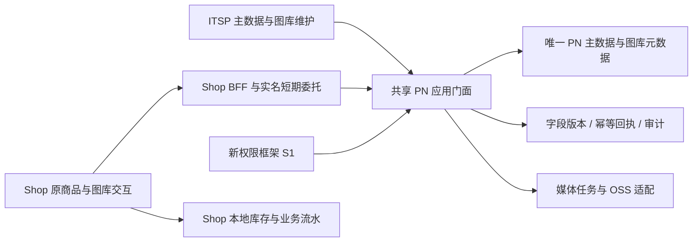

# 共享 PN 双仓统一候选验收

本记录对应隔离开发候选，未合并、未部署、未操作生产。用户要求的主数据、PN × 好坏件通用文案、图库、审计和权限对接均已落到代码；完整 CI 仍在运行，实际用户点按尚待验收。

## 实现主干

共享逻辑集中在 ITSP 的 `pn_catalog`；Shop 使用生成契约和适配层。权限通过 `VerifiedIdentity → Grant → Cerbos`，接入指定会话 S1；没有新增独立权限中心。库存、订单和单件故障继续保留原业务归属。

## 阶段代码基线（后续修复与完整 CI 以 PR 最新提交为准）

| 阶段 | 候选 PR | 已记录提交 |
|---|---|---|
| ITSP B1 | [#468](https://github.com/Jinchen-Yang/it-spareparts/pull/468) | `1815817` |
| Shop B1 | [#81](https://github.com/Jinchen-Yang/spareparts-shop/pull/81) | `b5280e3` |
| ITSP B2 | [#470](https://github.com/Jinchen-Yang/it-spareparts/pull/470) | `2c2cc6c` |
| Shop B2 | [#82](https://github.com/Jinchen-Yang/spareparts-shop/pull/82) | `d898de2` |
| ITSP B3 权限 | [#472](https://github.com/Jinchen-Yang/it-spareparts/pull/472) | `f8ffd0c` |
| ITSP B3 界面 | [#471](https://github.com/Jinchen-Yang/it-spareparts/pull/471) | `526b1f9` |
| ITSP B4 基础扩展 | [#474](https://github.com/Jinchen-Yang/it-spareparts/pull/474) | `d35f094` |
| ITSP B4 工作台 | [#475](https://github.com/Jinchen-Yang/it-spareparts/pull/475) | `7714d4d` |
| ITSP B4 历史恢复 | [#476](https://github.com/Jinchen-Yang/it-spareparts/pull/476) | `ba2ce7e` |
| Shop B3 后端适配 | [#83](https://github.com/Jinchen-Yang/spareparts-shop/pull/83) | `b6c3535` |
| Shop B3 原交互接入 | [#84](https://github.com/Jinchen-Yang/spareparts-shop/pull/84) | `64acb04` |

所有 PR 保留 Draft。阶段基线用于分开评审，依赖进入 main 后需重新对齐 main 并跑 CI，不能把比较分支当交付目标。Shop UI 完整树与整合候选 `82e2a9b` 相同；ITSP 最终产品代码来自 `a63e0f1`，之后同步阶段祖先、测试夹具和验收文档。

## 已通过的开发检查

| 范围 | 结果及实际边界 |
|---|---|
| ITSP 共享 PN、媒体及前端契约后端回归 | 409 项通过；真实独占 PostgreSQL，真实 Cerbos |
| ITSP 全量前端 | 180 文件、2007 项通过；类型与生产构建通过 |
| ITSP 最后导入身份/撤权夹具修复 | 34 项通过；前置导航合并后 13 项通过 |
| Shop 共享后端 | 92 项通过；最终库存修复另跑17项与旧库存35项，共52项通过 |
| Shop 全量前端 | 73 文件、523 项通过；后续认证恢复/冲突/只读查询9项通过；双 TypeScript、构建与生成契约通过 |
| 独立迁移恢复复审 | 21 项通过；共用上传只能凭不可变、相容的退休决定继续恢复 |
| 独立库存导入复审 | 原失败反例＋正式库存17项，共18项通过；8类旧显式身份异常不能回退到另一库存 |
| 两站真实网络 | 13 项通过；真实 HTTPS 委托、两个应用、独立数据库和 Cerbos |
| 固定构建浏览器 | 双向保存同一 PN、双站审计、Shop 390px 手机布局通过；两会话 console 0 errors / 0 warnings |

各批存在重叠，不相加为“总测试数”。此处陈述实际运行范围，不把局部回归冒充整个后端全量 CI。

并发证据包括：同字段双写一成功一冲突；不同字段均保留；同请求重放原审计/应用版本；同键换体拒绝；撤权后原回执仍拒绝；晚到 worker、删除/恢复、合并周期与上传归档栅栏有真实数据库反例。旧引用失效的库存导入返回409保留预览，不产生流水；129/256字 PN 返回422并包含原行号。

迁移已覆盖冻结17类来源、稳定旧 UUID/对象键、未知来源归档、收件箱/上传/任务/审计/研究/识别成果、显式恢复与不可变决定。切换记录持久化；新事实产生后不能靠关闭配置或危险降级恢复旧写。合成 Shop ORM 导出已通过 ITSP manifest 与摘要核验；未运行生产副本全量迁移。

性能证据限于批量快照/目录/收件箱查询预算与并行网络检查；没有生产规模吞吐或延迟对比，不能宣称效率翻倍。媒体适配的分片、续传、缩略图租约、过期回调、临时下载包和未知结果通过隔离测试；本轮未调用真实 OSS、FC 或模型。

## 用户统一点按清单

1. 在 Shop 编辑 PN 基本信息、好坏件文案及自定义参数，ITSP 刷新看到同值；反向亦然。
2. 两个页面打开同一字段后分别提交，后一页明确冲突且保留未提交内容；不同字段互不覆盖。
3. 图库上传、顺序/主图、删除恢复、隐藏规则、收件箱和手机入口保持原流程；真实媒体项需要独立测试存储环境后再验收。
4. 检查人工、AI候选采用、Excel来源审计；确认谁发起、谁执行、从哪个入口、改了什么。
5. 限制或撤销字段权限，确认详情、来源、审计和导出均同步隐藏，旧请求不能重放写入。
6. 原库存、数量流水与批次撤销仍归原 UUID；旧 PN 关联异常时能看到明确错误和原预览。
7. 在授权隔离副本核对17类历史状态与对象引用守恒，并演练切换前回退、切换后前向修复。

真实用户验收、生产规模副本对账、真实 OSS/FC 测试与正式发布分别记录；本任务不会自动启用生产。

## 报告独立核对

独立复核确认最终两仓 OpenAPI 逐字节相同，实际登记82个操作（含7个仅原生ITSP入口）；报告所述行为均有路由/实现。ITSP产品树与已复核修复一致，Shop完整树一致；S1调用链及主要日志计数已交叉核对。此次复核只核对实现、报告和既有证据，没有重新执行测试，也不改变真实环境待验收项。

## 完整 CI 收尾记录

2026-10-23 21:07 UTC：完整CI暴露解析器测试绕过统一清理，继承前序3万条规模样本。纯测试修复恢复逐用例隔离，显式建立家族变体与精确型号，并增加弱召回不构成歧义反例；旧顺序复现失败，修后同序19项、搜索相关51项通过。解析器算法未变。Shop全量2307项通过；迁移head与固定模式检查SQL预算已修正，两个完整文件19项通过。两种规模逐类SQL预算经独立复核，生产查询未删减。最终完整CI及用户验收以 [总跟踪 #463](https://github.com/Jinchen-Yang/it-spareparts/issues/463) 更新为准。

B4c 产品候选 `ba2ce7e` 的完整CI run `40021241564` 已全部通过；后续只同步解析器测试隔离、阶段词表祖先与验收文档，最终产品代码保持相同，新提交按要求重新检查。B4b独立阶段移除尚未实现的历史读取词表项，后端协议检查及前端权限9项通过；B4c保留自身实际支持的历史读取动作。
