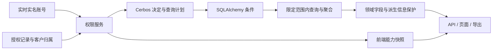

# 权限架构选型与首批实施报告

决策：D-0026。基线：`7a9fd2098acb6be0009a59a84e7d7330bb960d6b`。跟踪：[issue #453](https://github.com/Jinchen-Yang/it-spareparts/issues/453)。

**选择 Cerbos，自托管，保留现有 FastAPI / SQLAlchemy / PostgreSQL / React / AntD。** 选择依据是完整目标：页面、动作、数据行、字段、列表统计、导出逐步使用同一个授权框架。如果只修这一个角色拦截问题，进程内 PyCasbin 的启动成本更低；本次需求已经超过这一范围。

## 主干：一个权限决定，多个业务执行点

Cerbos 解决“这位用户能做什么、哪些记录符合条件”；它依赖经过校验的身份、授权和业务归属，由 API、查询层调用。SQL 适配把范围放在分页、计数和聚合之前。字段政策解决成本、利润、客户等信息及其派生结果是否可见，依赖同一条授权的范围，由领域服务与导出调用。前端快照用于显示入口和按钮，不能替代 API 检查。

此次故障的直接原因是“页面权限允许”与“后端固定角色拒绝”同时存在。换回职位模板不会自动消除角色硬界；统一授权权威和真实客户归属比继续给角色加例外更有长期收益。

## 五个维度的比较

下表难度和代码量是工程相对判断，不是已经测得的全部迁移工时。

| 方案 | 实现难度 | 开发/运维成本 | 对本需求的收益 | 自维护代码 | 增量体量 |
|---|---|---|---|---|---|
| **Cerbos + 现有业务栈** | 中；复杂 JOIN、字段推导仍需逐域验证 | 接入中等；新增一个内部 PDP 服务 | 同源单条决定和查询计划，官方 SQLAlchemy adapter，可逐模块迁移 | 业务映射、管理 UI、字段政策；复用引擎与计划解释器 | 一个服务，22 个新增锁定 Python 包；不加前端框架 |
| PyCasbin + 具名范围适配 | 入门低；全面数据查询中高 | 运行成本最低；需持续维护查询范围适配 | 固定范围的权限系统很合适；本项目全链路一致性需自行实现较多 | 范围映射/转换、字段政策、管理 UI、缓存一致性 | 无新服务，仅 casbin/simpleeval 两个包 |
| OPA | 中高，需 Rego 与编译结果的业务接入 | 自托管服务及规则能力建设 | 已具备 SQL/UCAST 过滤和列 mask 能力，通用性强 | 仍需 ORM/别名/关联适配和业务字段处理 | 一个政策服务及接入层 |
| NocoBase / Frappe / Directus 迁平台 | 很高，涉及现有业务、数据模型及工作流 | 迁移、回归、运维和部分许可成本较高 | 对全新后台可节省管理界面开发 | 权限 UI 可复用更多，但业务搬迁代码最多 | 整套新平台，不适合作为当前系统的权限插件 |
| 全部自研 | 初版低，完整实现高 | 长期安全维护和回归成本最高 | 可完全定制 | 判定、范围编译、管理、诊断都自行承担 | 运行最轻，长期业务代码最多 |

独立可行性检查对“只有固定 own/project/all 范围”的成本排序偏向 PyCasbin；完整目标评审偏向 Cerbos。这里保留这个分歧：选 Cerbos 是接受新增服务，换取政策查询计划的复用，不是声称它在所有场景最轻。[独立可行性测量](../reviews/authz-rewrite-20261023/implementation-feasibility.md)、[完整目标成本比较](../reviews/authz-rewrite-20261023/implementation-tradeoffs.md)。

官方依据：[Cerbos SQLAlchemy adapter](https://github.com/cerbos/query-plan-adapters/tree/main/sqlalchemy)、[Cerbos Python SDK](https://github.com/cerbos/cerbos-sdk-python)、[Casbin 数据权限](https://casbin.org/docs/data-permissions/)、[OPA 数据过滤](https://www.openpolicyagent.org/docs/filtering)。这些引擎都不能自动理解“成本与营收能够反推利润”等业务信息关系。

## 体量与成本的实际证据

- 原系统后端业务约 14.9 万物理行、前端非测试约 5.95 万行；这些业务计算不会整体重写。
- Cerbos PDP 0.57.0、Python SDK 0.16.1、SQLAlchemy adapter 0.4.0 均固定发布版。新增锁定包 22 个，既有锁定依赖版本保持不变；Docker 使用同一锁定依赖导出的带 hash requirements。
- 官方 PDP 二进制 105,574,560 字节；发布压缩包 49,559,605 字节（还包含额外 CLI）。实测本机 linux/amd64 容器镜像大小 139,825,114 字节。
- 本地固定镜像、只读政策目录、无宿主机映射端口的容器启动成功并 healthy；一次空闲内存采样为 28.15 MiB。该采样不是负载、并发吞吐、生产容量或 SLA 证明。
- 不需要 Cerbos Hub 账号或新政策数据库；账号、授权、客户关系仍保存在现有 PostgreSQL。新增服务使用独立内部网络，前端不直接连接 PDP。
- 本批相对基线的实现增量：后端 15 文件、增加 902 行/删除 35 行；前端 16 文件、增加 771 行/删除 32 行；部署及 CI 6 文件、增加 123 行。另有测试 15 文件、增加 1,740 行/删除 12 行，以及依赖锁和说明资料。此处统计 diff 物理行（含注释/空行），不是全部业务重写规模，也不能直接换算为人天。
- 所有方案的主要工程成本都在业务映射和回归，不能靠更换引擎消除。本批实际代码量可作后续估算基准；全系统工期不能由 386 个入口或源码行数简单相乘。本次不依赖付费 Hub；未采购商业服务，也未据空闲内存推算生产费用。

## 已冻结的业务规则

服务销售默认读取**本人负责客户的全部订单**。客户归属以账号 ID → 客户 ID 明确维护，不以订单成交销售名推断。不分配客户时，页面可打开但列表、候选、统计和导出均为空；未匹配客户 ID 的订单也不进入这个范围。同一客户可显式分配给多人，调整后覆盖该客户全部历史和后续订单，原订单事实不变。同名不同 ID 的客户不自动合并授权。

新资源的一条授权同时保存动作、范围和字段，初期一个账号/资源一条。`read`、`export` 分开，导出依赖读取；利润、对账信息各自依赖成本及销售金额字段。首期只有实名管理员能配置，版本冲突返回 409，授权与客户归属替换、审计、登录版本递增同事务；新账号默认没有新授权。

迁移按旧有效页面资格生成存量授权：管理员/老板全范围，其他角色负责客户范围；有效 own_customers_only 进一步收紧。客户归属不自动回填。启用后，旧职位模板和 data_* 编辑不会隐式改动销售分析的独立授权，界面明示入口，避免第二个真值源。

## 本批实现与明确剩余

本批：可复用的资源定义/Grant/Decision/QueryPlan 核心、显式授权及归属模型和迁移、管理 UI、服务端能力快照、销售分析八个入口全链路接入、暂停开关、真实 PDP/PG 测试。沿用销售分析既有筛选、排序、客户统计与利润派生保护，不重写领域计算。客户归属、销售分析和采购分析的销售人员选择共同复用 AntD 组成的复选下拉组件（D-0025）；支持搜索、方框点选、重置、确定，单人直接显示姓名，确认前不更新查询。

尚未完成：其他采购、库存、维保、文件、后台任务、Agent 等模块的迁移；全局职位模板对新授权的统一编排；全部面板与字段的语义登记。已有 386 个 HTTP method/path 和 2,829 处显示源码出现点的盘点，后者不是 2,829 个独立权限，也不等于全部业务语义已人工核对。目录对未迁移页面标记 legacy；不能以本批销售分析完成声称全系统权限已统一。

后续按域迁移，每批包含页面/API/查询/导出/工具入口、字段用途及负向测试，只有该域验证通过才撤掉旧门。优先处理已复现的采购过滤与派生金额、利润 Agent 入口和文件身份路径，再处理维保既有业务例外及后台任务重鉴权。

## 验收与发布边界

本地开发验证与用户实际点按验收分开。生产没有切换；需要确认真实客户归属、候选页面验收与正式发布流程。新引擎拒绝、超时或无法解释计划均不可回退旧允许。发布后紧急停用使用 `AUTHZ_SALES_ANALYSIS_SUSPENDED=true`（保持新权威启用），不通过关闭新权威恢复旧宽权限，不做 schema downgrade。

相关旧销售/权限后端回归 258 条通过；四组新增权限测试共 118 条通过，无跳过，使用真实 Cerbos 和 PostgreSQL，覆盖身份、并发撤权、管理保存、迁移、空归属、历史订单、八入口及金额字段依赖。Alembic upgrade/check 无漂移且单头；带 hash 依赖的 Python 3.11 后端 Docker 镜像构建和实际导入通过。最后一批筛选组件合入后的前端 TypeScript、Vite 构建、161 文件/1,939 条完整行为测试全部通过。

跨模型独立复审发现并关闭 1 项继承 P1：对账快照及已对账/待对账金额可还原被隐藏金额。复审使用真实 PDP/PG 证明修复后非法组合被拒绝，八个入口均拒绝无效存量 grant，未留下本批已知阻断。[独立复审及证据边界](../reviews/authz-rewrite-20261023/independent-implementation-review.md)。

代理在隔离本地浏览器中实际验证了客户归属的重置/搜索/勾选/确定/保存，以及服务销售进入销售分析：两张负责客户订单分别由不同历史销售成交，均可读取；未负责客户不出现。人员筛选勾选时仍为两单，确定后 URL 和结果才收敛为一单，关闭面板直接显示所选姓名。截图保存在工作树 `output/playwright/`，均为合成测试数据，不是生产或用户验收证据。前端生产依赖扫描及后端完整锁定依赖漏洞查询均无已知漏洞；不等于证明没有未知漏洞。

发布、客户归属准备、实际用户验收与暂停回退步骤见 [候选 runbook](../releases/authz-sales-candidate-20261023.md)。全量远端 CI 和真实用户点按不由本地测试替代。

新版字段组合补充：销售对账快照包含原订单金额，因此 data_reconciliation 与 data_profit 都依赖 data_purchase_cost。新授权保存拒绝缺少金额权限的组合；迁移时删除该非法组合中的对账权限，不自动扩大金额权限。此收紧仅限新销售分析授权，旧模块口径不变。
