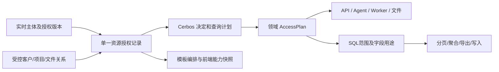

# 全模块权限迁移：独立对抗实施契约

核查时间：2026-10-23 15:32 UTC。代码基线：`42ce3532a886fa137a5d73058c7b73279a4135ed`（PR #455 候选）；已 fetch，`origin/main` 为 `7a9fd2098acb6be0009a59a84e7d7330bb960d6b`。本文件是独立只读架构复审及后续实施提案，没有修改业务实现、生产或授权数据。

**结论：现有 Cerbos 核心可以继续扩展，但不能把批量接上页面守卫称为全模块迁移。** 剩余工作必须逐域闭合「入口 → 授权 → 行范围 → 字段用途 → 输出/写入 → 撤权」；所有阶段通过独立对抗复审和该阶段精确提交的全量 CI 后才推进，全部完成后统一用户验收，不生产。

## 1. 当前代码事实与风险

| 已核对事实 | 证据 | 对推广的约束 |
| --- | --- | --- |
| 闭合目录仅注册 sales_analysis；Grant/Decision/Plan/QueryBindings 已抽成通用协议 | `backend/app/authz/catalog.py`、`engine.py` | 新增资源必须同时新增语义、SQL 绑定、策略、反向测试，不能把任意 legacy key 透传成新资源 |
| service 身份加载、授权查询和管理 API 仍绑定销售；`me` 与 catalog 也专用 | `authz/service.py:_load/sales_access`、`api/authorization.py:_grant/my_authorization/authorization_catalog` | 通用 engine 并不等于完整通用 PEP；应抽出可信主体加载和资源加载，并保留当前共享锁、token_version 校验与失败关闭 |
| 数据库 scope CHECK 仅允许 all / assigned_customers；每 user/resource 唯一一条 Grant | `models/authorization.py`、迁移 `f1a3c5e7b9d2` | 项目、owner、仓库、服务主体不能只改 Python 枚举。先显式设计 schema 和适配；不把 None 同时当 ALL 与空集 |
| 采购分析仍硬限 admin/boss，scope 账号被拒；普通采购分析服务还有独立旧范围/字段处理 | `api/purchases.py:_guard_scoped`、`services/purchase_analysis.py:_window_lines/analysis` | 新采购 read 不能只复制 page key。供应商筛选和价格趋势/建议属于敏感用途，需服务级统一控制 |
| 职位模板的保存/同步使用旧 permissions、template_perms、overrides | `api/role_templates.py`、`api/accounts.py` | 目前销售独立授权不双写是正确首期边界；全迁后必须重做模板编排，不能让两个编辑器分别声称控制同一资源 |
| Agent 有 18 个注册工具，dispatch 仅审计和派发；部分工具缺少网页资源门 | `agent/tools.py:_REGISTRY/dispatch/_get_profit_ranking/_get_inventory` | page_chat 不能代替利润、库存等资源读取权；工具应复用网页领域授权服务，不能只增加工具名白名单 |
| Agent runtime 和 chat worker 沿用请求 ctx；导入 worker 只接收 created_by | `agent/runtime.py:_agent_loop`、`api/chat_sessions.py:_worker`、`api/imports.py:_process_import_job` | 任务执行时和发布时重鉴权，不能把排队时通过当永久授权；应区分用户委派任务与内部系统任务 |
| Agent 文件 owner 用 username，FULL_SCOPE_ROLES 可跨人；底层文件服务不接 ctx | `api/agent.py:download/preview_file`、`agent/tools.py:_owns`、`services/agent_files.py` | 文件 owner 应绑定不可变主体；历史文件只有 owner 无业务血缘，不能自动证明所有内容仍可读 |
| legacy token 校验在实名账号不存在时仍返回签名数据；fallback 跳过 DB 吊销 | `auth.py:verify_token_db` | 新主体加载应共用 sales 已实现的严格实名规则；fallback 不得装成同名实名账号。共享登录是否保留须显式登记独立主体类型和边界 |
| D-03 是对象关系例外；负责人本人项目完整工作簿可读可改；销售还需利润字段 | `decisions/0001`、`services/maintenance_project_assignments.py:is_project_workbook_editor/can_edit_master_workbook` | 不能把所有条件机械 AND 而取消负责人权益，也不能 OR 出本人项目之外的全公司金额权 |
| 商城 7 个服务入口有独立静态 token 能力和 DTO；相关数据公开是业务合同 | `api/resale_export.py`、`api/resale_catalog_export.py`、`decisions/0014`、`0020-商城参考价销售均价.md`、`0021` | 不把服务 token 当人类 admin；不把既有服务合同误删；注册 service principal/audience/capability 后保留 DTO 边界 |

运行时只导入应用、未启 lifespan/调用端点/连接数据库：本候选共有 **391 个 HTTP method/path、387 个 route 对象、18 个 Agent 工具**。旧原始清单的 386/382 基于旧 SHA，新增的五项为 `/api/authz/*`，不能拿旧数量作当前完成率。`verify_artifacts.py` 明确固定旧 SHA 且只检查材料完整性，不是现候选权限正确性 CI。

D-0026 只覆盖销售分析旧角色硬界，其余模块业务规则目前没有被该决策废止。全迁实施需新增决策，记录「权限权威替换」覆盖 D-07 的旧键真值约定，并逐项列明保留/收紧/取代的例外。用户已授权继续全迁，无需再询问是否继续；可从现行规则导出的保守迁移直接做。没有关系数据或业务语义的能力可以先实现为默认拒绝，不得猜测归属后自动授予。

## 2. 最小封闭契约

最小验收单元不是页面，是一个完整资源操作。每条机器可读登记至少包含：

| 项 | 必须记录的内容 | 可机器阻断的条件 |
| --- | --- | --- |
| 身份 | human/service/system/bootstrap 类型；稳定主体 ID；凭证验证；active/deleted/epoch 规则 | 不能将 `user_id` 字符串、role、前端 permissions 直接当可信授权 |
| 资源动作 | 稳定 resource/action；领域含义；旧规则来源；允许主体类型；动作依赖 | 未注册或未授予拒绝；不得通配自动覆盖未来动作 |
| 范围 | 类型、稳定关系、空集语义、可信 ORM 别名/关联绑定 | 授权条件必须进入所有事实 SELECT，且在分页/计数/聚合/Top N 前生效 |
| 字段用途 | DTO 字段路径与来源；select/filter/sort/group/aggregate/export/LLM/display 各用途；派生依赖 | 隐藏金额后不允许用金额范围、排序、份额、颜色、趋势或总数差反推；未登记字段默认不可输出 |
| 执行点 | HTTP method/path、domain service、工具名、worker、文件读取/生成/下载 | 新入口与覆盖表集合不相等即失败；不是非空 guard 名字即可通过 |
| 对象关系 | 子对象反查父资源；项目/客户/文件归属来源 | URL 的项目 ID 与实际对象不一致拒绝；ID 可枚举性不作为防护 |
| 变更与撤权 | 授权版本、关系版本、事务锁序、任务重检边界、缓存键 | 同事务写授权/关系/审计/epoch；旧凭据不能在新边界继续读写 |
| 测试证据 | allow、deny、空范围、跨对象、隐藏字段、撤权、PDP 故障测试 ID | 不得未 collect、skip、xfail 或用宽松替身替代 PDP/PG 证据 |

单一权威的精确定义：新模块的 allow 来自规范 Grant/关系及 Cerbos，业务状态、CAS、幂等、数据完整性等条件继续独立执行；不得在 Cerbos 拒绝/不可用后按 legacy 角色放行。管理员仅有显式管理能力，不能通过通用 `role == admin` 绕过新业务 Grant。

范围和字段必须成组：当前一资源一 Grant 可以继续用，但**不能表达「所有项目普通字段 + 本人负责项目完整金额」后把 scope 与 field 集合分别取并集**。最小安全方案是拆分 `maintenance.project_summary` 与 `maintenance.project_workbook` 等不同数据合同，工作簿使用项目关系计划。若以后引入多条 grant，必须按每条 grant 的 scope×field 配对计算；先写测试再扩协议。也不能把不同 action 的不同范围挤进一条 all Grant。

读取和写入分别守约：写操作要有明确 update/import/restore/recompute/assign 动作及目标范围，不能由 read、export 或“页面可进”推导。批量操作遵循现行业务的逐行/整事务规则，权限迁移不自行改变事务语义；高风险写在锁内重检 actor、Grant、对象关系和版本。

撤权承诺须可实现：普通读取在请求/分页边界重检；长任务每次工具调用、每个导入文件事务、读取源数据前、发布产物前重检；流式输出在约定批次边界停止。已发送字节和用户已下载副本无法撤回，不能承诺“即时抹除”。不建议把 sales 的用户共享锁延长到整个 LLM 会话或长导出，否则会长期阻塞管理员撤权。

文件是独立数据出口：区分用户上传原件、业务原件、系统生成受限导出。业务原件须验证整本涉及的资源/对象/字段范围，不能因筛选预览只见一部分而允许整本下载；生成产物保存 provenance（来源资源、对象/范围、字段合同、授权/策略版本、生成主体），下载时重判。历史产物缺 provenance 时不能伪造“当前权限一致”证明；可保留经登记的明确原件能力，或拒绝重下并重新生成受控产物。历史聊天中的数据文本同样不是仅靠 session owner 就能逐块重授权，必须单列历史内容处理策略。

## 3. 存量迁移与权限中心

迁移目标不是复制 49 个旧布尔键，而是保存旧**实际允许集合**，并补齐原来只有角色/关系/隐式页面条件的显式能力。对于未被新决策明确改变的动作：`new_allow ⊆ old_actual_allow`；允许有明确、可解释的安全收紧。比较需包括行和字段可观察结果，不能只比 HTTP 200。D-0026 已批准的销售客户归属变更是单独登记的政策变化，不能外推到采购或其他模块。

1. 冻结旧有效权限解释器，逐角色、模板快照、overrides、收紧键、关系例外生成迁移证据；迁移脚本不可 import 会变化的应用 defaults。
2. 补新动作时按旧真正的角色/实名/字段/对象交集生成：库存人工覆盖、利润重算、需求恢复、回款恢复、项目关系分配、返件分类裁决、收款冲突裁决、成本与归因回填均不随普通 read/manage 自动授予。原始依据见 `non-key-rule-migration.csv`，每条仍需检查当前 handler/service。
3. 已退役的 pool/rebuild 继续 410；已明确失效的 checklist import 键不得“补权限”时重新变成附加门。Beta/发布闸是部署状态，不能混作用户权限，也不能在权限迁移时顺便开放。
4. 模板保存仍只改模板，显式同步才改账号。模板应产出同一规范 Grant 集合，配置来源/模板版本/个别调整只是 provenance，不是另一运行时授权源；资源同步采用预览 diff + 指纹 + CAS + 稳定锁序 + 原子审计/epoch。
5. 模板同步不会自动覆盖显式客户/项目关系；全量替换与保留覆盖项的规则需明示。授权管理与普通账号资料管理分开，防止 action_account_manage 通过模板批量分配新高权；管理权限自身的分配首期继续实名管理员控制。
6. 兼容旧 UI/API 时，只允许把旧编辑请求规范化为新 Grant 的同一事务入口；不能两边都写再“最终一致”。未支持的旧编辑明确拒绝/只读，不能成功响应但实际不生效。
7. 完成全迁后移除生产运行时 legacy allow 分支；旧快照可留作迁移审计。暂停开关继续 fail closed，不能以关闭新引擎回到宽松旧路径作为回滚。

## 4. 阶段切分和每阶段门槛

阶段按依赖推进；一个阶段可以拆成数个可审查 PR。跨模块接口可以先定义，不能据此提前标记资源 migrated。

| 阶段 | 闭合交付范围 | 对抗复审重点 |
| --- | --- | --- |
| 0：覆盖账本与核心协议 | 新决策；刷新路由/前端/工具/任务/文件清单；资源/动作/字段/范围 schema；统一 live principal；通用管理 API/快照协议；覆盖漂移 CI | “全页面有门”不等于全数据面；未知资源/动作/属性/策略错误默认拒绝；sales 已有行为不回归 |
| 1：账户与授权控制面 | 账号管理、模板、授权、客户/项目关系管理、系统设置；新建/复制/停用/同步/批量授权生命周期 | 自提权、委派上限、角色改名绕过、旧 API 双写、并发模板同步、跨账号锁序、管理员失权 |
| 2：横向数据读取域 | 采购列表/分析、利润、库存、主数据/PN/池/替代关系、看板/质疑治理及对应导出；按各子域分小批 | SQL scope 在所有别名/子查询/CTE/联合分支；字段筛选/排序/聚合/建议；已有角色动作补登记 |
| 3：维保关系及所有读面 | 稳定项目、总览/排名/钻取、需求/领用/返还/成本/费用/回款/验收、附件预览；明确 D-03 与 D-25 的不同投影 | manager/viewer/canonical sales 区分；无关系为空；同名账号不推断共享范围；子对象逃逸、全局汇总与详情策略差异 |
| 4：维保与业务写面 | 工作簿全生命周期、导入预览/应用、作废/恢复、领用/返还、项目挂靠、仓库、补库、数据修正、重算/回填/迁移操作 | 锁内撤权、幂等重放、跨项目批量、文件中隐藏目标、预览后关系变动；不改变既有业务状态/CAS/事务口径 |
| 5：旁路与延迟执行面 | Agent 每工具、Skills 可见性与工具执行、会话/重连、全部文件、导入 worker/inbox/其他任务、商城服务身份及 DTO | 网页拒绝但 Agent 能读、旧 ctx 执行、原件整体泄漏、历史产物、服务 token 交叉使用、Agent 不得取得任何业务写动作 |
| 6：收口与统一验收候选 | 全前端能力切换、旧授权路径退役、全量迁移演练、覆盖报告、权限中心操作说明、验收账号矩阵 | legacy/unknown/uncovered 均归零；仅公开探针/登录等显式 exemption；最终 SHA 全绿；用户全场景统一点按 |

阶段 5 的必要 hook（工具统一门、worker 重检 API、文件 provenance 入口）应在阶段 0 提前定接口，在每个业务资源迁移时同步接入对应出口，不能到最后才修一个已声称迁完的域。阶段 5 是跨域收口，不是允许阶段 2–4 暂留旁路。

每阶段退出前要有三个独立角度并记录精确 SHA、发现、复现和关闭证据：① 攻击者从替代入口、隐藏字段、伪造对象及并发撤权攻击；② 架构审查检查单一权威、范围/字段配对、服务与任务闭合；③ 业务回归核对旧决策、例外、事务和无扩权迁移。不得由同一实现者改成多个文件名就算独立复审。完成复审修复、针对性回归和远端全量 CI 全绿后才推进下一阶段；本地通过不替代远端精确提交结果。

## 5. CI 的最小可执行卡口

当前 CI 已安装固定 Cerbos、真实 PG、迁移单头/零漂移、全量 pytest 和前端检查。这些可复用，新增卡口应接入同一必需检查，不能设置 continue-on-error。

1. **集合闭合**：运行时全部 HTTP method/path、Agent `_REGISTRY`、前端业务路由/能力、任务启动器、文件出口与声明清单精确比对。登录/刷新/health/docs 等 exemption 必须逐条具名与有理由；禁止用路径前缀豁免整个业务域。标注 deprecated/retired 与 public 不同。
2. **能力闭合**：所有登记资源/动作均有策略和端到端 deny/allow 测试；每个入口指向已 collect 的测试 ID；所有输出 DTO 敏感字段、查询用途、文件类型有领域 field contract。无法静态推导的动态 JSON 必须有显式契约与负向样例。
3. **查询等价**：真实 Cerbos check 与 query plan 对同一合成对象集合等价；测试空归属、单归属、多归属、NULL、重复/外连接、多客户同名、对象换归属、父子 ID 不一致。scope 选择完成后才分页、聚合，并断言分组计数/Top N/候选/导出一致。
4. **不扩权差分**：冻结旧解释器 + 合成全部 legacy 分支，与新动作/行/字段结果比较；每项差异必须属于已登记的政策变化或收紧。不允许通过修改 expected 为新宽值静默消除失败。
5. **字段非干扰**：仅修改不可见字段或范围外记录，受限用户的可观察响应应不变（除契约允许的元信息）；覆盖排名、金额区间、趋势、推荐、候选和错误消息。该测试检验语义泄漏，不只是 JSON 字段被置 null。
6. **故障/撤权**：PDP deny/timeout/错版本/坏 plan、未知字段、Grant 损坏、账号失效及 epoch 改变均不能回落；真实并发验证授权与关系原子性、锁内写、排队任务、生成与下载之间撤权。
7. **测试能抓到缺门**：对代表性资源临时移除 scope predicate、资源 gate、字段用途 gate、任务 recheck 的受控 mutation 必须被对应测试杀死；不用“测函数存在”代替行为证据。
8. **候选精确性**：全量前后端/迁移/依赖检查通过，复审版本与 CI SHA 一致；修改后不沿用旧绿灯。授权验收矩阵所需测试不允许 skip/xfail；未装 PDP 必须失败而不是跳过。

终态报告应列实际分母与证据：入口覆盖、策略动作覆盖、对象范围覆盖、字段用途覆盖、任务/文件覆盖、迁移差分、独立复审关闭项。不能把 2,829 个源码显示出现点换个标签叫 2,829 项权限全部验收。

## 6. 自动化不能替代的部分

- 扫描只能发现候选入口，不能自动判断“负责人可看本人项目完整金额”“项目汇总可比详情更广”等业务合理性；这些必须指向决策和实际领域测试。
- 没有可信主键映射时，不能自动从销售姓名、手机号、历史成交、展示名称生成客户/项目授权。同名、改名、离职接管分别登记；默认空集不等于已完成业务配置。
- JSON 字段字面量、递归 mask 与 SDK query adapter 不会自动认识可反推的利润、价格趋势或成本份额。字段依赖需按领域人工建模，测试只能证明已覆盖输入。
- 跨入口数据组合、用户此前已下载数据和任意历史聊天文本无法靠一个通用 FieldPlan 完整追溯；应记录可证明边界、明确原件能力及历史内容策略，而非写“全部动态脱敏”。
- 用 middleware 根据 URL 推断 page、仅改 require_page/require_action、把 role 映射成一个万能 Cerbos role、只补管理 UI、让 worker 信 initial ctx、只在响应末尾 mask，均属于名义迁移。
- 全量 CI 绿证明已编码的契约通过，不证明真实关系已正确配置；最终统一用户验收仍需实名测试账号和典型业务样本。生产继续保持未授权发布状态。

本次只对上述关键链路做代码核验与运行时登记计数，没有重跑全量测试，没有声明所有旧审计发现均已在当前代码复现。原始审计清单是后续逐域追踪输入，不能替代阶段内的实时验证。

## 7. 全量 CI 缩时的只读评估（候选 `1be345d`）

**建议优先试验 4 片 GitHub matrix，每片独立 runner/PG、一个普通 pytest 进程；不增加 Python 依赖，不直接启用 xdist。** 现有完整套件约 50 分钟是本次任务给定现状，尚未做分片计时；不能据此承诺降到某个分钟数。理想耗时为「准备/全量收集 + 最慢分片 + 汇总」，实际受长尾文件、runner 排队、重复依赖安装/迁移影响。先获取逐文件用时，再决定 4 片是否优于 2/6 片。

### 已核对的隔离基础与真实限制

- `tests/conftest.py` 导入时为每个 pytest 进程创建独占 PostgreSQL 数据库和原件目录；session/autouse `migrated` 执行 upgrade head，普通 `db` fixture 每用例 TRUNCATE/重播模板。迁移测试可能降级/升级乃至重建 schema，所以不能在同一个测试库里并发。
- `tests/run_isolation.py:181–191` 明确拒绝 `PYTEST_XDIST_WORKER`、`-n`、`--numprocesses`，`test_pytest_run_isolation.py` 有对应负向测试；当前锁文件也没有 pytest-xdist。直接加 `-n auto` 必然失败，删除限制后让测试共享库更不可取。
- 已有 `test_two_concurrent_sub_pytests_are_isolated_and_cleanup_independently` 验证两个独立子 pytest 的 DB/raw 不相交及独立清理。matrix 各有独立 PG/文件系统，比在一个小 runner 中并发多个进程更少资源争用，也不需要改变隔离协议。
- 静态 AST 盘点当前 `tests/test_*.py` 共 387 文件；108 文件含跨测试文件 import，共 220 处 ImportFrom，未见导入 `test_*` 函数或 `*`。例如销售授权导入 `seeded` fixture、维保导入造数 helper。这是代码复用，不自动等于执行顺序依赖；完整 checkout 下按文件分片仍能 import helper。没有据静态结果宣称全部测试顺序无关。
- `test_bom.py`、`test_rbac.py`、`test_agent_tools.py`、`test_resolver.py` 重定义 module-scope `db`；第一版保持整个文件为最小分片单元并保留文件内原顺序。`test_agent_tools.py` 存在“真库无该型号”动态 skip，这类用例可能因全套之前遗留数据而运行、分片后变 skip；必须和同环境串行基准比较，不能只看退出码。
- PDP fixture `tests/authz_pdp_helpers.py` 采用临时目录和动态端口，适合独立 runner；但缺二进制会 skip。每片必须保留固定版本/校验和 Cerbos 安装和预检，授权测试 skip 必须使汇总失败。
- 当前 workflow 两个 required 名字为 `后端测试（pytest + 迁移链验证）`、`前端类型检查 + 构建`。当前后端单 job 还包含 Alembic upgrade/check、单头校验与生产依赖漏洞扫描，分片不能漏掉这些。

### 具体方案：保留 required 名字的三段式执行

1. 新增准备/验证 job：同一精确 checkout SHA，钉住现有 uv、Python/锁依赖与 PDP；运行原有迁移 upgrade/check、单头和漏洞扫描。通过 pytest 官方 collection hook 生成**完整 nodeid manifest**、文件→nodeid 映射及内容 SHA256；不是 grep 文件或解析 `-q` 展示文本。collect-only 仍会触发当前 conftest 建库/清理，因此该 job 也需要测试 PG 与原隔离守卫。
2. 用 pytest 原生 hooks 的轻量仓库内插件实现分片，无新第三方包：各 matrix job 都先完整收集，与准备 job 的 manifest 精确比对，再按文件分配表 deselect 其他片；保留每文件及片内的原始收集顺序。这能保留全量模块导入带来的相同 collection 环境，比只传选中文件更容易发现漂移。首次可按每文件 nodeid 数量贪心分配；获得 JUnit/pytest report 的真实用时后改成确定性的最长文件优先装箱。新文件缺用时也必须自动分配，不能排除。
3. `backend_shards` 使用 `fail-fast: false`，每片普通单进程 pytest、独立 PostgreSQL service、独立 artifacts（run_id/attempt/shard_id），保留真实退出码。测试末尾记录已选/实际报告 nodeids、setup/call/teardown 结果与 duration；无用例、收集错误、fixture 错误、清理错误、超时都失败。禁止 `continue-on-error`、`|| true` 或只靠输出 XML 的存在判绿。
4. 原 `backend` job 改为汇总门，**name 保持完全不变**；`needs` 包含准备/验证和 matrix，`if: always()`。它必须显式要求每个 needed result 为 success，且获取全部预期分片证据，再做集合/结果核验；上游 skipped/cancelled/failure、缺 artifact、错 SHA/hash/run attempt 一律非零。前端 job 保持原名及全部步骤。不能让失败上游导致 required 汇总被跳过后仍被视作通过。GitHub 官方说明 [workflow needs/always/fail-fast](https://docs.github.com/en/actions/reference/workflows-and-actions/workflow-syntax) 与 [required checks](https://docs.github.com/en/pull-requests/collaborating-with-pull-requests/collaborating-on-repositories-with-code-quality-features/troubleshooting-required-status-checks) 支持此结构。

### exact-once 卡口与试验通过标准

- 令全量 manifest 为 U、各片选集为 Sᵢ、实际完成报告集为 Eᵢ：要求 U 无重复、`∪Sᵢ = U`、任意两 Sᵢ 不相交、每片 Eᵢ 恰好等于 Sᵢ。报告需保留完整 nodeid，而不是会丢失参数化身份的测试名称；对执行阶段分别验证 setup/call/teardown，不能把 teardown error 因已有 passed call 覆盖掉。skip/xfail 是明确状态，不等于执行成功。
- 允许的既有 skip（例如未提供私有样本、选择性 benchmark）须具名记录原因并与相同 runner/环境串行基准比较；新 skip、unexpected xfail/xpass、授权集的任意 skip/xfail 阻断。这里不能简单要求旧全套零 skip，也不能把所有 skip 默认为无害。测试清单只描述本次正式顶层套件，隔离测试内部自启的 `_pytest_run_isolation_probe.py` 属于该测试行为，不混入顶层 exact-once 分母。
- 先验证插件纯逻辑：空片、漏一例、重复一例、错 manifest、错 attempt、参数化 ID、setup fail、teardown fail、skip、子进程退出非零、artifact 缺失/截断，各自必须使汇总失败；故意让某片失败/取消，required 后端 check 必须红，其他片继续运行并留证。
- 然后对**同一 SHA、相同配置**保留一次串行全量作为比较基准，跑完整 4 片，比较 nodeids 与各状态，不得把失败/新增 skip 改白名单消音；由每片 JUnit/报告记录用时。复核跨文件 helper 和 module-scope fixture 涉及的文件组；发现真实顺序依赖时补 self-contained fixture 或暂把相关文件保持在同片，必须保留覆盖而不是 deselect。
- 套件已有 `test_ci_pins_setup_uv_action_and_binary_version` 解析 workflow 约束 uv 锁定方式；分片时保留当前钉版和版本校验，并让现有 release-control/隔离测试全部运行。统计全部片合计测试数不能替代 nodeid 集合比对。
- 只有实际时间和资源使用显示改善、完整行为状态一致、故意失败可阻断且两个 required 名字未变后，才把此结构当作下一阶段门禁。这里尚未执行分片或证明加速，也未更改 workflow、依赖、隔离逻辑及测试。

pytest collection/selection hooks 的官方接口见 [pytest API reference](https://docs.pytest.org/en/stable/reference/reference.html#pytest.hookspec.pytest_collection_modifyitems)。复用已有隔离＋GitHub matrix 比为 xdist 重写 controller/worker 生命周期协议的变更更小；后者可作为后续独立优化，不宜夹在权限迁移内顺便移除安全守卫。
