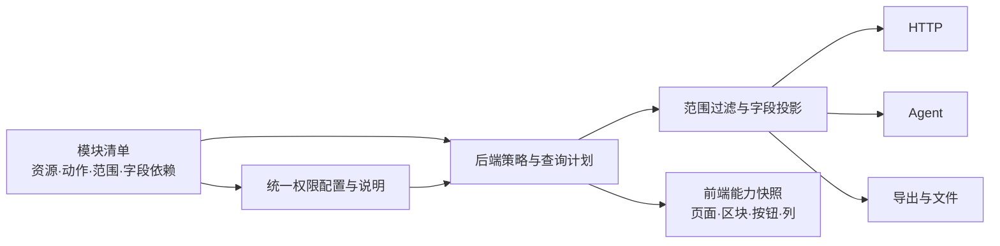

# 完整平台权限方案补充调研

核验时间：2026-10-23 11:49 UTC 起。范围：官方 GitHub 仓库、官方文档及当前许可证/版本说明；未安装、未试用生产数据、未修改业务。本文的“适合本项目”是结合当前 FastAPI + SQLAlchemy + React/AntD 的工程判断，不是已经完成的接入验证。

## 结论

**有接近目标体验的成品：NocoBase 最像“统一配置页面、区块、操作、记录和字段”，Frappe/ERPNext 最像成熟 ERP 的权限管理。** 但它们主要统一自己的资源模型和运行时，不能安装后自动管住现有 FastAPI 查询、Excel、Agent 工具和自定义聚合。Refine 最容易逐步接入现有 React/AntD，但提供的是前端授权接口和组件，不是整个后端权限中心。Directus 能提供数据库 API 与权限后台，接入它意味着把相应数据访问迁入其 API/服务层。

建议：**借鉴 NocoBase/Frappe 的权限管理产品形态，保留现有业务栈，统一后端授权与查询投影契约；Refine 可作为前端适配候选。** 不建议单为权限把现有业务搬到整个平台。四者的许可也不能统称“公开源码、无条件免费商用”，尤其 NocoBase 和 Directus 的当前条款已有实质限制。

| 项目 | 已有完整度 | 对现有项目的接入边界 | 本次建议 |
|---|---|---|---|
| [NocoBase](https://github.com/nocobase/nocobase) | 权限后台、菜单、集合动作、字段、记录范围、区块联动 | 规则绑定 NocoBase 数据源/资源/动作；要直接使用后台需引入平台或开发适配 | **优先研究产品交互与模块注册设计**；不为权限迁平台 |
| [Frappe](https://github.com/frappe/frappe) / [ERPNext](https://github.com/frappe/erpnext) | 用户/角色、文档权限、字段级别、用户记录约束、页面/报表权限 | DocType、Document、权限管理和业务运行时绑定；不是 SQLAlchemy 插件 | **优先借鉴 ERP 权限模型**；新建 ERP 可考虑，现有项目不直接换栈 |
| [Refine](https://github.com/refinedev/refine) | React 后台框架、授权适配接口、按钮/组件门、AntD 集成 | 可渐进接入；授权存储、管理员配置、后端执行仍由本项目/授权服务提供 | **可选前端适配器**；不能单独解决数据权限 |
| [Directus](https://github.com/directus/directus) | 数据库 API、Studio、用户/角色/策略、记录和字段权限 | 要让受保护访问走 Directus；原 FastAPI/原 SQL 不会自动受它控制 | 可做独立数据后台候选；**当前不优先作为本系统统一权限底座** |

以上能力细节和官方依据如下；不能把表中的“有字段权限”解释为已经证明不会从金额、排序或统计推导出隐藏信息。

## NocoBase：最接近所需的可配置体验

`@nocobase/plugin-acl` 是内置且默认启用的 Community Edition+ 插件。权限配置包括菜单访问、集合的查看/新增/编辑/删除/导入/导出、按动作配置字段、全部/本人创建记录范围，以及界面配置与插件管理能力。[ACL 插件](https://nocode.docs.nocobase.com/plugins/@nocobase/plugin-acl)、[权限配置](https://nocode.docs.nocobase.com/users-permissions/acl/permissions)

它的区块和字段会响应同一资源权限：集合不可读时，其数据区块隐藏；字段可分别控制查看、编辑、创建、导入与导出。**“一个页面里多个区块跟权限走”是已有能力。** 但 2.0 文档明确说动作主要由集合资源权限统一控制，同一集合在不同页面、弹窗、区块中的同类动作保持一致；这不等于每个任意自定义卡片都自动获得独立授权项。[UI 联动](https://nocode.docs.nocobase.com/users-permissions/acl/ui)、[动作权限](https://nocode.docs.nocobase.com/interface-builder/actions/permission)

开发扩展有比较贴近本次方案的机制：数据源拥有 ACL；`registerSnippet` 组织可复用权限组合；`setAvailableAction` 把自定义动作登记到配置界面；服务端支持固定范围约束和自定义中间件。这是值得借鉴的“模块注册一次，管理界面和服务端消费同一目录”。但它并未提供现成 FastAPI/SQLAlchemy 适配器，应用里直接写的 SQL/外部接口仍需接入权限执行链。[服务端 ACL](https://docs.nocobase.com/plugin-development/server/acl)

两点不能原样套用：其默认“本人”是创建人，不是本系统的销售/客户/项目负责人；角色合并模式取允许权限的并集，而本次方案含显式拒绝及范围—字段关联，必须做组合测试，不能只换名词。[本人记录说明](https://docs.nocobase.com/tutorials/v2/05-roles-and-permissions)、[角色合并](https://docs.nocobase.com/users-permissions/acl/union)

**免费/商业边界**：基础 ACL 属社区版；官方当前版本说明把外部 MySQL/PostgreSQL 数据源列在 Standard，SSO、审批等高级工作流列在 Professional，集群、详细操作审计等列在 Enterprise。因此“接现有 PostgreSQL”“用组织登录”“全量审计”不能默认均由免费社区版覆盖；这与用 PostgreSQL 作为平台自身主库不是同一件事。[官方版本对比](https://www.nocobase.com/en/commercial)

**许可核验**：当前仓库 `LICENSE.txt`（注明 2026-02-24 更新）引用 Apache-2.0，但同时规定附加条款优先，含界面品牌保留、不得以原版/修改版公开提供低代码等平台 SaaS/PaaS 的限制；商用版另有客户交付及配置权限条款。应准确称“附加条款许可”，不能仅据宣传中的 Apache-2.0 就写成纯 Apache、可任意改牌和转售。本文未判断我们的交付模式必然需要哪一商业版本。[仓库现行协议](https://github.com/nocobase/nocobase/blob/main/LICENSE.txt)

## Frappe / ERPNext：完整 ERP 权限的可靠参照

Frappe 已带 Role Permission Manager：DocType 动作包含读写建删、提交/取消/修订、导入/导出等；Permission Level 对字段分组；User Permissions 通过 Link 字段限定记录；页面和报表有独立权限管理。相比仅给菜单开关，它确实提供了完整业务平台的配置入口。[用户与权限](https://docs.frappe.io/framework/user/en/basics/users-and-permissions)、[User Permissions](https://docs.frappe.io/erpnext/user-permissions)

v16 起还支持自定义 Permission Types，但官方流程明确要求开发者在动作执行代码中添加权限检查，再由管理员在界面分配。可见即便是完整平台，也不能从按钮名称自动推断并保护新业务动作。[自定义权限类型](https://docs.frappe.io/framework/permission-types)

**接入判断**：Frappe 的强项来自 DocType、Document 与整套运行时。现有维保事务、数据导入、金额口径、稳定项目身份和工作簿要映射为它的模型或编写桥接；“也是 Python”不等于能直接套在现有 SQLAlchemy Session 外。只借权限中心也会引入双用户/双角色/双数据关系同步。更适合新建整套 ERP，或者借鉴其配置结构，不适合本轮单独替换权限时顺带迁业务。[官方架构](https://docs.frappe.io/framework/user/en/basics/architecture)

**许可边界**：Frappe Framework 是 MIT，允许商用并要求保留许可/版权声明；ERPNext 是 GPLv3，不能把 ERPNext 业务代码当作同一套 MIT 代码复用。上述基本权限能力在框架文档中提供，不需把购买托管/支持等同于购买这些权限功能。是否复制/修改/分发 ERPNext 应按实际版本和交付方式遵守 GPL。[Frappe LICENSE](https://github.com/frappe/frappe/blob/develop/LICENSE)、[ERPNext license](https://github.com/frappe/erpnext/blob/develop/license.txt)

## Refine：最容易接入 React，但不是现成的全栈权限中心

Refine 的 `accessControlProvider.can({ resource, action, params })` 可连接 RBAC/ABAC/ACL 或外部引擎，`CanAccess`/`useCan` 和支持的按钮据此控制 UI。它不替我们定义角色存储、授权编辑表单、数据范围 SQL 或敏感字段投影；后端仍需独立鉴权。不能把浏览器里 `can=false` 当作请求数据已被保护。[授权 Provider](https://refine.dev/core/docs/authorization/access-control-provider/)、[授权概念](https://refine.dev/core/docs/guides-concepts/authorization/)

它有明确的“已有项目渐进接入”文档，可以只包某一块组件或子路由；Data Provider 负责适配已有 API，官方有 AntD 集成。因此可保留现有 FastAPI 和 UI，先在权限管理页或新模块试接，而不必重写全部页面。我们现有 AntD 已较成熟，若只需少量权限包装器，额外引入整个 Refine 是否省事仍要通过小样比较。[已有项目](https://refine.dev/core/docs/guides-concepts/usage-with-existing-projects/)、[Data Provider](https://refine.dev/core/docs/data/data-provider/)、[AntD](https://refine.dev/core/docs/ui-integrations/ant-design/introduction/)

**许可边界**：公开 core 仓库为 MIT，基础 Access Control Provider 位于该公开文档范围；官方 Okta Provider 和预制 Multitenancy 套件明确属于 Enterprise Edition，需要私有 registry 的访问凭据。不要把企业版包、托管/AI 产品与 MIT core 混为一谈。[MIT 说明](https://refine.dev/core/docs/further-readings/license/)、[Okta 企业包](https://refine.dev/core/docs/enterprise-edition/okta/)、[多租户企业包](https://refine.dev/core/docs/enterprise-edition/multitenancy/)

## Directus：权限后台完整，但执行入口和当前许可证都要算进去

Directus 提供数据库上的 REST/GraphQL、认证、文件管理、Studio 和仪表板。权限以 collection + action 为单位，支持记录过滤、字段集合、写入验证和预设，策略可授给用户/角色；多策略是累加授权，管理员拥有不可收窄的完整访问。其默认模型与本方案“普通管理员也可限制、显式拒绝”的要求存在需要适配的差异。[产品概述](https://directus.com/docs/getting-started/overview)、[Access Control](https://directus.com/docs/guides/auth/access-control)

**接入判断**：如果让 React 通过 Directus 查询受管集合，能直接消费它的权限能力；如果原 FastAPI 继续自己读 PostgreSQL，它不会自动替这些 SQL 过滤。自定义扩展也需要传递用户 accountability；官方 Services 文档明确说明遗漏或置 null 会使用管理员权限。所以本项目的 Agent、导出、跨表金额聚合仍需主动接入，不能只增加一个 Studio 就宣称全部统一。[扩展服务与 accountability](https://directus.com/docs/guides/extensions/api-extensions/services)

**许可已变化**：本次实际打开旧 `/bsl` 会跳转现行 license；当前主分支是 **MSCL-1.0-GPL**，不能继续引用旧版本的 BSL 规则作为当前结论。现行条款限制竞争用途、禁止绕过许可密钥保护，列出特定版本发布四周年后追加 GPLv3 许可。[当前 license](https://directus.com/license)、[仓库 license](https://github.com/directus/directus/blob/main/license)

官方 Pricing 对 Custom Access Policies、SSO 等分层；OIG 申请页目前写明符合“少于 50 名员工且 ARR 低于 500 万美元”的组织可申请全功能自托管 grant，包含自定义策略。它不是“所有企业自动免费”；现有系统启用账号数不等于员工数，本轮不据账号统计判定是否符合资格。费用、激活、遥测和 grant 义务应以最终锁定版本与正式条款核对，而不是沿用旧博客结论。[版本/功能比较](https://directus.com/pricing)、[OIG 资格](https://directus.com/oig)

## 对本项目真正可采用的部分

建议的统一对象不是“所有页面各写一段角色判断”，而是每个业务模块登记资源、动作、范围、字段及派生信息依赖，再由框架统一执行和展示：

NocoBase 的资源注册和区块联动、Frappe 的文档/字段权限配置可作为界面与契约参照；Refine 可承接前端能力快照。对本次已经证实的供应商筛选反推、价格趋势/建议残留、Agent 利润推导差异，四者文档中的“字段权限”都不足以直接证明覆盖：仍须登记信息依赖，并在同一授权上下文中验证列表、候选、排序、聚合、导出和工具查询。

若做下一步 PoC，应只用合成业务：一张销售记录、一个项目、一个金额卡片和一个导出，验证“同一人本人记录能看成本、全公司记录只能看数量”不会组合扩权；再验证通过 API/Agent/导出看到的范围和字段一致。以此检验统一框架效果，再决定是否需要 Refine；不先迁移业务平台。
