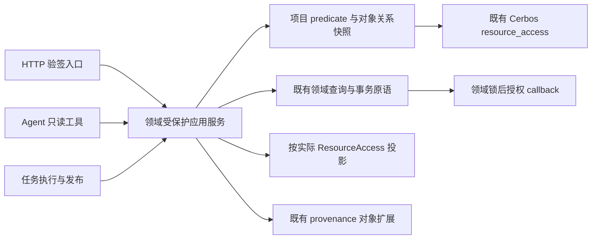

# S3 项目授权接缝与迁移缺口（只读设计）

本文没有实施 S3。检查对象为 S2 工作树中的既有维保代码；配套 [s3-resource-seed-gaps.json](s3-resource-seed-gaps.json) 记录实际源码 SHA256、228 个 human method/path 的当前依赖及 47 个候选资源的缺口。另有 11 个补库旧入口必须继续 410。239 个入口、39 个 API 模块与先前逐入口清单的集合相等，只证明入口盘点，不代表权限语义已闭合。依据 D-0027、D-03、D-25、D-07 与当前实际实现；本文明确指出草案和实际代码的差异，不能把草案反过来当业务真值。

后续完整执行设计已收敛为 [s3-execution-spec.json](s3-execution-spec.json)：原47候选拆成73个实际数据合同、228个 human入口全部精确绑定。本文第8节保留盘点历史，动作/字段/seed与HTTP wire以full spec为准；10项复杂差分另保留execution delta。

已与根确认：继续复用 typed `VerifiedIdentity`、`resource_access`、领域锁后 actor SHARE、S2 文件/Agent provenance；对象 `authorization_revision` 采用每次重新计算的 opaque 关系指纹。它不是通行票，不代替完整对象政策、当前身份/epoch、Grant version、真实 parent 绑定的复核。S3 仍等待 S2 精确提交的 CI 门，只有设计文件变更。

## 1. 先冻结共同依赖，不先给 router 套统一门



根部领域模块建议 `services/maintenance_authorization.py`。它隐藏关系查询、SQL 绑定、指纹、parent 解析、完整 D03 合同择选，不接收客户端声称的 role/scope/owner。普通领域服务继续负责事实计算、版本冲突、幂等与事务；新应用服务负责授权与调用编排。所有受保护函数可供 HTTP/工具/任务调用，不互相 import API。当前 `services/maintenance_row_workbench.py` 反向 import `api/maintenance_project_scope.py` 要先解除；多个 workbook API 共用的 multipart、错误文件、worker 清理辅助应移到单一基础模块，禁止三组作者各复制一套。

## 2. 精确项目集合与 SQL

下列是旧业务集合的可执行定义，不能都叫“本人项目”。角色只用来做一次性 legacy seed；切换后的谓词由显式 scope 决定。`P` 为稳定项目表，`U` 为当前已验证且有效的账号，`A` 为项目账号关系。`is_active` 项目过滤依具体业务查询决定，不能塞进所有授权谓词：归档项目的历史读取/恢复和未归属事实仍有既有行为。

基础 SQL：

```sql
-- M: 当前 primary_manager；V: viewer。身份来自已经验证的 U.id。
EXISTS (
  SELECT 1 FROM maintenance_project_user_assignment a
  JOIN sys_user u ON u.id = a.user_id
  WHERE a.project_id = p.project_id AND u.id = :verified_user_id
    AND u.is_active IS TRUE AND a.archived_at IS NULL
    AND a.responsibility_type = 'primary_manager'
)
-- V 同上，responsibility_type = 'viewer'
-- S: 精确 canonical 销售关系；没有名称时为 FALSE，不比较两个 NULL/空串。
p.salesperson = :current_nonempty_salesperson_name
```

| 集合 | 既有定义 | 当前实现与迁移用法 |
| --- | --- | --- |
| `assigned_projects` | M ∪ V | `maintenance_project_assignments.owned_project_ids`；名字 owned 实际含 viewer，不能改成 manager-only。 |
| `assigned_or_sales_projects` | M ∪ V ∪ S | `can_access_project` 的非 FULL_SCOPE 分支，不论 own_maintenance_projects_only 是否开启，canonical 销售都可直接访问。 |
| 目录 D | FULL_SCOPE → ALL；其余 scoped → M∪V∪S；其余 → M∪V | `api/maintenance_project_scope.resolve_visible_project_ids`；全局行、需求目录/需求操作、部分导入使用它。未 scoped 的销售不能因直接可访问而自动进入目录。 |
| 汇总 SCOPE | 非 scoped → ALL；scoped → M∪V∪S | `maintenance_scope_project_ids`，dashboard/analytics 在聚合之前与请求筛选相交。`None=ALL`，空集合=false；空查询参数不等于空授权集。 |
| 卡片 | role=maintenance_manager → ALL；其他同汇总 | `maintenance_boss_board._project_card_scope`，只迁成该资源的显式 ALL scope，不能把目录/详情一起扩大。 |
| 直接项目 | FULL_SCOPE → ALL；其他 M∪V∪S | `can_access_project`；主档/workspace/具体 return 等。对象缺失与不可见仍按各端点原 403/404 合同，不统一成空列表。 |
| 月度经理文件 | 当前实名账号的 M 且项目 active；必须非空 | `maintenance_manager_workbook_adapter._scope_assignment_rows`；不包含 V 或 S，`_owner` 另要求合同额可见 F。 |
| 提醒目录 | 默认 FULL_SCOPE=all，其余=me；me=M∪V | `collection_reminders.search_reminders`；详情/节点写使用直接项目关系。`owner_scope=all` 不能由普通主体传参升级。 |
| 来源维保单目录 | FULL_SCOPE 任意有效单；其余仅 active assignment.project_id ∈ M∪V | `maintenance_source_assignments.list_source_orders`；未归属单对非full不可见，canonical S 不额外加入。assign/unassign/auto_assign 当前仅full。 |
| 仓库文档 | FULL_SCOPE ALL；其余存在 active project link 且 linked project ∈ M | `maintenance_warehouse._document_scope_condition`：document_id→link(kind=project,target_type=maintenance_project,status=active)→assignment(primary_manager,not archived)→live U。不能用 V/S 通用项目集。 |
| 旧成本来源 | own_customers_only=false → ALL；true → `f_maintenance_order.salesperson == U.salesperson_name` | `maintenance_cost`；使用源订单销售名，不是 canonical project.salesperson，也不是上述 own_maintenance_projects_only。缺绑定名称必false。 |
| 全库报销对账 | ALL，原 admin/boss + live F | `maintenance_expense_reconcile` 无 project 参数；候选 direct_access_projects 不符合实际。 |
| 补库申请 | cart 为 owner；application 为 owner（admin原全量）；提交另验当前项目集 | `replenishment._application_scope` 与项目验证分开。业务所有者与 project scope 是两个条件，不能互相替代。 |

`FULL_SCOPE_ROLES={admin,boss,PHASE1_BYPASS_ROLE}` 是旧代码事实；canonical 不保留其 runtime 通行分支。旧 scoped 判定还包含 ENABLE_RBAC 与 FULL_SCOPE 例外，seed 必须解释保存的旧权限真值及原模板/覆盖来源，而不是仅按 role=sales 猜。运行 feature gate 与永久授权分开：部署暂时关闭 Beta 不能把本来存在的 entitlement 永久种成空；但原 explicit Beta 账号资格不能在切换时被悄悄丢掉。

**SQL 接缝**：尽量把 M/V/S 作为可信 `QueryBindings` 的 EXISTS/列表达式，经 Cerbos plan 返回 predicate 后附到事实 join 上。不要先全量查敏感行再 Python 过滤，也不要为复用 `read_accesses` 强行改 scope=all。现 `read_accesses` 拒绝 contextual/query-bound 资源；S3 需要注册精确 query attributes，并用真实 Cerbos/SQL 反例验证 EXISTS 的 plan 编译。可以复用 `maintenance_dashboard.resolve_project_scope` 的交集逻辑、`active_orders` 的业务有效性、行筛选 registry 的白名单；它们收到的是已授权集合/表达式，不再自己读旧角色。

## 3. D03 是对象与完整字段合同的择选

令 F 表示当前调用点的旧利润可见性，X 为旧 `action_maintenance_expense_collection_upload`，G 为 `action_maintenance_project_manage`。具体旧 helper 有 admin/RBAC shortcut、`perms is None` 与 `perms or template` 的差别；迁移 interpreter 要使用已冻结 effective 图解释已存配置，并对这些差异做独立向量，不能通过新 `field_context` 再读旧权限。

| 旧入口 | 准入/字段资格 | 新资源/接缝 |
| --- | --- | --- |
| master V1/V2 download | 已可直接访问，admin 或 F 或 M；销售分支仅 S∧F | `managed_workbook.download` 只 M+完整文档字段；`general_workbook.download` 自己的完整文档字段+自己scope。 |
| master V1/V2 validate/apply | 已可直接访问；admin 或 X∧F 或 M 或 S∧F | `maintenance_managed_workbook` 与 `maintenance_general_workbook_write` 择选；general 读取单独资源，不能把 download 的宽范围转成上传资格。 |
| master 合同额变化 | 实名；G∧F 或 M 或 S∧F（RBAC关闭旧例外） | 是精确文档 operation，不能因能改合同额获得普通项目备注、合同建档、viewer改写等能力。 |
| master 项目备注变化 | `action_project_manage+F` +实名 | 不继承 M 的整本文档金额例外；混合文件全部所需 operation 合同在写之前通过。 |
| expense-collection workbook | download=admin或F；validate/apply=X∧F；直接项目 | `maintenance_finance_workbook`；没有 D03 M 豁免，不能复用 managed 的全财务。 |
| 旧 project/workbook roundtrip | 非 own_customers_only，C∧F∧K；validate/apply/error 文件另 roundtrip_apply | `maintenance_project_roundtrip` 内必须细分旧v2动作/合同。 |
| project/workbook-v3.xlsx | 当前实名 C∧F +直接项目，没有旧v2的K或禁scoped条件 | 不可同旧v2只用一个 download 授予；建议 `download_v2` / `download_v3`，最终命名由root统一。 |
| manager monthly v3 | `_owner` 对**所有**status/download/validate/apply检查合同额F；自身active M集合；apply再manager_workbook_apply | 与 D03 master完全不同；`maintenance_manager_workbook` 保留其整集合 scope_version/校验令牌。 |
| global lines workbook | 目录D；download=admin或F；validate/apply=X∧F | `maintenance_global_workbook`；不能因为一个项目M而把整文件财务放开。 |
| 单项目 row-fields/readonly export；global rows/fields/export 带 project_id | 金额=admin 或 F 或 M（`is_project_workbook_editor`的S分支还需F） | 拆 `maintenance_managed_rows` 与普通行资源；global 无 project_id 时不借每行 M 权限扩出金额。 |
| 单项目 master-workbook/rows 成本 tab | **外层** `_require_profit_visibility`=admin 或 F；之后才调用金额 helper | 只绑定普通 `maintenance_row_workbench.read_cost_rows`；M 且 F=false 不能进入，不能因内层 helper 存在 D03 而扩张实际入口。 |

**混合身份毒针**：账号是 A 项目负责人、B 项目 canonical 销售，旧 F=false。A 的 managed 完整字段允许，B 不允许财务，V项目同样不允许。绝不能把 `managed_workbook.fields={all}` 当成 user 全局财务图，或用它使 B 的 S∧F 分支变 true。

**已采纳的拆分方向**：单个 resource Grant 只有一个 scope+field set；不能以 direct scope+全字段承接 A 的 M 例外，否则会扩大 B。配套 [s3-execution-contract-delta.json](s3-execution-contract-delta.json) 固定推荐 10 个相关资源的 actions/scopes/fields、旧 seed AST 与 21 个精确入口映射；新增 `maintenance_managed_rows`、`maintenance_general_workbook_write`、`maintenance_contract_amount_write`，本轮候选 47→50。managed 与普通合同按实际对象择一完整匹配，不并集 fields；general 读允许 direct，无上传键的 general 写只 S。合同额 operation 还需自己完整授权，旧 helper **没有独立 admin shortcut**。这些是设计合同，不是已执行 seed；其余独立缺口仍由第8节列出。

## 4. authorization_revision 的可证明组成与边界

根已采纳 opaque 指纹推荐，避免新增触发器及其锁顺序。建议 `mpr1:<sha256(canonical_json)>`；输入来自数据库，不接收客户端返回的关系图。固定 key/order、UTF-8、NULL与空串严格区分，整数不经浮点，指纹只作对象上下文/旧结果失效依据，不是签名授权票。

- 项目快照：project_id、project.version、is_active、canonical salesperson、salesperson_override_active；必要时 workbook state.revision（存在才读，不在普通读中创建状态行）。
- 项目 ACL：排序的完整 manager/viewer 关系投影 `(assignment_id,responsibility_type,user_id,version,archived_at)`。至少当前有效关系及其generation必须在指纹；若只取effective集合，必须证明移除后再添会产生新ID/版本。不要用 display_name/project_manager_id 文本代替关系。
- actor：来自当前 principal 的稳定 id、authorization_epoch、当前 salesperson_name。这些放独立主体证明，不将共享role映射伪装对象revision；账号映射修改已有受保护security命令推进epoch。
- 子对象：`object_type/object_id`、实际 project_id、真实parent链、每个有版本的 link/entity 的ID+version+状态。source_order→active assignment、contract→project、receipt→old/new project、attachment→deliverable→project、warehouse document→active links 的路径不能由URL里的project_id代替。
- 文档/集合：精确项目集合 +每项revision，另有按业务需要的 scope-selection digest。旧文件不因后来新增项目自动扩张；月度完整集变化仍按原scope_version冲突。全量汇总产物还必须绑定当时作用域解析结果或整个关系集合的revision，不能只记录已输出的Top N。

| 关系贡献者 | 已实读的版本/代次行为 | S3接入位置 |
| --- | --- | --- |
| 主档销售名、归档/恢复 | `maintenance_project_catalog.update_project/set_project_active` 有project.version和workbook revision bump | name identity锁在state之前；锁后重新取project与actor，不能只复用请求开始的ctx。 |
| primary manager改派/归档 | assignments 新建UUID、旧关系version+1/archive；可选销售同步project.version+1；workbook bump | 包括assign_primary_manager与archive_primary_manager，不只HTTP路由。 |
| viewer整组同步 | `sync_project_viewers` 归档version+1/新增UUID；API聚合project.version、workbook revision | viewer-only PATCH也走state→project OCC；主档+viewer混合修改保持原单次bump，不为authz再次倍增。 |
| 源单销售自动回填 | `maintenance_source_assignments._backfill_project_owner` 更新既有project.version；可建manager assignment；新项目首次成形特殊skip | 保留人工清空salesperson_override，不因seed/自动导入恢复旧授权关系。 |
| 台账导入销售变化 | `maintenance_ledger._upsert_project` 对销售/override等真实变化project.version+1 | importer内部commit前callback，预检不能当写时授权。 |
| 来源单改派/撤销/墓碑 | source_assignments旧关系version+1、新关系UUID；maintenance_demands墓碑停用关系version+1 | 锁全部旧/新项目后复核parent；不能在actor锁后再发现额外项目并追锁。 |
| 历史项目归并 | project_identity归档source project.version+1；manager/viewer迁移新UUID/旧version+1；source link新generation；canonical workbook bump | 迁移run/归并是独立受保护命令；所有受影响parent均进入artifact依赖，不仅canonical。 |
| 实收返还跨项目修改 | `maintenance_return_receipts.update_receipt` 与import apply bump receipt.version，明确old/new project锁 | 当前parent参与每次检查；上传源头行project_id本身不能替代正式receipt版本。 |
| XSDD稳定映射 | `maintenance_project_xsdd`无自身version；claim只新增或同属校验；merge可批量移动映射 | 指纹包含实际mapping值及关联project/workbook generation。**尚未证明所有历史/运维SQL路径ABA**，不能单凭映射内容宣称单调。 |
| doc head重解析 | doc_import.relink_projects只处理project_id IS NULL，非空不覆盖；head无通用授权版本 | 本身是NULL→parent，当前合法函数不是可反向ABA接口；若未来允许rebind必须加generation，不能只hash parent值。 |

以上是已查主路径的静态证据，不是对全库任意 SQL 的 ABA 证明。尤其 project_identity 的反射FK迁移、历史脚本/迁移、原始head/link缺version，必须在S3实施时用持久测试覆盖。若合法业务写发现 A→B→A 且以上全部版本/代次均未变，应先修该领域已有版本bump或引入单调关系revision；不能补一个缓存绕过。即使指纹相等，任务发布/下载/重放也重跑完整当前对象政策；即使指纹变化后当前仍允许，旧文件按照原快照/再生成合同处理，不能自动扩展内容。

**一致性**：多次无锁READ COMMITTED查询不保证关系快照与事实读取同一时点。只读领域应用采用短独立 REPEATABLE READ 批量快照；所有actor、Grant、真实parent及该次事实投影来自同一观察；它们不能同时成为写命令的预锁依赖。单条列表 SQL 可将predicate直接关联事实；需要返回capabilities/指纹时，批量读同一快照，避免N+1。普通读不得偷偷创建workbook state/写revision。若采用短项目SHARE，则也必须先领域锁再actor锁：reader先actor SHARE后等project，会与持project UPDATE、准备锁同一个target用户UPDATE的assignment写形成反序；不因是GET就例外。

## 5. 提议的深模块 Interface

以下为 S3 设计签名，尚未实现；公用核心既有名称保持不变。模块内部在 SQLAlchemy/Cerbos 绑定上实现，不将“ctx带角色”的泛型上下文作为authority。

```python
# 查询：结果只能由可信域模块构造；identity来自验签adapter。
project_read_plan(db, identity, resource, action, *,
                  collection_ref, selection, context_batch,
                  locked_user=None) -> ProjectReadPlan

# 单对象：解析真实parent、校验predicate命中、返回资源配对的完整合同。
authorize_project_object(db, identity, resource, action, *,
                         object_ref, locked_domain=None,
                         locked_user=None) -> ProjectObjectAccess

# 只对指定document kind选择一个完整合同，不合并fields。
authorize_workbook_document(db, identity, *, document_kind, action,
                            project_ids, parsed_operations=(),
                            locked_domain=None, locked_user=None) -> DocumentAccess

# 写事务由领域原语拿完原有锁再调用，不自行commit/升级锁。
authorize_locked_command(db, identity, *, command, locked_domain,
                         locked_users) -> CommandAccess

# 当前真实parent重解析，提供给既有provenance的注册domain validator。
revalidate_project_dependency(db, identity, dependency) -> ProjectObjectAccess
```

| 名称 | 类型/用途 | 定义原因与限制 |
| --- | --- | --- |
| identity | VerifiedIdentity | 真实验签结果，不能从UserContext/username构造；失效实名401。 |
| resource/action | 注册常量 | 由应用服务选择，不让用户传字符串切换成更宽资源。 |
| relation_family | 域内封闭枚举 | 对应第2节确切集合，内部选ORM绑定；不是客户端scope。 |
| project_binding | 可信SQLAlchemy绑定 | 将授权predicate作用于当前事实parent，不允许不相关项目子查询。 |
| object_ref | 封闭类型+稳定ID | 域内解析parent；仅最小路由元数据可在对象准入前读取。 |
| locked_domain | 已持锁的领域对象包 | 指明已锁state/project/contract/facts，刷新ORM缓存；发现漏锁父对象立即冲突并重启事务。 |
| locked_users | 已按最终强度稳定排序锁定的用户包 | 复用actor行，避免晚升级或反向target锁。 |
| ProjectReadPlan | ResourceAccess+predicate+投影合同 | scope先进入SQL，再做聚合/分页/筛选候选；不把整图permissions往下传。 |
| ProjectObjectAccess | ResourceAccess+真实parent+authorization_revision | 才能产生对象capabilities、文件依赖；仅`resource_access`计划存在不等于对象匹配。 |
| DocumentAccess | 每项目选定的完整合同+操作要求+精确范围证明 | 不从“某项目有权”推导整文件有权，不并集fields。 |

列表计划尚无单project_id时，提议使用域内封闭的 collection_ref +当前完整关系集合指纹，交给同一resource_access；它不是客户端可选对象ID。逐对象capabilities仍用实际稳定project_id。不能以Top N输出代替全集合关系证明，不能用scope=all绕过context_scopes检查；该集合上下文wire由root与前端一并冻结。

`resource_access(... bindings,attributes,object_id,authorization_revision,locked_user=...)` 已有。它返回计划，不执行目标行查询；领域适配器必须验证目标对象确实命中predicate。`requires_context` 的 /me 决策不能变成前端允许按钮，真实对象响应带稳定ID/revision和实际决策；响应读取方只消费其适用对象。

建议三组应用入口分别为 `maintenance_read_access`、`maintenance_workbook_access`、`maintenance_flow_access`（命名待root最终文件ownership），共同调用上述单一关系模块。查询/写动作采用显式函数，避免一个接收任意handler/resource名称的万能dispatcher。旧业务纯计算、解析、render、hash/签名可复用，角色门和字段派生必须迁到受保护边界。

### 对象及集合响应的最小协议

复用现有详情、列表和工作簿 status/preview 响应，附加 `authorization_context`；不新增任意 resource/action 的通用探测端点。顶层含 `schema_version=1`、当前 `catalog_version`、`authorization_epoch`；`context` 含 `{kind: project|collection|object, id, object_type?, authorization_revision}`，object_type仅kind=object时必填且来自闭集，`resources[resource_id]` 含当前 `grant_version`、S1 `decisions[action]={effect,reason}` 与**该资源** `field_permissions`。完整形状、closed object_type/collection_ref、12个view=authorization领域resolver统一在full spec。

- project id 是真实稳定 ID，集合 id 只能是域内注册 enum；不同报表 purpose、report_month、规范化筛选/选定项目集进入集合指纹，客户端不能给 SQL、scope 或 resolver。
- 集合计划先 SQL 过滤，再聚合/分页/filter-options；集合 allow 只证明该次集合操作，不能为其中任意具体项目的写按钮授 allow。写按钮必须消费真实对象当前 capability；`/me.requires_context` 仅提示需要上下文。
- 指纹绑定完整关系贡献者和选择，不只 Top N/当前页。普通分页的 offset/page_size 不改变授权集合；真正改变集合的筛选或手动项目选择必须进入 selection binding。
- 服务端每次 command 都在原领域锁之后重验身份、Grant 和实际关系。客户端回传 revision 只是原对象/集合上下文 OCC；不能替代完整授权，也不接受客户端 capabilities 当凭证。既有业务 expected_version、文件签名及幂等规则继续各自校验。
- 无 Grant 的拒绝保留 `grant_version=null`；版本与 epoch 均按 S1 safe integer 要求。普通 deny 可给相应块决策，PDP/DB/runtime 异常不能伪装为局部 deny。

**字段适配限制**：finance workbook、manager monthly、contract_amount operation 的固定内容合同是 F-only；旧 F seed 来自经过 runtime_safe 的旧图，canonical F 不再隐含别域 C。它们使用当前 ResourceAccess 的注册字段直接检查和领域投影。不能将 F-only Grant 套回旧 `hidden_groups/runtime_safe`（其全局 F→C 会静默拒绝），也不能为哄过旧 helper 补 C。含真实成本和利润的 master/roundtrip 则保留同资源 F→C dependency。row_workbench 金额 registry 直接消费本资源 C，不再调用带 role/M/S 判断的旧 `can_view_amounts`。

## 6. 写锁后授权接入与死锁约束

| 写族 | 已有领域顺序/可复用入口 | callback具体时点 |
| --- | --- | --- |
| 主档/manager/viewer/总表 | 可选名称/XSDD identity锁 → 全部state(sorted) → project(sorted) →assignment/facts | 拿完本命令全部领域锁，再actor/target用户集合最终锁，刷新principal/关系，再验证与写；回执投影在commit前。 |
| 回款提醒 | state→project→contract→milestone，已有幂等ledger | replay命中也先当前授权；正常路径milestone最终锁后、状态派生/写前；canary与active contract保留。 |
| 实收返还 | DATA_CHANGE advisory SHARE→old/new project SHARE→receipt/demand锁 | 复用`lock_receipt_context/lock_receipt_projects`；不得为了统一state顺序给这条从不写state的路径补反向state锁。 |
| 返还导入 | receipt context→import advisory→batch/old+new project/receipt锁；已有scope_provider | 该provider扩成完整typed授权callback；核对全部旧/新parent、Grant/epoch，而不是只重算旧ctx可见IDs。 |
| source cancel/demand delete | 原DATA_CHANGE/业务锁与集合OCC；部分已有reauthorize callback | 直接接入callback；删除/恢复、幂等回执、墓碑状态规则不变。 |
| monthly manager workbook | owner-operation advisory→state(sorted)→project(sorted)→assignments→owner用户 | 保留scope二次比较；owner==actor取最终需要的锁，不先SHARE再UPDATE。 |
| ledger/doc/bulk transfer | importer既有batch/advisory/target project锁，部分内部commit | 在领域原语暴露after-lock callback或事务-owned模式；不可HTTP预检后把用户名传进长期worker。保留原整文件/分批提交边界。 |

**具体反向锁案例**：原`assign_primary_manager`在project锁后锁target SysUser UPDATE；若再补actor SHARE，A在P给B指派、B在Q给A指派可互等。域锁对不同项目不串行化。应在所有领域锁后收齐actor+全部受影响用户，按稳定user_id顺序一次取得最终强度（相同用户取较强锁），再实时principal校验。保留原OCC与same-target无变更拒绝顺序。

**同一actor两领域写**：不修改账号的命令用actor SHARE即可阻塞管理员UPDATE；不要为“更安全”用UPDATE引入与项目/物料FK锁的反向等待。新建assignment引用target用户可能隐式拿KEY SHARE，因此先收齐这类target锁需求；不能只看显式FOR UPDATE。若一个领域命令会改用户或关系，应先核实目标用户集合，不在callback后偷偷追锁。source auto-fill可调用assign_primary_manager，属于隐式target用户锁接缝，不能按普通导入忽略。

只读snapshot和写command必须有不同调用路径。现在`service.resource_access`会获取actor SHARE，若在写handler最前调用它再等待领域锁，仍可能与现有domain→user链死锁。先验签可以；预先取业务Grant并持actor锁不可以。

## 7. 字段、聚合与文件合同

- boss board/analytics成本看C、合同/回款/预算看F；新dashboard的金额可见性实际挂F。不能把所有包含`cost`单词的域统一强制C，或者把所有维保数据统一F。
- front_stock/recovery数量与库龄可读，单位成本/估值/成本证据按各资源C隐藏。采购面板unit_price同理。salvage旧整表按F门，其有效旧图F蕴含C，实际完整输出含成本和利润；full spec固定同资源C/F完整合同，seed同时授予，不借其他资源字段。
- D25成本禁用还影响按成本排序、份额、颜色、缺价信号；客户隐藏还影响维度和filter-options。registry/SQL选择列与派生字段必须一起受控，不能只在JSON尾部遮金额。
- workspace复合响应固定 project_identity、operation_summary、contracts、collection_snapshots、requisitions、approved_expenses 六个块；没有当前不存在的 cost_gaps 顶层块，复用S2 `block_access`。普通缺Grant才deny块；PDP/DB/runtime故障整请求失败；deny块不执行事实SQL，计数/金额null、行[]。基础对象可访问不自动授其所有子域。
- board HealthBand/summary的合法**聚合**信息必须先明确归属summary的具名动作与field合同，再与原read面等价seed。不能把它伪装成可读原始expenses/collections，也不能未经决定强加原始明细read依赖而缩窄既有汇总权限。
- 二进制文件在render之前授权整份字段/对象集合。原始上传件和server生成件继续按真实metadata来源区分；owner只是必要条件之一。重新投影不能把旧文件中的字段真正删除时，应拒绝并要求重生成。

## 8. 47资源 seed缺口台账

下表缩写与精确入口、当前闭包依赖、源码hash见JSON；它是可执行迁移前的缺口列表，**不是已经通过对抗验证的最终seed解释器**。P=page_maintenance，C=data_purchase_cost，F=data_profit，K=data_customer；动作简写省略`action_maintenance_`。普通admin shortcut与显式账号/live F门分别保留。JSON中每个human入口只存一份证据，资源引用该入口及候选动作。

| 候选资源 | 已核实的 scope / seed 门 | 迁移前必须闭合的缺口 |
| --- | --- | --- |
| `maintenance_acceptance` | directory for search; direct for object; attachment resolves deliverable parent<br>checklist read/preview/apply/template: P, no retired checklist-import action and no Beta; deliverable/attachment: Beta+P, writes action_acceptance_submit | Checklist and deliverable share read but different Beta eligibility; split named reads. No finance fields should be inferred from generic candidate field list; inspect actual attachment payload and preserve whole-file sensitivity. |
| `maintenance_ai_assist` | proposal owner; admin all only for proposal listing; accepted target import parent<br>P+Beta; propose/accept selected doc_type action_doc_import+C OR action_ledger_import+F; list own proposal metadata | Split document/ledger propose and accept, or explicit branch dependencies; one generic action with union fields expands. AI remains proposal only; human acceptance is not autonomous business writing. |
| `maintenance_analysis` | summary scope S<br>P; cost according to data_purchase_cost; customer filters require K | D25 customer/cost filter, dimension, order, share and color dependencies must be registered per operation. can_open_project is a separate object capability. |
| `maintenance_assignments` | candidate directory is company active accounts; assign/archive global protected relationship command<br>candidate_read=P; assign/archive=Beta+P+live admin+action_project_manage+F | Do not attach manager-only project scope to account candidate search. Relationship-changing action remains protected administration; seed only current admin-qualified users, no implicit role allow after cutover. |
| `maintenance_audit` | company masked diagnostics, no project predicate today<br>P; no cost/profit requirement | Do not use candidate direct scope or auto-require C/F. Masked counts/sample refs are the precise read contract. |
| `maintenance_collection` | direct per object; workspace separate block<br>create/update=Beta+P+action_roundtrip_apply+F; plan read=P+profit visibility; restore_plan=live named admin | Single read currently conflates workspace projection and plan full finance. Restore not implied by update. Workbook D03 changes must use their own document contract. |
| `maintenance_collection_followup` | directory active projects with owned(manager|viewer); direct project/milestone<br>P+Beta; record/evidence_upload=explicit account follow_up key, no admin shortcut; amount projection F | read/evidence_read do not require follow_up allowlist. Keep canary/project/contract live guards; directory and direct detail require distinct predicates. |
| `maintenance_collection_plan_import` | whole import owner and current binding project/contract set<br>P+Beta+named admin+explicit collection_plan_import+live F for all endpoints | No ordinary admin shortcut to explicit allowlist. Raw download checks entire document rather than visible preview rows. New binding creation must be authorized before any write. |
| `maintenance_contract` | direct per object and exact current contract parent<br>Beta+P; create/update/archive action_project_manage+F | Workspace read must separately project contract amounts. D03 contract amount changes are a narrower document operation, not general contract-create/admin-note authority. |
| `maintenance_contract_cost` | all contract records only when not own_customers_only<br>P; read rejects scoped sales; export additionally C+F | Do not apply stable-project summary/directory scope to this old contract board. Preserve contract financial field coupling and full export eligibility. |
| `maintenance_cost` | source FMaintenanceOrder.salesperson, not canonical project salesperson<br>P; read and ordinary exports can mask fields; workbook exports reject scoped and require C+F; recompute live admin | Split export_rows vs export_workbook under this resource; generic export would merge incompatible file/scope qualifications. None/empty salesperson means false when scoped. |
| `maintenance_cost_fill` | direct project; admin global backfill<br>read=P+Beta, cost projection; fill/recompute action_project_manage+C; backfill live admin | Backfill is global repair, not direct project action. Response stats may reveal cost quality; require explicit financial projection instead of copying author role. |
| `maintenance_cost_roundtrip` | whole contract file; not own_customers_only<br>P+C+F+K; apply action_roundtrip_apply+F and named operator | Keep template download separate from editable import. All rows/fields/signature/replay qualified; neither visible subset nor page grants full file. |
| `maintenance_dashboard` | summary S intersect selected IDs before aggregates<br>P; amount visibility is admin OR F, not C; valuation requires F; explicit policy adjustments follow valuation query rule | S3 field set must reflect F-based valuation despite cost-looking names. Separate valuation read from quantity reads and query override action; defaults never count as attempted override. |
| `maintenance_demand` | directory D for search/edit/delete; restore global admin; intent owner and saved set<br>P+Beta; delete/plan action_demand_delete; create/edit/clear action_demand_manage; restore named admin+delete | Draft direct_access_projects is inaccurate. read combines intent status(delete action), manual protection(manage action), ordinary search. Split named reads, bind intent parent set; no automatic cost fields for edit. |
| `maintenance_document_import` | owner or admin/boss; relink owned(manager|viewer) unless full<br>P+Beta+action_doc_import+C for preview/read/apply/relink | CKD/doc import global and per-document ownership need explicit own/all-import scope. Relink only fills null parents; no direct-project union widening. |
| `maintenance_expense` | direct project; admin global attribution repair<br>P+Beta; create/readiness/status action_roundtrip_apply+F; expense_rows P+profit; backfill live admin | Split read details from workspace aggregate. Admin-only global backfill not inferred from expense.create. D03 workbook editor must not automatically receive other expense commands. |
| `maintenance_expense_reconcile` | all-company raw/ledger/official-fact reconciliation<br>P+Beta+named admin/boss+live F | Draft direct_access_projects is wrong: API calls expense_reconcile_rows without project filter. Explicit company scope and financial read, no invented project restriction. |
| `maintenance_finance_workbook` | direct project<br>download P+(admin OR F); validate/apply P+action_expense_collection_upload+F; no D03 manager bypass | Use finance file own fields; candidate C/K are not automatically mandatory old gates. Do not reuse master-workbook D03 selector. |
| `maintenance_front_stock` | direct project<br>P+Beta; quantity/age readable, valuation C | Null all derived valuation/price flags when C denied; no all-finance requirement for quantities. |
| `maintenance_general_workbook` | direct D03 general qualifier, separated from managed M<br>download P+(admin OR F); validate/apply P+(admin OR upload+F OR canonical sales+F) within direct set | One grant scope cannot encode general upload for all direct projects and sales-only upload when no upload key. See D03 matrix and field-pairing proposal; no fields borrowed from managed resource. |
| `maintenance_global_rows` | directory D; optional project still intersect D<br>P; amounts admin OR F; with explicit project can invoke D03 editor amount exception | D03 conditional fields also exist here when project_id supplied. Need named managed-row action/contract before seeding F globally; filter metadata enum queries must obey same fields and scope. |
| `maintenance_global_workbook` | directory D, exact uploaded project set<br>download P+(admin OR F); validate/apply P+action_expense_collection_upload+F | No manager D03 bypass for whole global file. Scope refresh inside transaction, not precomputed IDs reused after wait. |
| `maintenance_issue` | directory for searches; direct object for writes/detail; source-order parent mapping<br>P; most write paths Beta or boss feature + action_site_issue_manage+C; correction endpoints reauthorize inside service | Same resource contains stable and Beta surfaces. read/preview/create must preserve each gate; correction payload independent validation and void/tombstone business locks remain. |
| `maintenance_ledger_import` | batch owner or admin/boss; whole imported target set<br>P+Beta+action_ledger_import; preview/apply additionally live F; read metadata currently no separate F guard | Separate report/financial preview from safe metadata or make deliberate contract change. Existing importer commits internally; inject lock-time authorization before first domain change and before receipt replay. |
| `maintenance_managed_workbook` | active primary_manager relation M only; never viewer<br>P+M; download/validate/apply bypass old financial keys by D03 | Full document fields only under M. Role alone and project_manager_id display text are not membership. Seed latent managed scope, not a list of current projects, so later assignment works without role recomputation. |
| `maintenance_manager_workbook` | current named owner active primary_manager projects; nonempty current set<br>P+Beta; every entry _owner requires visible contract_amount(F); own manager set; apply additionally action_manager_workbook_apply+F | D03 master manager exception does not cover this monthly adapter: _owner requires F for status/download/validate too. monthly scope_version already assignment+project vector; retain exact whole-set compare and owner-late-lock protocol. |
| `maintenance_migration` | run/project manifest set; legacy named reviewer qualification<br>P+Beta; explicit persisted migration_review+C+F (admin no shortcut) | Preview/read/approve/reconcile each bound to run manifest. Inspect global vs per-project evidence; historic scripts are trusted deployment actions, not normal project grants. |
| `maintenance_project` | direct except global backfill; manual create decision conflict<br>P+boss feature; update/archive/restore/manage backfill action_project_manage+F | Do not seed create_conflict: D05 only sales-order import creates projects. viewer-list change is an authorization-bearing command, not ordinary metadata field. Separate global backfill scope. |
| `maintenance_project_cards` | manager role all-company; otherwise summary S<br>board view admin OR page_maintenance OR page_maintenance_boss | Seed manager all-card scope explicitly without granting project detail. Card financial fields use exact card projection; can_open separate direct decision. |
| `maintenance_project_directory` | D: full all; scoped assigned-or-sales; other assigned only<br>P+boss feature | Do not widen unscoped salesperson directory to direct set. Requested owner filters cannot widen stored scope. Actual project existence/lifecycle remain business filters. |
| `maintenance_project_operations` | global search/list summary-scope helper; direct tasks/workspace<br>P+Beta or boss feature depending handler | read collapses tasks/workspace/list and multiple domain blocks. Split named reads; workspace block_access per actual resource, no broad role field context. |
| `maintenance_project_purchase` | direct project plus optional assigned source_order_id<br>P+Beta; unit_price projection via data_purchase_cost | Use own purchase resource fields, not maintenance_summary/parts purchase grant. Parent association must be checked in SQL, including supplied WBDD filter. |
| `maintenance_project_roundtrip` | direct; old v2 also not own_customers_only; v3 does not have that old exclusion<br>v2 download/validate/apply/errorfile: P+Beta+C+F+K and not scoped-sales; upload/error additionally roundtrip_apply; v3 download P+Beta+live C+F | Split download_v2/download_v3 (or equivalent independent data contracts). Single download action with union C/F/K or scope widens or narrows one path. |
| `maintenance_project_transfer` | selected whole document; directory for apply; summary selection for export branch<br>board view; preview/apply ledger_import+F; receipt_ruling named admin/boss+F; export field whitelist | Specific file_type/forms and selected_fields alter readable/writable domains. Preserve selected project set and operation semantics, no global all-project implication from batch action. |
| `maintenance_recovery` | direct project<br>P+Beta; quantity read with C-masked cost/valuation | Derived balances and cost evidence null when hidden; number-only read cannot require F. |
| `maintenance_return_import` | batch owner plus directory authorized projects for entire preview/apply; original file whole set<br>P+boss feature+bad_return_manage on router including job metadata/raw download | Typed identity must reach worker; apply scope_provider after old/new parent and receipt locks; original must not authorize by owner only. |
| `maintenance_return_obligation` | directory for search, direct project/object; category dictionary/admin resolver global<br>P+Beta; writes bad_return_manage; category read/resolve live admin | Split category_read from ordinary obligation read; do not let ordinary read grant admin diagnostic dictionary. Warehouse-confirm is workflow state not official usable-stock inbound. |
| `maintenance_return_receipt` | direct old/new project; receipt audit resolves current parent<br>P+boss feature; create/update/void bad_return_manage; reads no finance requirement | Moves require both old and new parent access after locks. DTO has quantity/SN/evidence/audit metadata, not generic C/F/K; keep scoped count before aggregate. |
| `maintenance_row_workbench` | direct project<br>row-fields/export金额 admin/F/M；成本 tab 外层另需 admin/F | 已由 execution delta 拆 managed_rows 与 ordinary read_cost_rows；保留成本 tab 更严格旧门。待实施 SQL/字段与反例验证。 |
| `maintenance_salvage` | direct project and stored salvage parent<br>P+Beta; read live F; register/void bad_return_manage+F | Costs and gross profit are included by this specific full F contract; do not accidentally require additional C because names look like cost. |
| `maintenance_shipment_import` | batch/import target parent and owner contract<br>P+Beta+action_doc_import+C for all three actions | Keep CKD document type distinct from generic doc_import/AI ledger. Confirm exact uploaded_by exception and all parent set at apply. |
| `maintenance_source_assignment` | read full all or active assigned manager/viewer projects; writes full scope only<br>P+boss feature; read ordinary; assign/unassign/auto require action_project_manage+F+FULL_SCOPE | Candidate draft assignment_admin_or_managed_scope too broad for writes. Unassigned sources never visible to nonfull. XSDD candidate ranking needs authorized target, not hidden-project ordering oracle. |
| `maintenance_source_document` | WBDD latest global metadata vs project-scoped cancellation; reconcile current sources/owner set<br>P; WBDD submit/latest_missing action_wbdd_import; reconcile wbdd_import+demand_delete; cancellation confirm/status demand_delete | One read conflates latest, missing payload, cancellation detail/status with incompatible action prerequisites. Split reads. Task/replay authorization persists beyond initial HTTP gate. |
| `maintenance_summary` | summary S; unassigned pseudo-bucket only all; source details joined through actual active assignment<br>board view; fields C for cost, F for contract/collection; export selected whitelist | read includes health, aggregate, project snapshot, order rows. Split summary/project/order data actions for removable detail and D25. HealthBand aggregates are not automatically raw expense/collection access; freeze block domain contract. |
| `maintenance_warehouse` | active document project link joined to primary_manager; full role all; write apply/reconcile full only<br>P+Beta; preview P; apply/reconcile warehouse_manage+FULL_SCOPE; ambiguity resolve warehouse_manage | No viewer/sales union. Read vs all-file write scopes differ; preview of caller upload distinct from stored document content. Original cost dependency/project link membership must be query-bound. |
| `replenishment_request` | cart own; applications own except admin all; submitted visible project membership<br>named replenishment_beta; factual catalog/projects/application reads governance; submit/revise create+governance; capabilities can be read without governance | Split capabilities from actual fact read. Fixed 11 retired routes remain410 and never seeded. System auto-review is already authorized deterministic post-work, never user Agent business write. |

Seed共同行为延续S1/S2：只有 `authorization_legacy_seed_eligible=true` 对象可解释旧角色/保存权限；canonical none/空bundle不补权。每个迁移资源显式写规范配置，即使actions=[]；已有Grant、override或保存snapshot资源键（含空拒绝）不覆盖。inactive non-deleted保留entitlement但认证拒绝；deleted不种。旧sales与其他已迁资源不重新按role推导；origin不消耗，未来域仍用。模板只记录符号scope，不复制项目/账号关系。

**必须先消除的非一一对应**：roundtrip v2/v3下载；cost普通CSV/整工作簿；acceptance checklist/交付；demand普通读/有写动作前提的审核元数据；source_document latest/missing/status；return类别字典；replenishment capabilities/事实读取。可优先增加具名动作，只有确有不同scope/fields且单Grant无法表达时再拆资源。47是候选目录数量，不是必须保持的业务约束；不能为了数字固定把条件抹平。

## 9. 实施分工与必须独立证明的反例

基础owner先交项目predicate、typed对象/parent snapshot、指纹和文档择选；root统一catalog/policy/seed/单一迁移/provenance核心。三个并行包沿现 `/tmp/s3-backend-entry-dependency-groups.json` 的94/64/81入口，服务公共锁/关系文件由基础owner统一改，不重复写。

1. **项目/汇总/财务94入口**：独立SQL谓词、字段维度、workspace固定block、汇总与明细能力分开；复用旧纯计算与sort/filter规则。
2. **文件/来源/关系64入口**：各种文档合同、真实parent、upload/validate/apply/replay/job/download；assignment用户锁集合与source归属变更；AI只建议不写事实。
3. **流转/仓库81入口**：需求墓碑、返还实收/义务/变卖、验收、仓库、补库；保留原业务状态机、OCC、幂等、批次原子性和11个410。

跨HTTP/Agent/任务的artifact补充见独立审查者的 [s3-artifact-task-execution-seams.md](s3-artifact-task-execution-seams.md)；已与其中各类工作簿旧门、对象依赖和真实worker边界对拍，本文件不复制第二套provenance协议。已确认当前S2 `AccessCollector.record`拒绝任何object_id，`validate_provenance`只能resource/action/version：S3必须在同一框架注册domain validator，不能把对象依赖丢掉后继续输出。任务executor、worker、发布、聊天重放、文件下载均重跑当前对象政策，旧无足够血缘结果失败关闭。Agent工具只开放读入口，禁止利用受保护command服务生成业务写权限。

持久测试至少包括：

- 相同账号分别作为M/V/S、旧scoped on/off、FULL_SCOPE/maintenance_manager卡片例外，对目录/direct/汇总/卡片/仓库/source集合逐一比较；空集合及无salesperson不扩成ALL。
- 混合A经理/B销售F=false：A总表全财务，B总表/行/过滤候选/合同额不可见不可写；普通V不继承M。月度经理表仍需其F，不复用master例外。
- v2/v3下载、finance/master/global、普通CSV/整文件、带项目global rows的不同合同，seed向量与实际旧业务HTTP正反例配对，不能只复跑解释器自证。
- manager/viewer移除、销售A→B→A、source parent改派、receipt跨项目、project archive/restore在等待锁时发生；同epoch不同关系仍拒绝旧对象结果，任务发布也拒绝。
- 两管理员反向目标、同actor两个领域写、自动销售回填触发manager赋值、月度多项目新增归属漂移；真实PG锁等待而非只mock调用顺序。
- 允许summary但无detail、允许一个workspace块其他deny；被拒绝事实SQL不执行，topN/total/sort/color不能泄露，实际空allow保持不同。
- payload合法却已撤权的幂等replay、下载错误文件、原始文件、queued job成功产物、assistant重放；PDP失败整请求503且不得写业务/返回半张allow票。
- 新迁资源来源true/false、显式空配置、inactive、saved-template-vs-latest、canonical override存在性；下降迁移拒绝丢失cutover/source/provenance，继续沿S1/S2守卫。

本轮没有运行S3业务请求、迁移或测试；提供的是源码关系核对、入口等集结果和设计接缝。最终字段/动作冻结、真实PG/PDP/HTTP与任务对抗验证、精确提交CI仍是S3实施门槛。

## 10. 最终执行设计收敛说明

full spec 的73个资源是 scope/输出合同实际差异所需的拆分，不是每个端点独建权限。除D03之外，还显式分开了AI列表与按doc_type接受、批次owner与目标项目、仓库M范围与全库导入、全局四源健康与项目汇总、回款计划其他管理员可读与仅创建者可应用。旧ROLE只进入seed解释器，不出现在canonical运行时allow。

校正盘点中的候选推断：普通合同CSV导出没有额外C/F硬门；operations目录是FULL/all或M/V；site-issue和return-obligation搜索绑定请求project_id，非全局目录；候选送货/需求身份读取不带C硬门；cost-gaps独立详情有C门。`BOARD`精确为admin或有效page_maintenance_boss/page_maintenance，不能用manager角色直接替代。collection提醒/导入的Beta来自main.include_router依赖，不能只扫描本地router就删去。

多对象授权采用一次快照或一次完整锁计划，不能循环调用“对象domain锁→actor”后再锁下一个对象。写callback只复用调用者当前事务和完整锁，纯读快照不取显式actor/domain锁。SQLAlchemy adapter要求普通属性有.table，因此项目四关系布尔使用derived subquery列，不能直接绑定裸EXISTS。真实PDP适配反例仍待S3开工。

本文引用的来源/版本表只证明已核合法路径的generation贡献，未声称任意SQL防ABA。full spec保留该限制，文件发布/任务恢复依然重跑完整当前对象政策。静态闭集校验与迁移/HTTP/PDP/并发实测是不同证据。
